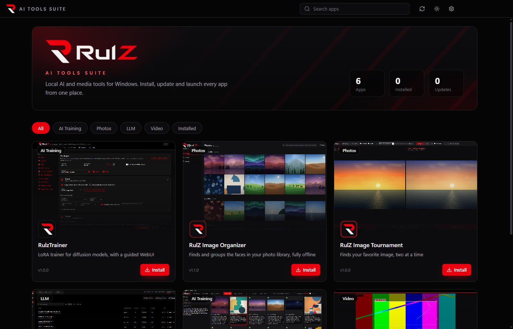
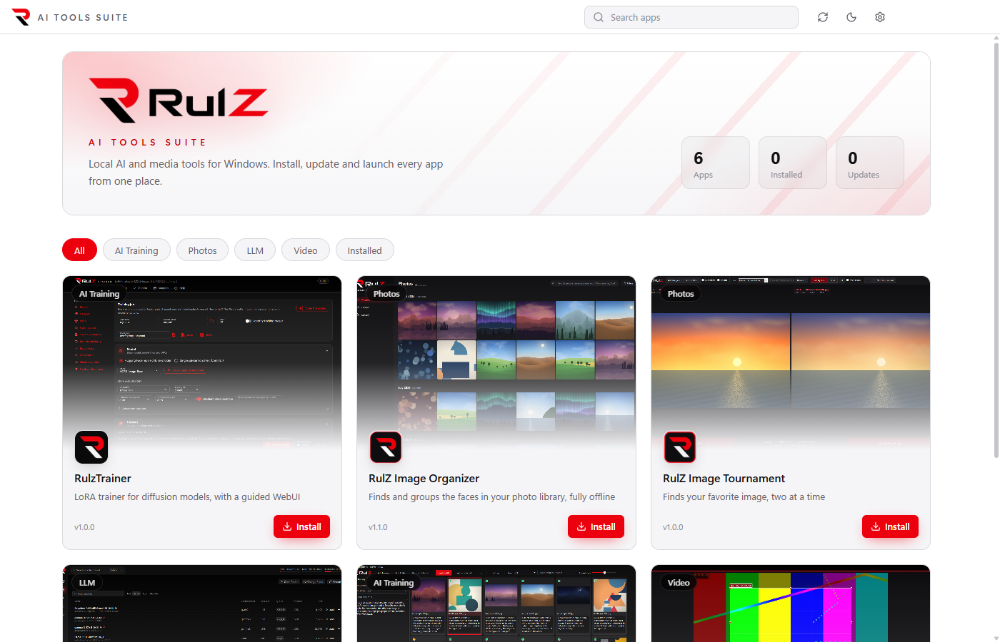
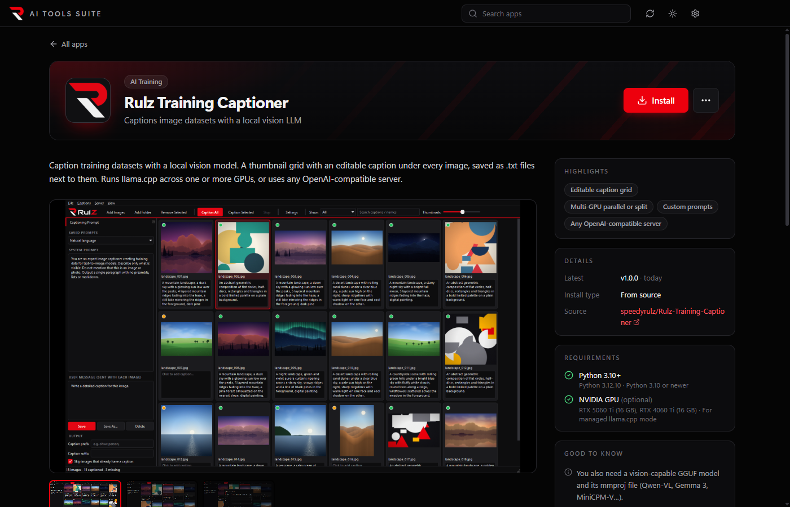
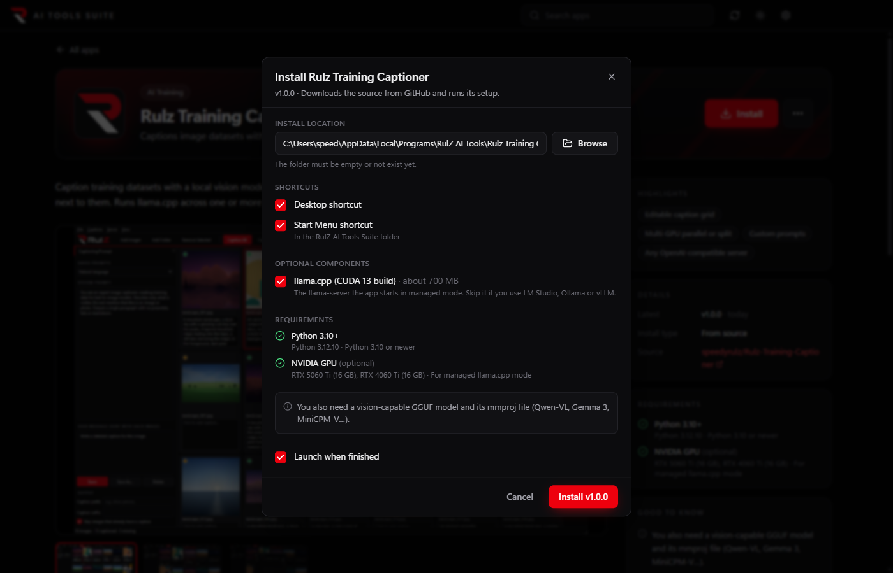

<p align="center">
  
</p>

# RulZ AI Tools Suite

One launcher for the RulZ apps. Browse every tool with screenshots and its full README, install it with one
click, keep it updated, and launch it, all from a single black-and-red window (or white-and-red, in light mode).

| Dark (default) | Light |
| --- | --- |
|  |  |





| App | What it does | How it installs |
| --- | --- | --- |
| [RulzTrainer](apps/RulzTrainer) | LoRA trainer for MOSS-Image, FIBO 2.0 and Krea 2, with a guided WebUI | From source, then its `install.bat` (venv + CUDA PyTorch) |
| [RulZ Image Organizer](apps/RulZ-Image-Organizer) | Offline face grouping and search for your photo library | Portable release zip |
| [RulZ Image Tournament](apps/RulZ-Image-Tournament) | Finds your favorite image, two at a time | Portable release zip (a single .exe) |
| [RulZ LLM Suite](apps/rulz-llm-suite) | Local LLMs with llama.cpp: models, chat, MCP tools, API server | Its setup program, run silently |
| [RulZ Coding Agent](apps/rulz-coding-agent) | Describe an app in plain English and a local model builds it (works with the LLM Suite) | Its setup program, run silently |
| [Rulz Training Captioner](apps/Rulz-Training-Captioner) | Captions image datasets with a local vision LLM | From source (venv), plus an optional llama.cpp CUDA build |
| [RulZ Simple Video Clip Extractor](apps/rulz-simple-video-clip-extractor) | Frame-accurate clips with lossless cuts and NVENC export | Portable release zip |
| [RulZ Image Crawler](apps/rulz-image-crawler) | Crawls a website or folder and keeps the images that match your description (local vision model) | From source (venv + Chromium), plus the model download and an optional llama.cpp CUDA build |
| [RulZ Image Preparer](apps/RulZ-Image-Preparer) | Cleans up image datasets for training: color noise, JPEG artifacts (fast filter or GPU AI model) and detail recovery, globally or per image; Auto crop crops pictures to something you describe, found with SAM 3.1 | From source (venv); the AI features' PyTorch and models are set up from the app on first use |

## Using the launcher

- **Home** shows a card per app with its screenshot, description and status (installed, update available,
  running). Filter by category or search.
- **Click an app** for its page: a screenshot gallery (click for full size, arrow keys to browse), the full README,
  version details, requirements and shortcuts.
- **Install** asks where to put the app (default `%LOCALAPPDATA%\Programs\RulZ AI Tools\<app>`), whether to add
  **Desktop** and **Start Menu** shortcuts (the Start Menu ones go in a *RulZ AI Tools Suite* folder), and any
  optional parts. Progress, download speed and the setup log show on the page.
- **Launch** starts the installed app. **Update** appears when GitHub has a newer release (or newer commits, for
  apps installed from source; those update with `git pull` when Git is installed). **Update all** in the top bar
  updates every app that has one, one at a time.
- The **⋯** menu has *Open install folder*, *Repair* (runs the setup again), *Locate an existing install* (for a
  copy you already have, e.g. a dev checkout), *View on GitHub*, the install log, and *Uninstall*.
- **Uninstall** removes the shortcuts and moves the app's folder to the Recycle Bin (apps with a setup program run
  their own uninstaller first). Installs the launcher found or that you located are only forgotten; their files
  are never touched.
- **Prerequisites** (Python, FFmpeg, Git, an NVIDIA GPU, .NET Framework) are checked on each app's page. When you
  install an app, missing ones it needs are installed first with winget (Python with *Add to PATH*). Anything winget
  can't install (a GPU driver, or any of them on a PC without winget) gets a step-by-step guide with a *Check again*
  button, and the install waits until it's found.

- **Updates:** when it starts, the launcher checks GitHub for a newer version of itself and asks whether to update
  (it closes, installs over itself and reopens). It also checks your installed apps. Both checks can be turned off in
  Settings.
- **Close on launch:** an optional setting (off by default) closes the launcher when you open an app.
- **Dark or light:** the first launch asks which look you want (dark is the default). Switch any time with the
  sun/moon button in the top bar or under Settings ▸ Appearance.

Settings and the list of installed apps are kept in `%APPDATA%\RulZ AI Tools Suite`.

## Install

Download `RulZ-AI-Tools-Suite-Setup-<version>.exe` from the Releases page and run it.

To run it from source instead, double-click `install.bat` (needs Node.js 22+), then `run.bat`.

## The apps

Every app's source is in `apps/`, one folder each, imported from its former repository with the full history
(those repositories are archived; RulZ Image Crawler never had one). Their guides are in the [wiki](https://github.com/speedyrulz/RulZ-AI-Tools-Suite/wiki),
one section per app. Each app builds and runs on its own, as before: see the README in its folder.

**Releasing an app.** Bump the version in the app's source, then push a tag named after the app:

```
git tag image-organizer-v1.3.0
git push origin image-organizer-v1.3.0
```

Push app tags one at a time: GitHub starts no workflow for any of them when more than three tags arrive in one push.

GitHub Actions (`.github/workflows/apps.yml`) builds it and publishes the release here, where the launcher picks it
up. The tag prefixes are `rulz-trainer-v`, `image-organizer-v`, `image-tournament-v`, `llm-suite-v`, `coding-agent-v`,
`training-captioner-v`, `clip-extractor-v`, `rulz-image-crawler-v` and `image-preparer-v`; launcher releases keep plain `v1.2.3` tags and the *Latest* badge.
Pushes and pull requests build every app whose folder changed, so a broken build shows up before it's tagged.

**Apps installed from source** (RulzTrainer, Rulz Training Captioner, RulZ Image Crawler, RulZ Image Preparer) are cloned
from a branch that holds just their folder: `app/rulz-trainer`, `app/training-captioner`, `app/rulz-image-crawler` and
`app/image-preparer`, rebuilt from `main` on every change by
`.github/workflows/app-branches.yml`. The branch continues the app's old repository commit for commit, so copies
cloned from there update with a fast-forward (the launcher switches them over on their next update). Image Crawler and
Image Preparer had no repository of their own, so their branches start at their import into the suite. A tag for a source app publishes a
release with the change notes and no files; installs still come from the branch.

## Development

```
npm install
node node_modules/electron/install.js   # first time only: Electron downloads its binary lazily
npm run dev          # run with hot reload
npm test             # unit tests (catalog, README handling, versions, command lines, archives)
npm run typecheck
npm run build:win    # installer → dist/RulZ-AI-Tools-Suite-Setup-<version>.exe
```

Pushing a `v*` tag builds the launcher's installer on GitHub Actions and attaches it to a release.

### Layout

| Part | Where |
| --- | --- |
| The app list: names, descriptions, how each installs and launches | `src/shared/catalog.ts` |
| Screenshots, icons and a README copy for each app | `catalog/<app id>/` |
| Install, update, launch, uninstall, shortcuts | `src/main/apps.ts`, `src/main/shortcuts.ts` |
| GitHub releases and downloads | `src/main/github.ts`, `src/main/download.ts`, `src/main/archive.ts` |
| Requirement checks and winget installs | `src/main/requirements.ts` |
| UI (React + Tailwind) | `src/renderer/src/` |
| Logo and icon generation from `assets/logo-source.webp` | `tools/make_logo.py` |
| How the catalog screenshots were made (demo content only) | `tools/screenshots/` |
| The apps' source | `apps/` |
| App builds and releases; the source apps' branches | `.github/workflows/apps.yml`, `app-branches.yml` |

### Adding an app

1. Put its source in `apps/<folder>/` (to keep an existing repository's history:
   `git subtree add --prefix=apps/<folder> <url> <branch>`).
2. Add an entry to `src/shared/catalog.ts`. `install.kind` is `zip` (a portable zip on its latest release),
   `installer` (an NSIS setup .exe on its latest release) or `source` (its `app/<id>` branch plus setup commands),
   and `launch.target` is the program to start, relative to the install folder.
3. Add a build for it to `.github/workflows/apps.yml` (and its tag prefix to the tag list there); a source app goes
   in `app-branches.yml` instead.
4. Add it to `tools/sync_catalog.py` and run `npm run sync-catalog` to copy its README, README images and icon into
   `catalog/<id>/`. Run the same command after changing any app's README.
5. Put 2–4 screenshots in `catalog/<id>/screenshots/` (`01-…` is the card thumbnail).

The launcher shows the README from GitHub when it can, and the copy in `catalog/` when offline.

## License

Open source under the [MIT License](LICENSE). Each app in `apps/` carries its own MIT license file too.

The RulZ name and logo are excluded from the MIT License; all rights reserved. If you fork or redistribute this
project, remove or replace the RulZ branding. See [LOGO-NOTICE.md](LOGO-NOTICE.md).
