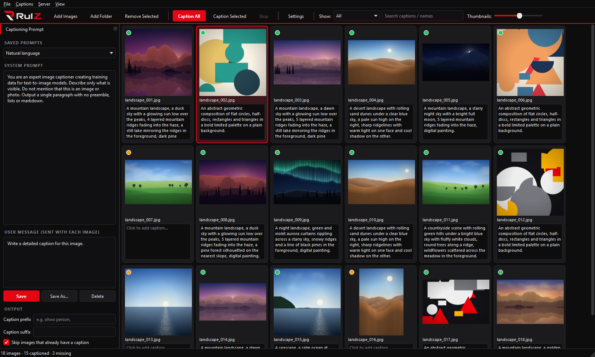
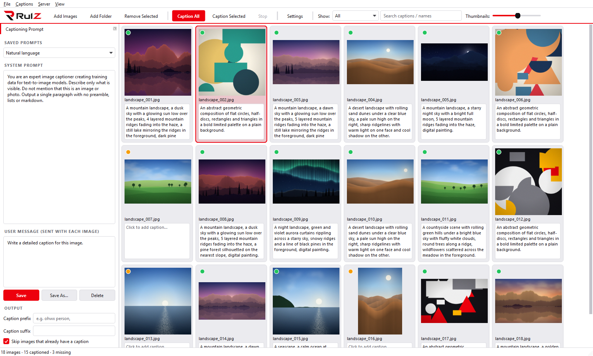
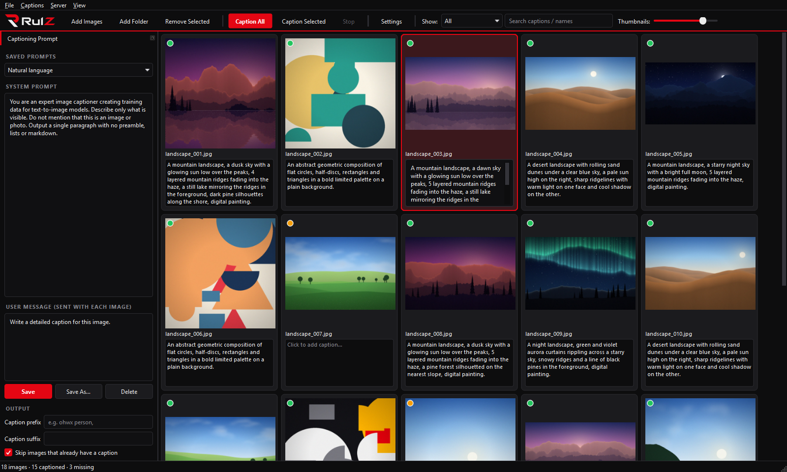
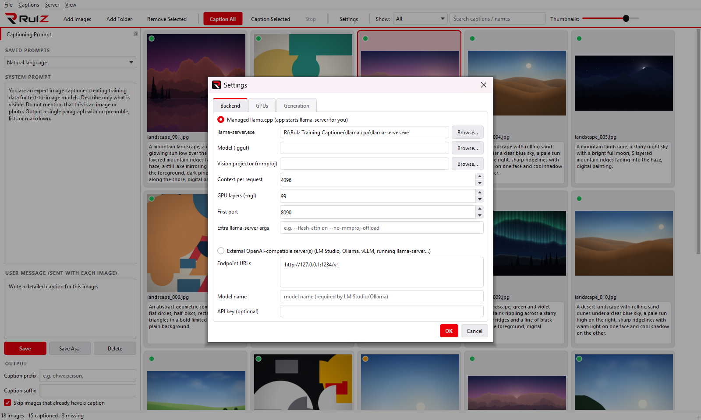
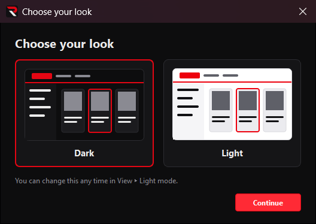

# Rulz Training Captioner

Windows desktop app for captioning image datasets with a local vision LLM.

| Dark | Light |
| --- | --- |
|  |  |

| Inline caption editing | Settings | First launch |
| --- | --- | --- |
|  |  |  |

- Add images, folders (or drag & drop). Thumbnail grid with an editable caption box under every image.
- Captions live in `image.txt` next to `image.png`. Editing a box (adding or removing text) writes the file, creating it if needed.
- Save/edit/delete your own system prompts (stored in `%APPDATA%\RulzCaptioner\prompts.json`).
- Multi-GPU: **Parallel** (one model copy per GPU, images shared out) or **Split** (one model spread across GPUs with `--split-mode layer`, plus `--tensor-split` when you give ratios).
- Works with any OpenAI-compatible server too (LM Studio, Ollama, vLLM…); list several URLs to caption in parallel.
- Dark (default) or light theme: the first launch asks which look you want; switch any time with **View ▸ Light mode**.

## Run

Double-click `run.bat` (creates a venv and installs PySide6 + requests on first run).

## Set up the model (managed mode)

1. **llama.cpp**: download `llama-bXXXX-bin-win-cuda-13.x-x64.zip` + `cudart-llama-bin-win-cuda-13.x-x64.zip` from
   <https://github.com/ggml-org/llama.cpp/releases> (CUDA 13 builds support RTX 50-series) and unzip both into a
   `llama.cpp\` folder next to `main.py`, where it's auto-detected. Unzip newer builds over it to update.
   Installing the app with the [RulZ AI Tools Suite](https://github.com/speedyrulz/RulZ-AI-Tools-Suite) launcher
   does this for you.
2. Download a vision-capable **GGUF** model and its **mmproj** file (e.g. Qwen2.5-VL / Qwen3-VL, Gemma 3, InternVL, MiniCPM-V, Mistral Small 3.x vision).
3. Settings ▸ Backend: choose the exe, model and mmproj. Settings ▸ GPUs: tick GPUs and the mode.
4. Press **Caption All** (or select images ▸ **Caption Selected**). The servers start on first use and stay loaded; **Server ▸ Stop Servers** frees VRAM.

### Which GPU mode?
- *Parallel*: fastest when the model + context fits on each card. Mixed cards are fine; each gets its own server.
- *Split*: needed when the model doesn't fit on one card. Use *Tensor split* for uneven ratios (e.g. `16,16`).
- *Concurrent requests per server* adds batching on a server at the cost of VRAM (context is multiplied).
- GPU numbers match `nvidia-smi`, so ticking GPU 1 uses the card `nvidia-smi` calls GPU 1, even on mixed cards.
- With no GPU ticked, one llama-server starts and picks the GPUs itself (one copy of the model spread over all
  of them).
- If one server stops responding during a run, the other servers take over its images. If none respond,
  captioning stops and the remaining images stay uncaptioned (not failed).
- The servers close with the app, even if it crashes, so they never keep holding VRAM.

## Tips
- Keep **Disable thinking** on (Settings ▸ Generation) for reasoning models like Qwen3.5/3.6 and Gemma 4, otherwise
  they spend the whole token budget thinking and return nothing.
- Prefix/suffix fields add a trigger word or fixed text to every generated caption. An empty reply or
  unfinished thinking counts as a failure, so a caption is never just the prefix.
- Images that share a name (`photo.png` and `photo.jpg`) share one caption file, `photo.txt`. The app warns
  when you add them: rename or remove one of each pair.
- A caption cut off by *Max new tokens* is still saved, with a warning in the log.
- "Skip images that already have a caption" applies to *Caption All*; *Caption Selected* always overwrites.
- Big folders are added in the background, so the window stays usable while they load. Images in subfolders
  stay grouped by folder.
- A caption is saved as a new file that then replaces the old one, so a full disk, a dropped network drive or
  a crash while saving leaves the old caption as it was. (When another program keeps the file open, it is
  written in place instead, as before.)
- If a caption file changes on disk while its image is being captioned (another program wrote it), the file is
  kept and the log says so. A caption file that can't be read is shown in red, skipped by *Caption All* when
  "skip existing" is on, and never replaced by a caption you haven't seen.
- Images you remove (or clear) during a run are skipped instead of captioned for nothing.
- If `settings.json` or `prompts.json` can't be read, it is renamed to `settings.bad-<time>.json` /
  `prompts.bad-<time>.json` (so a hand edit gone wrong can be repaired) and the defaults are used.
- The log (View ▸ Log) shows llama-server output, useful if a model fails to load.

## Settings folder

Settings, the theme choice and saved prompts are stored in `%APPDATA%\RulzCaptioner`. Set the environment
variable `RULZ_CAPTIONER_DIR` to use another folder instead (for a portable setup or for testing with a fresh
profile).

## License

Open source under the [MIT License](LICENSE). llama.cpp, which you download separately, has its own MIT license.

The RulZ name and logo are excluded from the MIT License; all rights reserved. If you fork or redistribute this
project, remove or replace the RulZ branding. See [LOGO-NOTICE.md](LOGO-NOTICE.md).
