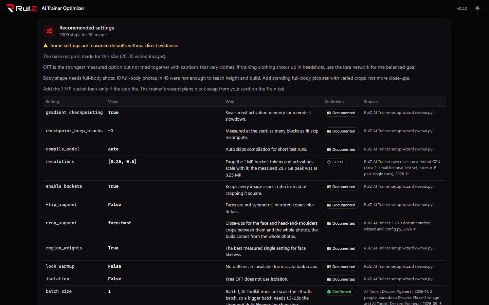
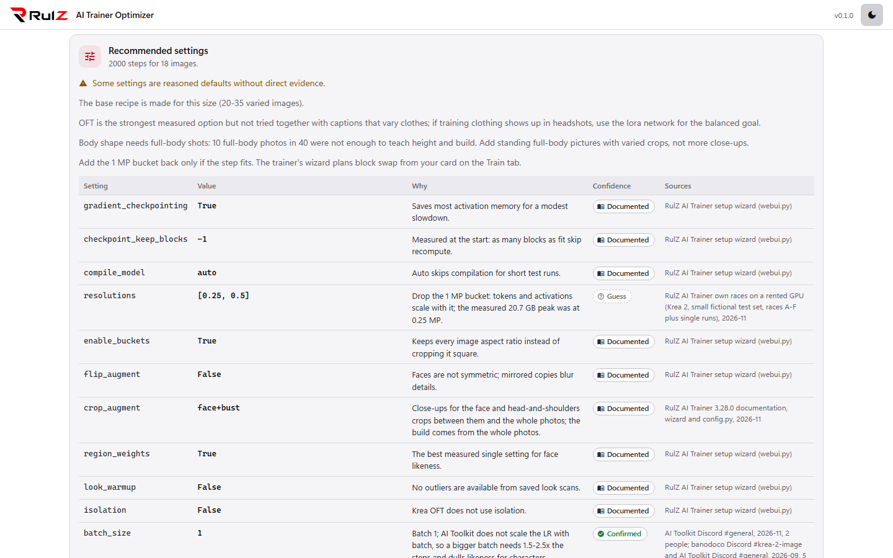
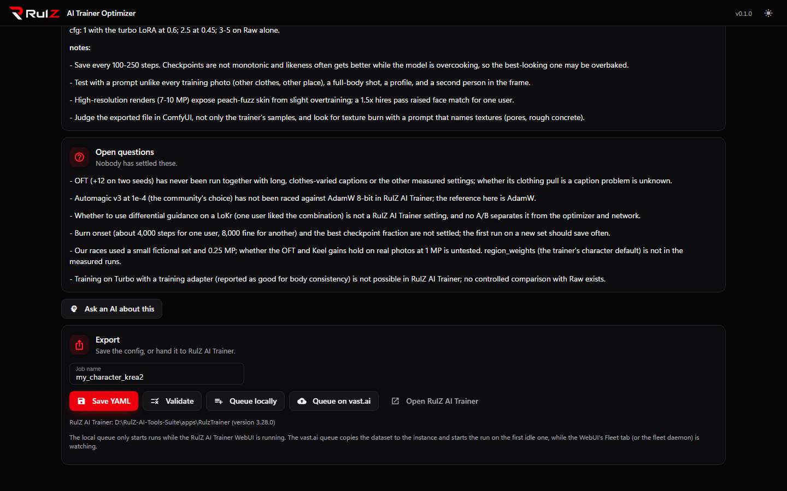
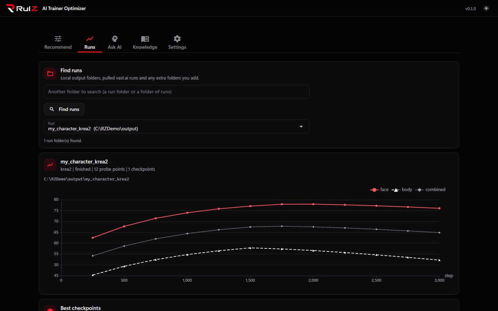
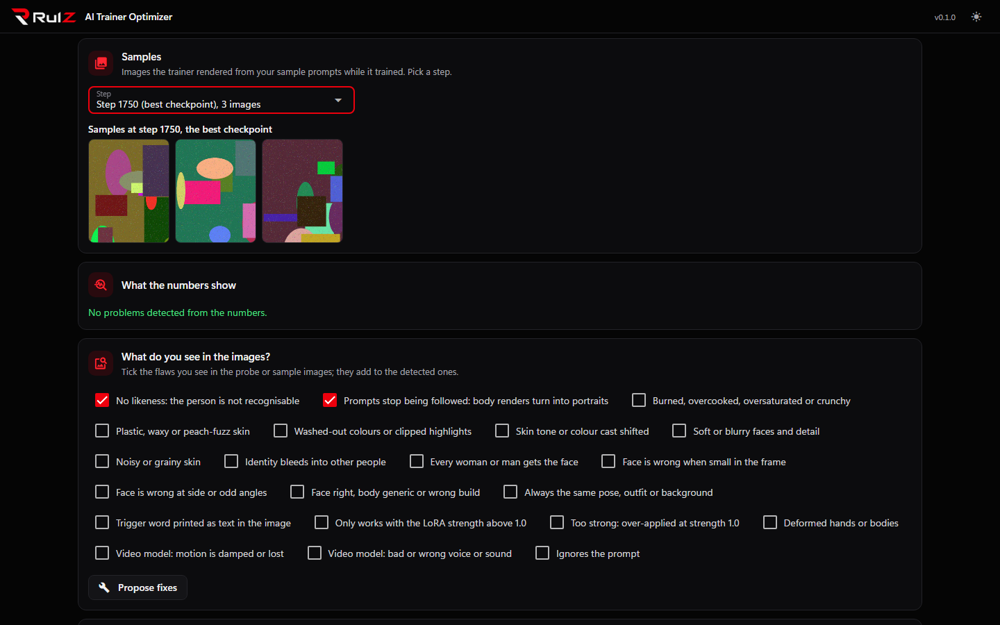
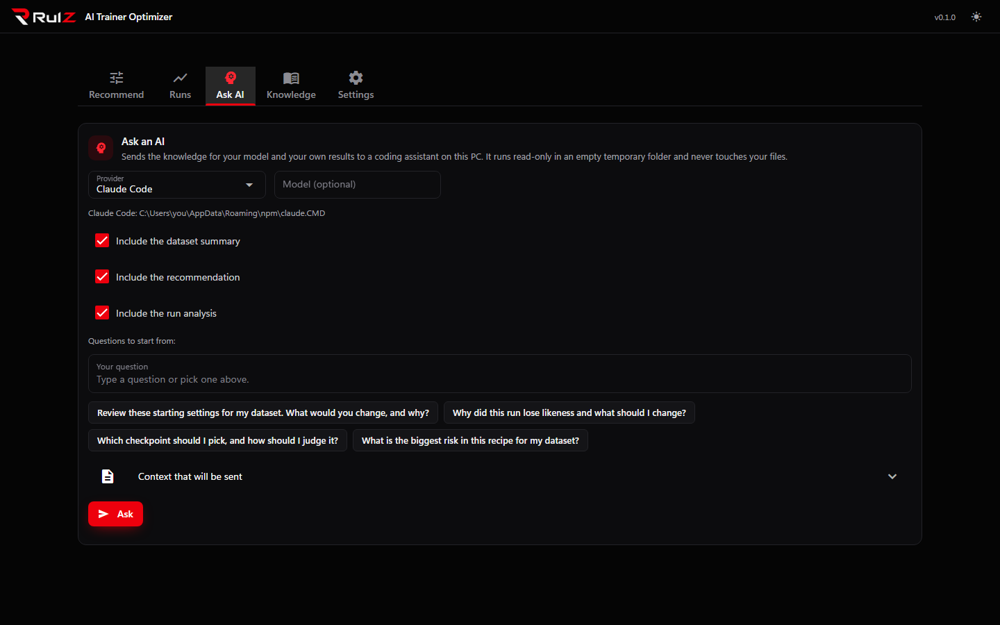
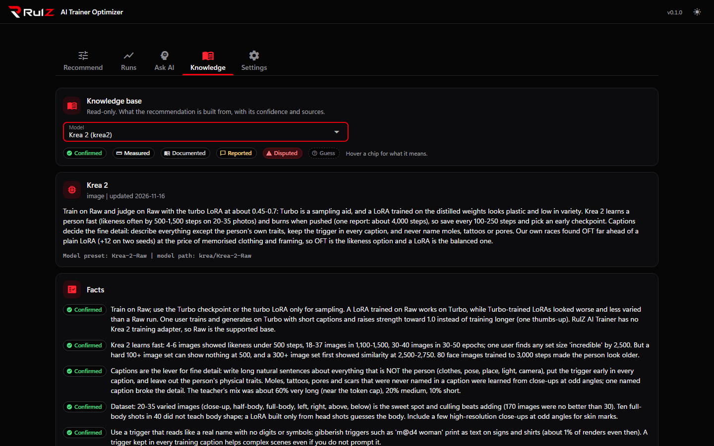

# RulZ AI Trainer Optimizer

A local web app that helps you get a character LoRA right in **RulZ AI Trainer**. It does not train anything and needs
no GPU. It gives you starting settings with the reason for each, reads your finished runs to see what went wrong, and
can ask an AI assistant on your PC for a second opinion.

> **Status: 0.1.0, never tested with a real training run yet.** The recommendations come from the knowledge base (see
> below), not from this app's own experiments. The export, queue and vast.ai steps are unit-tested against the trainer's
> code paths but have not been used on a real run. Treat the first results as a starting point and tell the app's author
> what you find.

## What it does

1. **Recommend**: pick a model, point at your dataset folder(s), set what you want, and get a settings table. Every row
   has the value, why, a confidence chip (a word such as Confirmed or Guess, never a code) and the sources. The dataset
   folders are scanned recursively; hidden folders are skipped.
2. **Runs**: read RulZ AI Trainer run folders, see likeness over steps, the best checkpoint by face, body and combined
   with its probe images, the samples of any step, the flaws the numbers show (including out-of-memory errors in the
   log), tick the flaws you see in the images, and get a corrected next config.
3. **Ask AI**: send the knowledge for your model, the dataset summary, the recommendation and/or the run analysis to
   Claude Code, Codex, Grok Build or Antigravity (your choice) and read the answer.
4. **Knowledge**: browse the knowledge base per model, read-only.
5. **Settings**: the RulZ AI Trainer folder, the default AI helper, export folder, extra run folders, the look.

## Install and run

You need Python 3.10 or newer.

- **Windows**: double-click `start-windows.bat`. The first start makes a virtual environment and installs the
  dependencies (`nicegui`, `pyyaml`, `pillow`).
- **Linux / WSL**: `./start-linux.sh`.

The app opens in your browser at `http://localhost:8775` (the next free port if that one is busy). Options:
`--port`, `--host`, `--no-browser`. Starting it twice opens the running one.

Under Settings, give the folder of your RulZ AI Trainer install. If the trainer sits next to this app (as in the RulZ AI
Tools suite) it is found by itself.

## Export, queue and vast.ai

After you press **Recommend settings**, the Export panel writes a RulZ AI Trainer config YAML and offers:

| Button | What it does |
| --- | --- |
| **Save YAML** | Writes `<export folder>/<job>.yaml`. Load it in the trainer WebUI with *Config file* -> Load. The default folder is the trainer's `configs` folder. |
| **Validate** | Loads the file with the trainer's own `TrainConfig.load(...).validate()`, run with the trainer's own Python. |
| **Queue locally** | Validates, then adds the run to the trainer's queue (`output/_queue.json`) through the trainer's own `TrainQueue`. **The queue only advances while the RulZ AI Trainer WebUI is running**, so open it with *Open RulZ AI Trainer*. |
| **Queue on vast.ai** | Runs the trainer's `scripts/vast/rulz_fleet.py queue add` with your dataset folders as `--push`, so the dataset is copied to the instance and the config's paths point at the copy. The run starts on the first idle instance, but only while something is watching: the WebUI's Fleet tab, or `python scripts/vast/rulz_fleet.py daemon`. The instances the fleet knows are listed under the buttons. |
| **Open RulZ AI Trainer** | Starts `run_webui.bat` / `run_webui.sh` unless the WebUI already answers on port 7870. |

The app never writes the trainer's files by hand: every write goes through the trainer's own code, so the formats stay
the trainer's. The same panel appears for the corrected config on the Runs tab.

If you give a **base config** (an earlier `config.yaml`), its model and hardware settings (model paths, quantisation,
block swap, attention, devices) are kept and the recommendation overlays the training settings only.

## Runs

The Runs tab searches the trainer's `output` folder, pulled vast.ai runs (`~/.rulz_vast/runs`,
`~/.rulz_vast/fleet/runs`) and any folder you add. Pick a run to see:

- a line chart of face, body and combined likeness against step,
- the best checkpoint for each, with the probe images saved near that step (click one to enlarge),
- the run's **samples**: pick a step, newest first; the best checkpoint's step is marked,
- what the numbers show (for example peaked early, lost framing, collapsed learning rate),
- a list of flaws to tick when you see them in the images (plastic skin, identity bleed ...),
- proposed fixes with their confidence, each with a checkbox, and **Export the next config** for the ticked ones. When
  two fixes change the same setting, the second is shown indented under the first as an alternative, unticked;
  ticking one unticks the other. The job name starts as `<job>_v2` (`_v3` for a run that already ends in `_v2`).

Only images inside a run folder the app has found are ever served to the browser.

## Ask AI

Pick Claude Code, Codex, Grok Build or Antigravity (`agy`) and optionally a model. The app writes a context file
(`advisor_context.md`: the model's knowledge with confidence ratings, your dataset summary, the recommendation, the run
analysis) into a fresh temporary folder, runs the CLI there **read-only**, and shows the answer, the command that ran
and how long it took:

| Provider | Command |
| --- | --- |
| Claude Code | `claude -p "<instruction>" --permission-mode plan --output-format text` |
| Codex | `codex exec --sandbox read-only --skip-git-repo-check "<instruction>"` |
| Grok Build | `grok -p "<instruction>" --permission-mode plan --output-format plain` |
| Antigravity | `agy -p "<instruction>" --mode plan --output-format text` |

Setup: install the CLI and sign in once (`claude`, `codex login`, `grok` or `agy` in a terminal). If a CLI is missing,
not signed in or out of quota, the tab says so. The AI sees only the context file: no file paths outside your dataset
and run (warnings about unreadable files keep the file name only), no personal details. Preview it under *Context that will be sent*. The AI's answer is advice, not an order.

## Where the knowledge comes from, and how far to trust it

The knowledge base (`knowledge/`, plain YAML) is built from community training reports, official model cards, the
trainer's documentation and our own measured runs. It names the place, the month, how many people agreed and the kind of
evidence for each fact, and carries no names or dataset details. Each setting has a confidence:

| Chip | Meaning |
| --- | --- |
| **Confirmed** (green) | Two or more independent sources agree, or numbers / an A-B comparison were shown. |
| **Measured** | Measured in our own RulZ AI Trainer runs. |
| **Documented** | From the official model card or the trainer's documentation. |
| **Reported** (amber) | One source says so. |
| **Disputed** (red) | Sources disagree; the reason gives both sides. |
| **Guess** (faint, dashed) | No evidence: a reasoned default. Treat it as a guess. |

Each chip also has an icon and a tooltip, so no rating depends on colour alone. Settings that come from the trainer's own
setup wizard name it as their source. The Knowledge tab also lists the dataset rules (advice on the dataset itself) and
any problems found in the knowledge files when they were loaded.

The knowledge changes with the models. The Knowledge tab shows exactly what the recommendation used.

**Alpha and learning rate (0.3.6).** A plain LoRA's update is scaled by alpha / rank, so alpha only changes the
effective learning rate. RulZ AI Trainer keeps alpha = rank (scale 1). OneTrainer's presets use rank 16, alpha 1 and
3e-4, which acts like 3e-4 x 1/16 = 1.9e-5 at alpha = rank. A knowledge entry that quotes a rate from a source trained
at another alpha and rank can say so with `source_alpha` and `source_rank` next to its `learning_rate` value; the
loader converts it to alpha = rank (rate x alpha / rank) before it is used and the reason says so. Entries without them
are used as written. On the Runs tab, a LoRA run whose alpha differs from its rank shows its rate at alpha = rank, with
a warning when that is more than 3x above or below the recommendation for its model. Full fine-tunes, LoKr / OFT and the
Automagic, Keel and Hull optimizers (which set their own rate) are skipped. Alpha-only-scales-the-rate is a community
view (OneTrainer Discord, 2026-11), not something measured here.

**Scale LR to alpha = rank (0.3.8).** RulZ AI Trainer 3.47.0 has an opt-in `lr_alpha_scale` setting that trains at the
entered rate x rank / alpha, so the entered rate is the rate at alpha = rank. For a run with it on (and applying), the Runs
tab treats the entered rate as the alpha = rank equivalent and says it was scaled and what it trained at. The key is in the
trainer key list with default off. The Optimizer never turns it on in a recommendation.

## Limits

- Never tested with a real training run. Nothing here has been checked against a finished LoRA you were happy with.
- The recommendation is a starting point for **one person's character LoRA**, not a universal recipe.
- Run analysis reads the files the trainer writes; a run from a much older trainer may show less.
- The Queue buttons need a RulZ AI Trainer install on this PC; vast.ai also needs the fleet set up in the trainer.
- Settings are saved in `%APPDATA%\RulZ-AI-Trainer-Optimizer\settings.json` (Windows) or
  `~/.config/rulz-ai-trainer-optimizer/settings.json`.

## License

MIT, except the RulZ name and logo (see `LOGO-NOTICE.md`).
