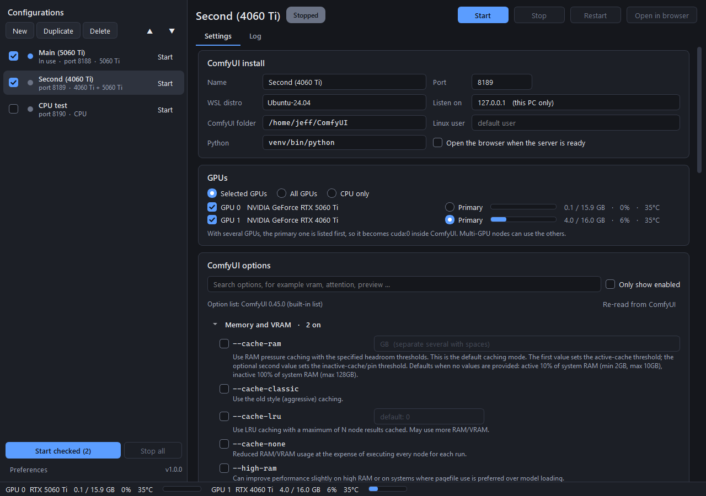

# RulZ ComfyUI Launcher

A Windows app that starts and stops ComfyUI servers running inside WSL. Each saved
configuration has its own port, GPUs, ComfyUI options and environment, and several
configurations can run at the same time.



## What it does

- **Configurations.** Create, duplicate, reorder and delete configurations. Changes are
  saved as you make them. Tick the ones that belong together and start them all with
  **Start checked**, or start and stop each one on its own.
- **GPU selection.** Pick one or more GPUs by name, all GPUs, or CPU only. With several
  GPUs you choose which one is the primary card (`cuda:0` inside ComfyUI). Live memory
  use, load and temperature of every card are shown.
- **ComfyUI options.** Every command line option of your ComfyUI is listed with its help
  text, grouped by topic and searchable. Options that exclude each other (for example
  `--highvram` and `--lowvram`) switch each other off. The list is read from your own
  ComfyUI install, so it stays correct after an update.
- **Environment.** Set environment variables and bash commands that run before ComfyUI
  starts. **Import from ~/.bashrc** finds the variables your terminal sets (CUDA paths
  and the like) and adds them, because a server started from the launcher does not read
  `~/.bashrc`.
- **Log per instance,** shown the way a terminal shows it (progress bars update in place).
- **Checks before starting:** a port used twice, a port that another program already
  uses, options that conflict, missing values, and two configurations on the same GPU
  (a warning you can accept).
- **Clean stop.** Stop sends Ctrl+C to ComfyUI. If it has not stopped after the waiting
  time, the launcher forces it.

## Requirements

- Windows 10 or 11 with WSL 2 and a distro that has ComfyUI installed.
- NVIDIA driver on Windows (for `nvidia-smi`) if you want GPU selection.
- To run from source: Python 3.10 or newer and `python -m pip install -r requirements.txt`.

## Running it

- Packaged: `dist\RulZ ComfyUI Launcher\RulZ ComfyUI Launcher.exe` (keep the folder together).
- From source: double-click `Launch.cmd`, or run `pythonw main.pyw`.

`--config <file>` uses another config file, which gives you a second, separate launcher.

## Building the .exe

```powershell
python -m pip install -r requirements-dev.txt
.\build.ps1
```

The script runs the tests and then PyInstaller.

## Settings of a configuration

| Field | Meaning |
| --- | --- |
| WSL distro | The distro ComfyUI lives in. "Default distro" is what plain `wsl` opens. |
| ComfyUI folder | Linux path of the folder that holds `main.py`, for example `~/ComfyUI`. |
| Python | The interpreter that runs `main.py`: a path inside the ComfyUI folder (`venv/bin/python`), a full path, or a command name. If an `activate` script sits next to it, the virtual environment is activated first. |
| Port, Listen on | `--port` and `--listen`. |
| Linux user | Leave empty for the distro's default user. |
| GPUs | Selected GPUs (`--cuda-device`), all GPUs (nothing is passed), or CPU only (`--cpu`). |
| ComfyUI options | Tick an option to pass it. Options with a value have a field next to them. |
| Environment | `NAME` and value pairs, applied from top to bottom. `$NAME` and `${NAME}` are replaced by bash, so `$CUDA_HOME/bin:$PATH` works. Everything else is literal; write `\$` for a dollar sign. |
| Commands to run first | Bash lines run in the ComfyUI folder after the environment is set. |
| Extra arguments | Added at the end of the command, as you would type them in a terminal. |

The **Command** box always shows what will run.

## How GPU selection works

The launcher identifies cards by their UUID, read from the Windows `nvidia-smi`. When an
instance starts, the launch script looks the UUIDs up in WSL's own `nvidia-smi`, sets
`CUDA_DEVICE_ORDER=PCI_BUS_ID`, and passes the matching numbers to `--cuda-device`.

This matters because CUDA's default numbering ("fastest card first") is not the numbering
`nvidia-smi` shows, so a hand-typed `--cuda-device 1` can mean a different card than
"GPU 1" in `nvidia-smi`. Picking by name removes that guesswork. The log of every start
says which card each number is, for example `GPU 1 (PCI bus order): NVIDIA GeForce RTX 4060 Ti`.

The numbers in the **Command** box are therefore `nvidia-smi` numbers. They can differ
from the number you would type by hand for the same card.

## How instances are run

- Each instance is one `wsl.exe` process with ComfyUI attached to it. They live and end
  together, so instances belong to the launcher: **closing the launcher stops them.**
  Closing the window while something runs asks whether to stop everything or keep the
  launcher running in the notification area.
- If the launcher crashes or is ended from Task Manager, Windows ends the `wsl.exe`
  processes and WSL ends the ComfyUI servers. Nothing is left running without an owner.
- Stop sends SIGINT (Ctrl+C) to ComfyUI and everything it started. After the waiting time
  from Preferences it sends SIGTERM, then SIGKILL.
- A ComfyUI that was started somewhere else (for example from a terminal) is never touched.
  If it uses a configuration's port, the launcher shows "Port in use (not started here)"
  and refuses to start a second server on that port.

## Files

| Path | Content |
| --- | --- |
| `%APPDATA%\RulZ ComfyUI Launcher\config.json` | Configurations and preferences. |
| `%APPDATA%\RulZ ComfyUI Launcher\catalogs.json` | The option lists read from your ComfyUI installs. |
| `%APPDATA%\RulZ ComfyUI Launcher\error.log` | Details of unexpected errors, if any happened. |

## Code layout

| File | Role |
| --- | --- |
| `rulz_comfy_launcher/model.py` | Configurations, preferences, the config file. |
| `rulz_comfy_launcher/options.py` | The option catalog and its categories. |
| `rulz_comfy_launcher/command.py` | Command line building, checks, the bash launch script. |
| `rulz_comfy_launcher/instance.py` | Running instances: start, stop, restart, the start queue. |
| `rulz_comfy_launcher/wsl.py`, `gpus.py`, `winjob.py` | `wsl.exe` helpers, GPU monitor, Windows job object. |
| `rulz_comfy_launcher/textstream.py` | Terminal-style handling of process output. |
| `rulz_comfy_launcher/ui/` | The window. `ui/theme.py` holds the RulZ colours (black with the logo red `#ED000D`). |
| `rulz_comfy_launcher/assets/` | The RulZ logo and app icon (see [LOGO-NOTICE.md](LOGO-NOTICE.md)). |
| `rulz_comfy_launcher/scripts/introspect_args.py` | Runs inside WSL and lists ComfyUI's options. |
| `tests/` | Unit tests: `python -m pytest -q tests`. |
| `tools/smoke_test.py` | Starts and stops a fake server inside WSL to check the process handling: `python tools/smoke_test.py`. |

## Limits

- Instances do not survive the launcher: there is no "detach and re-attach later".
- All WSL distros share one set of network ports, so two instances cannot use the same
  port even in different distros.
- The launcher does not watch free RAM. Two instances that each load large models can use
  more memory than WSL has (`memory=` in `.wslconfig`), which stops the whole WSL machine.
