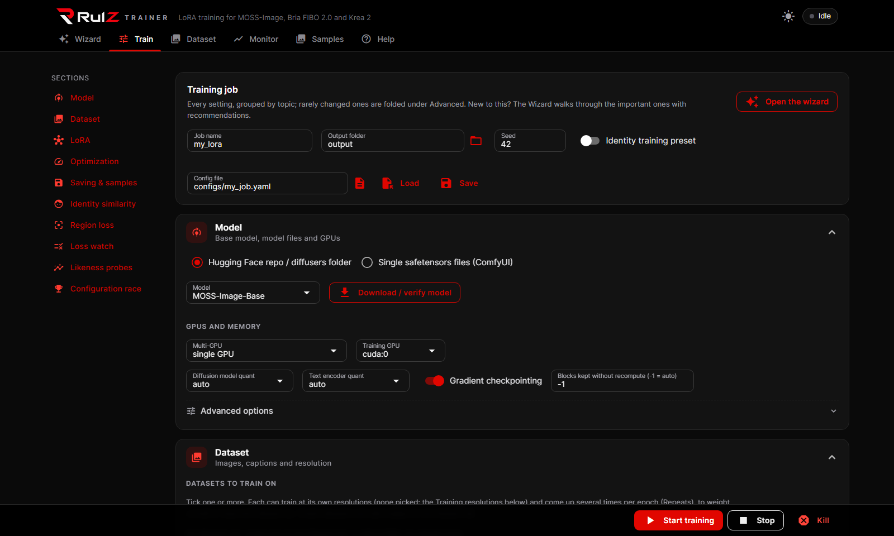
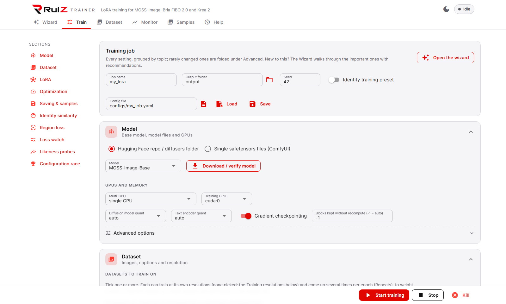
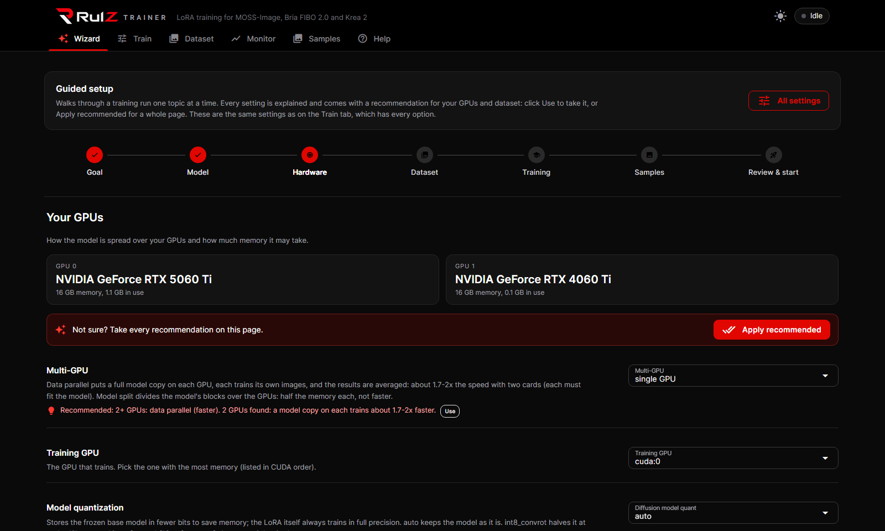
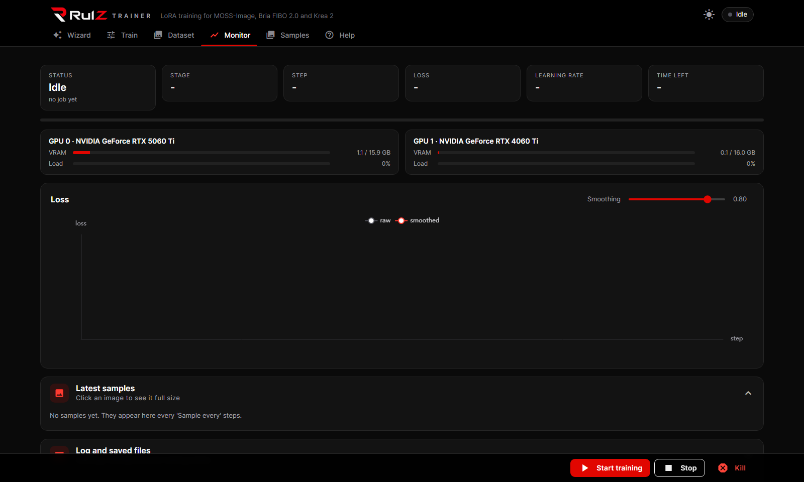
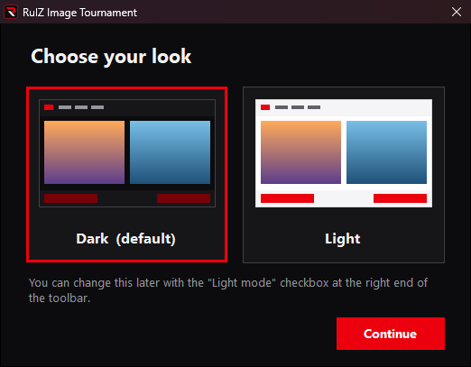

<p align="center">
  <picture>
    <source media="(prefers-color-scheme: dark)" srcset="assets/logo_dark.png">
    
  </picture>
</p>

# RulzTrainer

A simple diffusion-model LoRA trainer with a WebUI. Supported models:

- **MOSS-Image** (5B single-stream DiT by OpenMOSS), both the **Base** and **SFT** checkpoints. Output LoRAs load
  directly in ComfyUI with the standard *Load LoRA* node.
- **Bria FIBO 2.0** (8B): train on dev, use on Edit Turbo ([details](#fibo-20-bria-training-on-dev-using-the-lora-on-edit-turbo)).
- **Krea 2** (12B): train on Raw, use on Turbo ([details](#krea-2-training-on-raw-using-the-lora-on-turbo)).

| Dark | Light |
| --- | --- |
|  |  |

| Wizard: hardware step | Monitor | First visit |
| --- | --- | --- |
|  |  |  |

## Install

**Windows:** double-click `install.bat`. It creates `venv\`, installs CUDA PyTorch (cu130 by default; pass another
index URL as the first argument, e.g. `install.bat https://download.pytorch.org/whl/cu128`) and the requirements.
Then double-click `run_webui.bat` to start the UI and open it in your browser (optional first argument: port).

**Linux:** `./install.sh` does the same (`venv/`, cu128 PyTorch wheels by default, pass another index URL as the
first argument, or `system` to keep an already installed torch), then `./run_webui.sh [port] [host]`. On a headless
box (no display) the WebUI has no native Browse dialogs: type paths, or upload datasets on the Dataset tab.
Cloud GPUs: see [Running on vast.ai](#running-on-vastai).

**Manual:**

```bash
pip install -r requirements.txt
```

Requires a CUDA build of PyTorch 2.9+, diffusers 0.38+ and transformers 5.3+ (Qwen3.5 support).

## Run the WebUI

```bash
python webui.py --port 7870
```

Open http://127.0.0.1:7870.

New to LoRA training? Start on the **Wizard** tab. It walks through a run one step at a time (goal, model, GPUs,
dataset, training, samples, review) and explains every setting. Each one gets a recommended value based on your GPU
memory and on the image count and size of your dataset. *Use* takes one recommendation and *Apply recommended* takes
every one on the page. The wizard edits the same settings as the **Train** tab, which lists every option grouped by
topic, with rarely changed ones folded under *Advanced*. *Start training*, *Stop* and *Kill* sit in the bar at the
bottom of the Train and Monitor tabs.

The WebUI has a dark look (the default) and a light one. The first time you open it in a browser it asks which one
you want (*Choose your look*); the sun / moon button at the top right switches between them at any time. The choice
is kept per browser (its local storage).

1. **Dataset**: a folder of images. Each image may have a same-name `.txt` caption. Use *Scan dataset*
   to see the aspect-ratio buckets. Pick one or more *Training resolutions* (megapixels); see
   "Training resolutions and resolution step-up" below.
2. **Model**: choose `MOSS-Image-Base` or `MOSS-Image-SFT` (or a custom local directory / HF repo id).
   *Download / verify model* fetches about 30 GB into `models/`.
3. **Start training**. The *Monitor* tab shows progress, loss curve, log tail and sample images. Training runs
   as its own process: reloading or closing the page, opening it from another browser, or restarting the
   WebUI does not stop it, and the page reconnects to the running job (it opens on *Monitor* and loads the
   job's settings into the form). *Stop (save)* and *Kill* work on a reconnected job too.
4. Results: `output/<job>/<job>_<step>.safetensors` (checkpoints) and `output/<job>/<job>.safetensors` (final).

*Save* / *Load* (in the *Training job* card at the top of the Train tab) store the whole form as YAML (Browse opens
in `configs/`). Loading a config saved by
an older version fills every option added since with its default, appends those options to the end of the file
(your values and comments are left as they are) and lists them under the buttons. Options a newer version no longer
has are ignored instead of refusing the file. `configs/example.yaml` ships with the repo and is never modified.

### Remote access with Tailscale

To use the WebUI from your other devices (laptop, phone), start it with Tailscale. On Windows, double-click
`run_webui_tailscale.bat` or run `run_webui.bat 7870 tailscale`. On Linux, run `./run_webui.sh 7870 127.0.0.1 tailscale`.
`python webui.py --tailscale` and `RULZ_TAILSCALE=1` do the same.

It runs `tailscale serve`, so the WebUI stays bound to `127.0.0.1`. Tailscale publishes it over HTTPS at
`https://<machine>.<tailnet>.ts.net:7870`, and only devices logged in to your tailnet can open it. The URL is printed
on start. It uses its own HTTPS port, so an existing `tailscale serve` on the default port (ComfyUI, for example) is
not touched. When the WebUI stops (Ctrl+C, closing its console window, logging off), the address switches to a short
"RulzTrainer is not running" notice instead of a 502 error, and the next start brings the WebUI back on it.
Only a hard kill (Task Manager, a crash) leaves the 502. `tailscale serve --https=7870 off` removes the address for good.

Requirements: Tailscale installed and logged in on this machine, and HTTPS certificates turned on for the tailnet
(admin console > DNS > HTTPS Certificates). Browsers that connect remotely get no native *Browse* buttons, because
those dialogs would open on this machine's screen. Type server paths instead, or upload datasets on the Dataset tab.

### CLI

```bash
python -m rulztrainer.train --config configs/example.yaml --set steps=1000 --set job_name=cat_lora
```

## Running on vast.ai

Everything needed is in `scripts/vast/` and the repo is public, so a template only has to point at it.

**Create the template** (once), either with the CLI:

```bash
pip install vastai && vastai set api-key <your key>
bash scripts/vast/create_template.sh
```

or in the web editor (Templates -> Create) with these settings:

| field | value |
|---|---|
| Image path:tag | `vastai/pytorch:cuda-12.8.1-auto` (CUDA 12.8 build: RTX 30 / 40 / 50 series hosts) |
| Launch mode | Jupyter + SSH, direct connections |
| On-start script | `/opt/instance-tools/bin/entrypoint.sh` |
| Ports | `1111`, `7870`, `8080`, `22` |
| Environment variables | `PROVISIONING_SCRIPT=https://raw.githubusercontent.com/speedyrulz/RulzTrainer/main/scripts/vast/provision.sh`<br>`PORTAL_CONFIG=localhost:1111:11111:/:Instance Portal\|localhost:7870:17870:/:RulzTrainer\|localhost:8080:18080:/:Jupyter\|localhost:8080:8080:/terminals/1:Jupyter Terminal`<br>`OPEN_BUTTON_PORT=1111` |
| Disk space | 120 GB (the base model download is about 30 GB; datasets, caches and outputs come on top) |

Put `HF_TOKEN` (needed for the gated MOSS-Image repos) into your **account** environment variables
(cloud.vast.ai -> Account -> Environment Variables), never into the template: account variables are injected into
every instance and land in `/etc/environment`, where the WebUI and the training subprocess read them.

**Rent an instance** from the template (one 16 GB+ GPU is enough; two GPUs enable the multi-GPU modes). On the first
boot `provision.sh` clones the repo into `/workspace/RulzTrainer`, installs the requirements into the image's
`/venv/main` (its torch is reused) and registers the WebUI as a supervisor service; this takes 3-5 minutes and
shows in the Instance Portal's log viewer. Then click *Open* on the instance: the Instance Portal lists
**RulzTrainer** (the WebUI, proxied by Caddy on port 7870 with the portal's token / basic auth, so it is never open
to the internet unauthenticated), Jupyter (file browser + terminal for uploads and downloads) and the tunnel links.

Datasets: on the WebUI's Dataset tab, *Create dataset*, open it and upload images and `.txt` captions from your own
computer (drag and drop), or put them into `/workspace/RulzTrainer/datasets/<name>` with Jupyter / `scp` / Syncthing.
Results are written to
`/workspace/RulzTrainer/output/<job>/`; download them from Jupyter before destroying the instance (the disk is gone
with it; stopping keeps it). `models/` on the instance disk caches the downloaded base model between runs.

Every path field's Browse button opens a browser of the instance's own disk inside the page (folders, and files of
the field's type with their sizes; shortcuts to RulzTrainer's `models` / `datasets` / `output`, `/workspace`, home and
a ComfyUI `models` folder when there is one), so single model files, the dataset and the config are picked instead of
typed. The same browser opens for any viewer that is not at the machine's own desktop; there the system dialog opens.

**Auto-download your own model files from a Hugging Face Storage Bucket.** Add
`RULZ_MODEL_BUCKET=speedyrulz/MOSS-Image-bucket` to the template's environment variables (web editor: Environment
Variables; CLI: `MODEL_BUCKET=speedyrulz/MOSS-Image-bucket bash scripts/vast/create_template.sh`). After the
install, `provision.sh` syncs the bucket into `/workspace/RulzTrainer/models/bucket/` in the background, keeping
its folder layout, so the WebUI is usable (dataset uploads) while about 18 GB come down. Progress is in
`models/bucket_download.log`; `models/bucket/.download_complete` appears when every file is there. Then point the
single-file fields at the files, for example:

| WebUI field | path on the instance |
|---|---|
| Diffusion model | `models/bucket/diffusion_models/moss_image_base_int8_convrot.safetensors` |
| Text encoder | `models/bucket/text_encoders/qwen3.5_9b_int8_convrot.safetensors` |
| VAE | `models/bucket/vae/flux2-vae.safetensors` |
| Turbo LoRA (samples) | `models/bucket/MOSS-Image-Base-8-steps-dmd.safetensors` |

Rerun `bash scripts/vast/download_models.sh` (with `RULZ_MODEL_BUCKET` set) to fetch files you add to the bucket
later; complete files are skipped. `RULZ_MODEL_INCLUDE="vae/* text_encoders/*"` limits the download to matching
files and `RULZ_MODEL_DIR` changes the destination. A public bucket needs no token; a private one uses `HF_TOKEN`
from your account environment variables. The script upgrades `huggingface_hub` on the instance if its version
has no bucket support.

Service control on the instance: `supervisorctl status|restart rulztrainer`; its log is
`/var/log/portal/rulztrainer.log`. `RULZ_REPO` / `RULZ_BRANCH` environment variables point the provisioning at a
fork or branch. `Dockerfile` builds an image with the install baked in (`FROM vastai/pytorch:cuda-12.8.1-auto`,
same supervisor wiring) for faster instance starts: build, push and use it as the template image; the provisioning
variable is then unnecessary.

## How it trains

- **Caching first.** On the first run the Flux2 VAE encodes every image into normalized 128-channel
  latents (2x2 patchified, batch-norm normalized exactly as the reference pipeline does), and the
  Qwen3.5-9B text encoder embeds every caption through the chat template. Both are cached under
  `<dataset>/.rulz_cache`, then the encoders are unloaded. Training only holds the DiT and the LoRA.
- **Timesteps.** `logit_normal` (mean/std), `sigmoid` (scale) or `uniform`, with an optional `timestep_shift`.
- **Clean-end share** (`clean_share`, after Fizgig's MOSS-Image "Slide"; off by default). It sets the share of
  training steps at the clean end, where sigma is below 0.5 and faces and fine detail are refined, and it can change
  by epoch.
  - **Where the curve starts.** RulzTrainer's default logit-normal puts 50% of steps there, MOSS's own pretraining
    curve (`timestep_sampling: reference`) about 11%.
  - **How it hits the target.** The sampled curve is moved along the logit axis until the share is hit after
    `timestep_shift`, `sigma_min` / `sigma_max` and the 1000-step grid; its shape stays. The run logs each change.
  - **Notation** (Fizgig's; percentages, and 1-based epochs of the run's image queue):

    | Value | Meaning |
    |---|---|
    | `40` | 40% all run |
    | `75:5:40` | 75% for 5 epochs, then 40% |
    | `60:7:30:15` | 60% until epoch 7, sliding in a straight line to 30% by epoch 15 |
    | `60:7:30:15:2` | the same, plus one epoch in 2 after that back at 60% (Fizgig's MOSS default, the WebUI's *Slide* button) |

  - **What Fizgig measured.** On MOSS-Image, against MOSS's own ~11% curve and on its hardest dataset, Slide was the
    best of eight schedules. It led from epoch 12 and still held 71% likeness at epoch 60. A sudden drop from 75% to
    40% dipped likeness two epochs later.
  - **Unmeasured here.** RulzTrainer's default already starts at 50%, so race `clean_share: "60:7:30:15:2"` against
    `""` on your own data. It works with every model and timestep mode.
- **Flow matching loss.** `x_t = (1 - sigma) x0 + sigma * noise`, target `noise - x0`, timestep = `sigma * 1000`,
  sigmas snapped to the model's 1000-step training grid. Default sampling is logit-normal; `timestep_shift`
  is available.
- **LoRA** on the DiT attention and FFN projections (`q, k, v, o, ffn_up_gate, ffn_down`) in all 42 blocks, or
  only the blocks you pick (`lora_blocks`, e.g. `21-41`, `10-31,40`, `even`; the UI has a per-block toggle grid
  with presets). Blocks without LoRA get no backward pass if they sit before the first trained block, so
  training only later blocks is also faster per step. The exported file simply omits the untrained blocks.
  Optionally also the two text-projection blocks inside the DiT. The Qwen text encoder stays frozen, as the
  authors recommend.
- **Samples** are generated with the reference Euler schedule (shift 5, CFG 3, negative-branch layer-22 skip).

## Using two GPUs

`multi_gpu: data_parallel` with `devices: cuda:0,cuda:1` loads a full model copy on each GPU; every step each
copy trains its own images (effective batch = batch_size x GPUs), the LoRA gradients are averaged onto the
primary, the optimizer steps once and the LoRA weights are broadcast back. This is the mode that speeds
training up (roughly 1.7-2x throughput with two cards; the faster card waits for the slower one each step).
It needs no torch.distributed and works on Windows; each GPU must fit the whole model, so pair it with
`transformer_quant: int8_convrot` or `nvfp4` on 16 GB cards, or bf16 at modest resolutions.

Measured on an RTX 5060 Ti + RTX 4060 Ti at 1 MP, seconds per step of 2 images (per image in brackets):

| model | eager | compiled |
|---|---|---|
| MOSS-Image, int8_convrot | 7.30 (3.65) | **4.79 (2.40)** |
| Krea 2, nvfp4 | 12.74 (6.37) | 11.81 (5.91) |

### Unequal GPUs (`dp_balance`)

Each step waits for the slowest GPU. `dp_balance: auto` (the default) times every GPU's batches during the first
steps, logs them, and when the GPUs differ splits a step's batches by speed: with `gradient_accumulation: 4` on two
cards that run 1 : 1.6, 5+3 instead of 4+4. The images per step and the random draws stay the same; only the waiting
goes. A split replaces lockstep only when it is at least 5% faster per image; it is re-checked every 25 steps (another
job may share a card), resets when a resolution step-up starts a new stage, and is kept in training states. With
one batch per GPU per step there is nothing to split; `dp_balance: grow` then lets the faster GPU run more batches in
the slower one's time (for example 3+2), so a step holds more images and `steps` should be lowered to match.
`off` keeps lockstep. Drawing all of a step's batches first also drops the sync points between micro-batches:
Krea 2 with `gradient_accumulation: 4` trains at 6.26 s per image against 6.37 at 1 per step.

On these two cards the balancer finds nothing to split. Alone, the 5060 Ti trains Krea 2 nvfp4 at 8.5 s per image
(FP4 tensor cores) and the 4060 Ti at about 12.5 (it dequantizes), but together they measured 14.2 and 12.4 s per
batch. Both GPUs are driven by threads of one Python process; the 5060 Ti's many short FP4 kernels most likely wait
on the other thread's turn at the interpreter, while the 4060 Ti's longer kernels hide it. Compiling cuts the work
the threads do in Python (see the table above).

`multi_gpu: model_split` places consecutive block ranges on different GPUs instead. It halves the memory per
GPU (full bf16 at high resolution becomes possible) but is not faster, since the GPUs take turns. The split is
auto-balanced by estimated cost (blocks before the first trained block are forward-only and cheap; every later
block also runs backward), or set `split_plan: "cuda:0=0-25;cuda:1=26-41"` to give the faster card more.

### Splitting side jobs across the GPUs (`parallel_jobs`, on by default)

With either multi-GPU mode, the work around training is split across the GPUs too. Each GPU has its own worker
that pulls the next job from a shared queue, so the faster card simply does more of them:

- **Samples and probes**: every sample prompt and every probe render (face, body, each seed) is a job. Two probes
  means one per GPU. In data parallel each GPU renders on its own training copy. In model split the training
  model spans both GPUs, so images split only when a separate sampling model is set (it gets a copy per GPU).
  Scoring stays on the main thread after the renders.
- **Latent caching**: a VAE copy per GPU, each encoding its share of the images (and their flips).
- **Text caching**: a second text encoder copy is loaded on the other GPU when the encoder sits wholly on one
  GPU (a quantized Qwen3.5-9B, about 10 GB) and timing shows the copy saves more than it costs to load. A bf16
  encoder (19 GB) is spread over both GPUs and stays a single copy.
- **SAM 3 region masks** (`region_weights` with `mediapipe+sam3`): a SAM 3 copy per GPU, each kept resident for
  the whole batch instead of moving to the GPU and back for every image.

Face detection (InsightFace) and MediaPipe run on the CPU and are not split. With `compile_model`, the first
sampling round of each image size runs one GPU after the other while the graphs compile; later rounds run in
parallel. Turn the switch off ("Split samples, probes and caching across GPUs") to keep all side jobs on the
primary GPU.

Measured with data parallel on an RTX 5060 Ti + RTX 4060 Ti (8 images, 512 px, 8 sampling steps):

| Side job | One GPU | Split across both |
|---|---|---|
| 2 samples | 28.6 s | 14.7 s |
| Face + body probe (render and score) | 35.4 s | 17.7 s |
| Latent cache, 8 images + flips | 5.6 s | 1.9 s |
| SAM 3 region masks, 8 images | 16 s (was 28 s before SAM 3 stayed resident) | 9 s |

Text caching is only split when it pays: the first few prompts are timed on the loaded encoder, and a second copy
is loaded only if it saves more time than loading it takes (about 13 s for the int8 Qwen3.5-9B). Images rendered on
different GPU models differ very slightly in their pixels (different kernels); the same seed gives the same picture.

## Model sources and quantization

**Single safetensors files (the default, `model_source: files`)**: the model you pick comes as ComfyUI files from
Comfy-Org's repackages on Hugging Face, downloaded on the first run (into Hugging Face's cache, reused after that; the
WebUI's *Download now* fetches them ahead of time). `model_file_quant` and `text_encoder_file_quant` pick the format,
`int8_convrot` by default (about half of bf16, trains as fast, under 1% error):

| Model | Repo | Diffusion model | Text encoder | VAE |
|---|---|---|---|---|
| MOSS-Image Base / SFT | [Comfy-Org/MOSS-Image](https://huggingface.co/Comfy-Org/MOSS-Image) | int8_convrot 5.4 GB, bf16 10.2 GB | Qwen3.5-9B int8_convrot 9.8 GB, bf16 19.3 GB | `flux2-vae_small` |
| Krea 2 Raw / Turbo | [Comfy-Org/Krea-2](https://huggingface.co/Comfy-Org/Krea-2) | int8_convrot 13.5 GB, fp8_scaled 13.1 GB, bf16 26.3 GB | Qwen3-VL-4B int8_convrot 4.9 GB, fp8_scaled 5.2 GB, bf16 8.9 GB | `qwen_image_vae` |
| FIBO 2.0 dev / Edit Turbo | [Comfy-Org/Fibo-2.0](https://huggingface.co/Comfy-Org/Fibo-2.0) | int8_convrot 8.4 GB, bf16 16.5 GB | Qwen3-VL-4B, the same files as Krea 2's | `flux2-vae` |

To use files you already have, set `transformer_file`, `text_encoder_file` and `vae_file` (the WebUI's optional file
fields): only the ones left empty are downloaded. Fused-qkv ("repacked") files are split back automatically. The
tokenizer is downloaded once (a few MB) if not given. MOSS-Image only takes its own Qwen3.5 tokenizer: earlier
versions took the first tokenizer folder under `models/`, Krea 2's when one was there, which turned every MOSS-Image
prompt into the wrong tokens (noise in samples and in the cached training captions); those cached captions are
encoded again automatically. For decoding MOSS-Image samples use the VAE that matches
MOSS-Image (the FLUX.2 klein "small" VAE, `flux2-vae_small.safetensors`); the encoder is identical across Flux2
VAEs, so caching latents works with either.

**Hugging Face / diffusers folder** (`model_source: hf`): the original diffusers repos (pick Base or SFT, or any
local folder with `transformer/`, `text_encoder/`, `tokenizer/`, `vae/`), downloaded into `models/`.

**FIBO 2.0 from single files**: ComfyUI's FIBO file fuses `to_q/to_k/to_v` into `qkv`, the cross-attention and
Perceiver `to_k/to_v` into `to_kv` and the feed-forward `w1/w3` into `w13`, and zero-pads the feed-forward width from
9536 to 9728. On load the fused weights are split back (an int8 weight is cut by rows with its per-row scales) and the
padding is cut off, so the model, and every LoRA trained on it, has Bria's shapes: a LoRA trained from single files
loads in diffusers. The int8 `w2` loses its padding columns by being dequantized, cut and quantized again (its
Hadamard rotation groups do not survive the cut), as per-row int8. Checked against Bria's weights: every split part
and every cut, re-quantized weight matches at cosine 1.00, and every diffusers weight is present. The text encoder is
Krea 2's Qwen3-VL-4B file (byte-identical in both repos) run text-only, the VAE MOSS-Image's Flux2 loader.

**Krea 2 from single files** works the same way with ComfyUI's Krea 2 files: the diffusion model (ComfyUI's own
`blocks.N.attn.wq` layout is renamed to ours on load; `transformer_quant: auto` keeps a quantized file's format where
it fits, converts an int8 file to nvfp4 on a single 16 GB card, and quantizes a bf16 / fp8 file for the memory it runs
in; a file name containing "turbo" marks the distilled model, whose
sampler shift is fixed), the Qwen3-VL-4B text encoder (ComfyUI's or the HF layout; the vision tower is dropped and the
language model runs text-only, which gives the same features) and the Qwen-Image VAE (its original Wan layout is
converted with diffusers' converter; the latent statistics are built in). The Qwen3-VL tokenizer comes from a
downloaded Krea 2 repo if there is one, else `Qwen/Qwen3-VL-4B-Instruct` (not gated, a few MB). The family is read
from the diffusion-model file's header, so the file name does not matter. Checked against the Hugging Face model:
the VAE file matches exactly, the int8 and scaled-fp8 text encoder files match the bf16 encoder at cosine 0.999
(quantization noise), and ComfyUI's int8_convrot DiT file matches the HF weights quantized the same way.

Accepted weight formats: bf16 / fp16 / fp32, fp8 (upcast) and ComfyUI's scaled fp8 (`weight_scale` applied on load),
ComfyUI `int8_tensorwise` with or without ConvRot (Hadamard rotation), and ComfyUI `nvfp4`. Those two quantized
formats are decoded exactly as comfy_kitchen does (verified against the HF weights: re-quantizing them with
RulzTrainer reproduces the ComfyUI file bit for bit).

*Diffusion model quant* / *Text encoder quant*:

| value | effect |
|---|---|
| `auto` | keep the file's format (bf16 stays bf16, int8/nvfp4 files stay quantized) |
| `none` | dequantize everything to bf16 |
| `int8`, `int8_convrot` | quantize eligible Linear layers on load (about half the VRAM) |
| `nvfp4` | quantize on load to FP4 with FP8 block scales (about a quarter of the VRAM) |

Only the frozen base weights are quantized. The LoRA trains in fp32. Exported LoRAs are bf16 by default
(`lora_save_dtype`).

### int8 compute: W8A8 (`int8_matmul`, `int8_backward`)

int8 and int8_convrot layers do not dequantize their weight any more. With `int8_matmul: true` (the default)
each Linear runs **W8A8**: the activations are quantized per token to int8 (symmetric, fp32 scale per row), the
int8 activations are multiplied with the stored int8 weight by `torch._int_mm` (int32 accumulate), and the
result is rescaled by the activation scale and the per-output-row weight scale in the compute dtype. For
int8_convrot files the activations are first rotated with the same grouped Hadamard (group 256) the weight was
stored with: x W^T = (xH)(WH)^T, so no inverse rotation of the weight is needed, and the rotation spreads
activation outliers over the group, which is what makes per-token int8 accurate on these models.

The two elementwise passes around the GEMM (per-token quantization of the activations, int32 -> bf16 rescale by
both scales) are single fused triton kernels when `triton` imports (`triton-windows` on Windows, in
`requirements.txt`; triton ships with the Linux torch wheels). For int8_convrot the Hadamard rotation of the
activations is folded into the quantization kernel: H_256 = H_16 (x) H_16, so each 256-group of a token row is
rotated as H_16 X H_16 with two tiny tensor-core dots (fp32 accumulate, the intermediate carried as a bf16
hi + lo pair), the row amax is taken over the rotated values and they are quantized straight from registers;
the rotated bf16 tensor is never written. Without triton the eager PyTorch versions run (a bf16 matmul for the
rotation, then two and three memory passes); the choice is made once at import and a kernel failure at run time
logs one warning and switches to eager. `RULZ_W8A8_TRITON=0` forces the eager path, e.g. for the before/after
bench.

The previous behaviour (`int8_matmul: false`) dequantized the weight to bf16 in every forward *and* every
backward, three times per step with gradient checkpointing, which made int8 training about 3x slower than
bf16. Measured with `scripts/bench_int8.py` (4096 tokens, int8_convrot, 50 iterations; "eager" is the same
W8A8 path with `RULZ_W8A8_TRITON=0`), forward / forward+backward ms:

| layer (K -> N) | path | RTX 5060 Ti | RTX 4060 Ti |
|---|---|---|---|
| 3072 -> 8192 (ffn up) | bf16 weight | 4.1 / 8.3 | 4.8 / 8.9 |
| | W8A8 fused, bf16 backward (default) | **1.9** / 6.7 | **2.3** / 7.2 |
| | W8A8 fused, int8 backward | 1.9 / 4.7 | 2.3 / 5.6 |
| | W8A8 fused, Hadamard as a separate matmul (previous) | 2.0 / 6.7 | 2.4 / 7.3 |
| | W8A8 eager, bf16 backward | 2.9 / 7.5 | 3.5 / 8.3 |
| | W8A8 eager, int8 backward | 2.9 / 6.6 | 3.5 / 8.2 |
| | dequantize per call (old) | 6.5 / 12.9 | 7.3 / 14.6 |
| | `torch._int_mm` alone | 1.2 | 1.3 |
| 8192 -> 3072 (ffn down) | bf16 weight | 4.2 / 8.3 | 4.7 / 8.9 |
| | W8A8 fused, bf16 backward | **1.7** / 6.5 | **2.0** / 7.2 |
| | W8A8 fused, int8 backward | 1.7 / 4.6 | 2.0 / 5.5 |
| | W8A8 fused, Hadamard as a separate matmul (previous) | 2.1 / 7.1 | 2.5 / 7.7 |
| | W8A8 eager, bf16 backward | 3.2 / 8.3 | 4.0 / 9.2 |
| | dequantize per call (old) | 6.4 / 12.9 | 7.3 / 14.6 |
| 3072 -> 3072 (q/k/v/o) | bf16 weight | 1.5 / 3.1 | 1.8 / 3.3 |
| | W8A8 fused, bf16 backward | **0.8** / 2.6 | **1.0** / 3.0 |
| | W8A8 fused, int8 backward | 0.8 / 2.0 | 1.0 / 2.6 |
| | W8A8 fused, Hadamard as a separate matmul (previous) | 0.9 / 2.8 | 1.1 / 3.1 |
| | W8A8 eager, bf16 backward | 1.5 / 3.3 | 1.9 / 3.8 |
| | dequantize per call (old) | 2.4 / 4.8 | 2.7 / 5.5 |

With the fused kernels the forward is 2-2.4x faster than bf16 on every MOSS layer shape (the eager W8A8
path was 1.4x on the ffn layers and only bf16 speed on the 3072 -> 3072 ones). Folding the Hadamard into the
quantization kernel took the rotate + quantize step from 0.31 / 0.93 ms (K = 3072 / 8192, 4060 Ti) to
0.13 / 0.44 ms; the remaining gap to the bare int8 GEMM is the int32 -> bf16 rescale of the output plus that
one read of x. With checkpointing the forward runs twice per step, so a step is bf16 speed or better at half
the VRAM. Forward error versus the dequantized weight is under 1% (the activation quantization), the same
order as the weight quantization itself. The fused quantizer and rescale round exactly like the eager ones
(the rescale even avoids the eager path's second bf16 rounding); the fused rotation keeps the rotated values
in fp32 where the separate bf16 matmul rounds them, so its int8 values are within 1 LSB of the two-step path
and closer to the exact rotation (about 5% of the two-step values are 1 LSB off an fp64 reference, about
0.002% of the fused ones).

`int8_backward` chooses how grad_x is computed:

| value | effect |
|---|---|
| `bf16` (default) | exact: the int8 weight is widened to bf16 once per backward and grad_x = grad_out @ W (no activation or gradient quantization; convrot applies the inverse Hadamard to grad_x) |
| `int8` | the weight scale is folded into grad_out, grad_out is quantized per token to int8 and multiplied with the int8 weight; about 1% gradient error, saves the bf16 weight copy and is slightly faster |

Fallbacks: CPU tensors and shapes the int8 kernel rejects (in/out features not multiples of 8) use the
dequantize path silently; a kernel error at run time logs one warning and falls back for that call. Rows are
padded to 17 when a call has 16 tokens or fewer, because `torch._int_mm` refuses smaller M. In the WebUI these
are *int8 layers compute* and *int8 backward* in the model section.

### nvfp4 compute: native FP4 on Blackwell (`nvfp4_matmul`)

nvfp4 layers multiply on the **FP4 tensor cores** of Blackwell GPUs (RTX 50, compute capability 12.x; B200 10.x)
with `nvfp4_matmul: true` (the default): the activations are quantized to NVFP4 by a fused triton kernel (per
16-value block an e4m3 scale written straight into cuBLAS's swizzled layout, values rounded to e2m1 nearest-even,
two per byte, plus a per-tensor fp32 scale), and `torch._scaled_mm` multiplies them with the stored NVFP4 weight.
That is **W4A4**: faster than any other path, but the activations lose precision too. By default the backward
stays exact against the stored weight (dequantized to bf16 for grad_x), as the int8 layers' default does; an
opt-in FP4 backward is described below.

GPUs without FP4 tensor cores (RTX 40 and older), `nvfp4_matmul: false`, CPU tensors and K not a multiple of 32
dequantize instead, now with one fused triton kernel (codes and scales read once, bf16 written directly; bit-identical
to the previous eager lookup). On a mixed machine CUDA numbers the GPUs by speed, not by slot, so check which index
is the RTX 50 card: the training log lists the GPUs that run native FP4 and names a capable GPU that was not picked.

Measured on an RTX 5060 Ti, one Krea 2 feed-forward layer (6144 -> 16384) on 4113 tokens:

| path | forward | error vs exact (random weights, uneven activations) |
|---|---|---|
| eager dequantize (previous) | 29.8 ms | 9.5% |
| fused dequantize | 17.2 ms | 9.5% (identical) |
| **native FP4 (W4A4)** | **4.0 ms** | 13.4% |
| bf16 weight, for reference | 16.7 ms | 0 |

The exact backward of that layer takes 17.5 ms either way. The kernels are checked bit for bit against the
reference quantizer and dequantizer in `tests/test_quant.py` (the native-matmul test runs on a Blackwell GPU only).

Whole training steps, Krea 2 LoRA (rank 16) in nvfp4 at 1 MP on one RTX 5060 Ti, batch 1, gradient checkpointing,
20 steps on the same 8 images:

| path | s/step | loss (average over 20 steps) |
|---|---|---|
| eager dequantize (previous) | 16.7 | 0.0714 |
| fused dequantize | 12.5 | 0.0713 |
| **native FP4** | **9.2** | 0.0724 |

Attention, norms and the bf16 backward are the same in all three, so the step gains less than the matmul alone.
Samples rendered through the native path come out clean.

**FP4 backward (`nvfp4_backward: fp4`, opt-in).** With native FP4 on, grad_x = grad_out @ W can run on the FP4
tensor cores too. grad_out is quantized to NVFP4 in 16-value blocks along the output axis with stochastic rounding
(unbiased; its block scales round up, so no value clips or flushes to zero), and the weight is requantized along the
other axis on the fly (a stored copy would cost 6 GB for Krea 2). Only the gradient flowing back through the frozen
base weights changes; the LoRA's own gradients stay in full precision. The default stays `bf16` (exact).

Measured on the RTX 5060 Ti, Krea 2 layer shapes on 4113 tokens:

| layer | exact backward | FP4 backward | grad_x error vs exact |
|---|---|---|---|
| feed-forward up (6144 -> 16384) | 17.6 ms | 11.4 ms | 17.6% (cosine 0.985) |
| feed-forward down (16384 -> 6144) | 17.3 ms | 9.8 ms | 17.5% |
| attention q (6144 -> 6144) | 6.5 ms | 4.6 ms | 17.5% |

On the whole model (one fixed batch, all LoRA gradients at once) the FP4 gradients point the same way as the exact
ones with cosine 0.99 at sigma 0.2, 0.93-0.96 at 0.5 and 0.97-0.98 at 0.8, and are 1-5% shorter. A 20-step run
(same setup as above, back to back):

| backward | s/step (steps 5-20) | loss (average over 20 steps) | peak memory |
|---|---|---|---|
| bf16 (exact) | 8.73 | 0.0724 | 12.9 GB |
| **FP4** | **7.93** (-9%) | 0.0724 (every step within 0.0007) | 13.1 GB |

20 steps show that training behaves the same, not what thousands of steps do with noisier gradients. Compare
samples on your own data before using it for a final run.

### Attention kernel (`attention_backend`)

The DiT blocks run PyTorch's scaled-dot-product attention. `torch` lets PyTorch pick the kernel (flash where it
can); `cudnn`, `flash`, `efficient` and `math` pin one; `auto` (the default) pins cuDNN on a Blackwell training GPU
(RTX 50, B200; ai-toolkit pins it there too) and lets PyTorch pick elsewhere. A pinned kernel that rejects a call (a
mask or dtype it does not take) falls back to PyTorch's pick for the rest of the run with one warning. Measured on
the RTX 5060 Ti, 1 MP, batch 1, 20 steps (median of steps 6-20), two runs each:

| model | PyTorch's pick | cuDNN | loss (both) | peak memory (both) |
|---|---|---|---|---|
| Krea 2 nvfp4 | 9.40 / 8.56 s per step | 7.90 / 6.70 s per step (-16% / -22%) | 0.0725 | 14.3 GB |
| MOSS-Image int8 | 6.66 / 6.65 s per step | 5.27 / 5.28 s per step (-21%) | 0.801 | 12.9 GB |

The attention kernel is a fifth of the step at 1 MP; the RTX 40 series (Ada) is not measured, so `auto` leaves
PyTorch's pick there. Set `cudnn` to try it on any card: the log says which kernel runs.

## Training resolutions and resolution step-up

*Training resolutions* is a list of megapixel values (`resolutions: [0.25, 1.0, 4.0]` in YAML; the WebUI offers
0.25 to 4 MP in 0.25 steps, 1 MP = 1024x1024). Every image is bucketed to each selected area with its aspect
ratio preserved (sides multiples of 16), and latents are cached once per image and resolution, so a second run at
the same resolutions starts immediately. `min_bucket_side` / `max_bucket_side` now rescale the bucket uniformly
before clamping, so a 2:3 portrait at 0.25 MP keeps its aspect ratio instead of being cropped to the minimum
side; raise `max_bucket_side` above 2048 if you want 4 MP buckets for wide images. The old single `resolution`
(a side length) still works when `resolutions` is empty.

With several resolutions selected and *Resolution step-up* off, all of them are mixed in every epoch (one item per
image and resolution, so an epoch is N times longer). Per-image loss watch, curriculum weights and exclusions are
keyed by image, so they apply to every resolution of that image.

**Resolution step-up** (`resolution_step_up: true`) trains the resolutions one after another, lowest first, and
lets the likeness probes decide when to move on:

* every probe (`probe_every` steps) yields the smoothed combined face/body score; the first probe of a stage is
  that stage's baseline and a later probe counts as an improvement when it beats the stage's best by more than
  the noise band;
* after `step_up_patience` probes in a row without improvement (default 1) the batcher switches to the next
  resolution; a new stage starts with a fresh baseline, so a dip right after the switch does not count against it;
* at the highest resolution, `step_up_stop_patience` probes without improvement (default 1) stop training; the
  final LoRA is saved as usual and `<job>_best.safetensors` still tracks the best score over the whole run.

`steps` stays the hard upper limit. In this mode the plain early stop (`likeness_patience`) is not used; the
learning-rate control, curriculum and best-checkpoint actions keep working across stages. The mode needs probes
(`probe_every > 0` with face and/or body references); the trainer refuses to start otherwise. The current
resolution and stage are logged, shown in the monitor line and written to `likeness.jsonl` (`stage`,
`stage_best`, `stage_since_improve`) and to training states, so a resumed run continues at the same stage.

## Training states

`save_state: true` writes `output/<job>/state_XXXXXX/` folders (fp32 LoRA, optimizer, LR scheduler and RNG
states) every `save_state_every` steps (0 = with each LoRA save), keeps a rolling `keep_states` of them
(0 = all), and always writes the final state when training ends or is stopped. Set `resume_state` to one of
those folders to continue exactly where it stopped. `resume_from` loads only LoRA weights from any exported file.

## Weight average (`lora_ema`)

At batch size 1 each step pulls the LoRA toward the image it just saw, so a checkpoint carries the tail of the
shuffle. With `lora_ema: 0.98` (the default; 0 = off) every checkpoint, sample, likeness probe and `_best` file is
made from a running average of the LoRA over roughly the last 1 / (1 - decay) images (50 at 0.98), while training
goes on with the raw weights. The decay is per image, so the window is the same at any batch size, gradient
accumulation or number of GPUs; it warms up over the first few hundred images and is capped at a quarter of a short
run. Training states keep the raw weights in `lora.safetensors` and the average beside them, so a resume continues
both; a state without one starts the average from the resumed weights. The average costs one fp32 copy of the LoRA
(about 0.2 GB at rank 16) and under a millisecond or two per step.

The default follows [Fizgig](https://github.com/shootthesound/Fizgig)'s measurement on MiniMax H3 (4-way A/B, 50
epochs, same dataset and seed): decay 0.98 scored 61.5% likeness over epochs 41-50 against 56.5% without an average,
with the swing between epochs down from 3.9 to 1.6 points; 0.99 smoothed without lifting it, and 0.995 averaged over
so many steps that it lagged the run and finished below no average. Fizgig uses 0.98 for Krea 2 and MOSS-Image too;
it has not been measured on the models here.

## Samples and monitoring

`sample_seed` is the seed of the first prompt; with `sample_walk_seed` each further prompt uses seed + 1.
`sample_before_training` renders a sample set at step 0 for comparison. The log reports each prompt and the
Monitor page shows the sampling step. The Monitor page also has per-GPU VRAM/utilization bars, an adjustable
loss-smoothing slider and an auto-scrolling log. `compile_model` (default `auto`, see
[torch.compile](#torchcompile-compile_model)) runs the DiT blocks through torch.compile
(skipped with a warning if triton is not installed; `triton-windows` from requirements.txt provides it on Windows).
No C++ compiler is needed: the blocks are compiled with Dynamo's `specialize_float` so the LoRA scale and
multiplier stay Python constants instead of becoming CPU tensors (which would make Inductor emit C++ and fail with
"InvalidCxxCompiler: cl is not found" on a machine without MSVC on PATH), and the fused W8A8 kernels run eagerly
behind a graph break, so int8 layers keep their fused triton path inside compiled blocks.

## Identity similarity for character LoRAs (face + body)

Pick reference images on the Dataset tab (*Face ref* / *Body ref* toggles) or list them as `face_refs` /
`body_refs`. After every sampling pass each sample is scored and the results go to `face_scores.jsonl`, the
Monitor chart and the sample captions:

- **Face**: the largest face in the sample is embedded with InsightFace (ArcFace, `buffalo_l`) and compared by
  cosine similarity to every reference face; the best match is reported as a percent (cosine x 100). For
  ArcFace, 50%+ generally means the same person; a typical reference's best match among the others is shown as
  the realistic ceiling.
- **Body** (`body_score: appearance`, the default): the body from the neck to mid-thigh, turned upright, cut out
  from the background and without the head, embedded with DINOv2 and compared with the reference photos that show
  the same part of the body; the best match is reported as a percent (details under *Body score* below). Body
  references should include three-quarter or full-length shots; samples that show no hips (portraits) or too
  little of the window get no body score.
- **Body** (`body_score: proportions`): MediaPipe pose landmarks give scale-free proportion ratios (shoulder/hip
  width, torso/leg length, upper/lower leg, upper arm/forearm, head/shoulder width, leg/height...). With
  `body_backend: mediapipe+sam3`, a SAM 3 person mask adds silhouette widths at the shoulder, waist, hip and thigh
  levels (normalised by body height) plus waist/hip and shoulder/waist, which captures build rather than only bone
  proportions. A median profile over the body references is the target; a sample scores by how close its ratios
  are (20% deviation on a ratio ~ 61%). Silhouette features are only used when the skeleton confirms a full-body
  view, and samples without a usable pose get no body score. Body references should be full-body, upright,
  fairly neutral poses, and the same goes for the sample prompts you want body-scored.
- **Combined**: `face_weight` x face + `body_weight` x body (defaults 0.7 / 0.3; whichever is available).

Model downloads (the InsightFace pack, the MediaPipe pose model and SAM 3) happen on first use with a progress
bar in the UI (reference checks) and in the status line during training.

Requirements: `insightface` + `onnxruntime-gpu` (face), `mediapipe` (body); `facebook/sam3` is a gated
Hugging Face model (accept the license, then `hf auth login`), or point `sam3_model` at a local
transformers-format folder. SAM 3 (3.4 GB) is kept in system RAM and moved to `body_device` only while scoring.

## Per-image loss watch and per-image learning rate

`loss_watch: true` records every image's loss normalised by the expected loss at its noise level (40 sigma
buckets, kernel-smoothed) and smooths the residual per image. At each epoch boundary every image gets a
verdict relative to the cohort median: *easy*, *healthy*, *suspect* (hard but improving), *stuck* (hard and not
improving for two epochs) or *exhausted* (learned, flat). `per_image_lr: true` acts on the verdicts the way
Fizgig's loss watch does: stuck images are throttled x0.5, then x0.25, then x0.125 (recovering one rung per
improving epoch), exhausted ones ease to x0.6, the healthy cohort gets `loss_watch_healthy_mult`. With batch
size 1 and no gradient accumulation this is a true per-image learning rate (the optimizer lr is scaled for that
step); otherwise it becomes a per-sample loss weight. `loss_watch_exclude_after: N` benches an image that stays
at the lowest throttle for N more epochs; exclusions are remembered in `<dataset>/.rulz_cache/excluded.json`
and cleared by editing the image's caption. Output: `per_image_loss.jsonl` (every observation),
`per_image_loss.json` (the table), a Monitor table and verdict badges on the Dataset tab. Not used with
`automagic3`, whose step normalisation would absorb the per-image scaling. Verdicts need a few epochs to mean
anything, so this suits typical character sets trained for thousands of steps.

## Identity training: what each step teaches (character LoRAs)

Four levers change the training objective and data for likeness, all off by default:

- **Region-weighted loss** (`region_weights`): at cache time the largest face (InsightFace) and the person
  silhouette (SAM 3 with `body_backend: mediapipe+sam3`, else a MediaPipe landmark hull) are mapped onto the
  16-px latent cells of each bucketed image and turned into a weight map (`face_loss_weight` 3 / `body_loss_weight`
  1.5 / `background_loss_weight` 0.3, `face_margin`, `region_feather_cells`), normalised to mean 1 and stored as
  `<stem>_regions.safetensors`. The per-cell squared error is multiplied by it. `region_prior_weight` adds an
  optional prior-preservation term on background cells toward the base model's prediction (extra forward).
- **Timestep emphasis**: `timestep_sampling: identity` (logit-normal mean -0.5, median sigma ~0.38),
  `content` (sigma = u^`content_power`, low-noise heavy) or `style` (mirror), plus `sigma_min` / `sigma_max`.
- **Automatic crops** (`crop_augment: face | face+bust`): a square face crop (`crop_face_scale` x face size) and a
  bust crop (`crop_bust_scale`) per image with a face, with captions from `crop_face_caption` / `crop_bust_caption`
  (`{caption}`, `{raw}`, `{trigger}`), skipped when the image is already a close-up or the crop would be tiny.
  Crops are ordinary items (own latents, captions, region maps, loss-watch verdicts) and count as face-heavy for
  the curriculum; `crop_augment_weight` scales how often they are drawn.
- **LoRA+** (`lora_plus_ratio`, 16 = paper): the `lora_up` matrices train at lr x ratio for faster convergence
  (AdamW-style optimizers; ignored by automagic3). Resuming a state requires the same ratio.
- **Automagic lr groups** (`automagic_groups: by_type`, automagic3 only): text-side layers (Krea's text fusion,
  MOSS's text projection, FIBO's perceiver), attention, feed-forward and the rest each adapt their own learning
  rate instead of one shared rate the largest group dominates. Fizgig trains Krea 2 this way (its text fusion is the
  slow minority), with `automagic_polarity_history: 16`. Resuming a state requires the same setting.

The face analysis cache is `<dataset>/.rulz_cache/faces.json`; the Train tab has preview buttons for region
maps and crops.

Measured on a 5-image synthetic character set (120 steps, probes every 20 steps, same seeds, face likeness EMA
at step 100; baseline 74.2): region-weighted loss 76.0, LoRA+ ratio 4 74.7, `identity` timesteps 73.9, auto crops
65.5 (the only crops available were 300 px and had to be upscaled), everything combined with LoRA+ 16: 63.1
(unstable, loss 40% higher). The **Identity training preset** (a switch at the top of the Train tab, `--preset identity` on the CLI, or
`preset: identity` recorded in the YAML) applies the whole recommendation in one go and restores your previous
settings when switched off. Suggested recipe: `region_weights: true`, `lora_plus_ratio: 4` with `adamw8bit`,
crops only from high-resolution photos (`crop_augment_min_px: 0` means crops are never upscaled), timesteps at
`logit_normal`; treat `identity` timesteps and the curriculum as options to A/B with the probes.

### Experimental: direct identity loss

`id_loss_weight > 0` (default 0 = off; the applied weight is capped at 0.5) adds a face-recognition term to the
diffusion loss. On every `id_loss_every`-th training sample with `sigma <= id_loss_sigma_max` (0.35) and a cached
face at least `id_loss_min_face_cells` (4) latent cells wide, the trainer forms the predicted clean latent
`x0 = noisy - sigma * pred`, crops the face cells plus `id_loss_margin_cells` (2) of context, decodes only that
crop with gradients (`decode_latents_grad`), aligns it to the 5-point face template with a differentiable affine
warp built from the cached landmarks, embeds it, and adds `weight * (1 - cos(embedding, reference))`. The
reference is one random face reference per step (`id_loss_random_ref`) or their mean embedding.

- Backends (`id_loss_backend`): `arcface` ports InsightFace's `buffalo_l/w600k_r50.onnx` to torch with
  `onnx2torch` (`pip install onnx2torch`; a self-check against the ONNX scorer on a reference face must reach
  cosine > 0.99, else the loss is disabled). This is the very network the face probe scores with, so **the probe
  metric becomes the training target** and can climb without a real likeness gain. `facenet` uses a vendored
  InceptionResnetV1 with VGGFace2 weights (downloaded once to `models/facenet/`) and keeps the probe an
  independent check.
- Needs `face_refs` (the reference identity) and builds the face cells / landmarks cache even without
  `region_weights` (person masks are skipped then). Runs on the primary GPU only (data parallel: the other
  replicas train on the diffusion loss alone).
- Guard: with probes on, if the smoothed face score falls more than 2 x `likeness_noise_band` below its best for
  two probes in a row, the controller vetoes the identity loss for the rest of the run (logged, `id_loss_vetoed`
  in the status).
- The Monitor loss chart shows the identity loss (smoothed, right axis); the step log reports its mean, sample
  count, seconds per sample and the peak VRAM.

Cost and effect, measured on an 8-image synthetic character set (512 px, base int8, rank 16, lr 2e-4, 80 steps,
one 16 GB card, arcface, weight 0.2; 22 of 80 steps had an eligible sample): the ArcFace port matched ONNX at
cosine 0.9998; the decoder runs as a bf16 copy with gradient checkpointing (an 18 x 18-cell face crop costs
~0.6 GB for forward + backward instead of 3.5 GB in fp32); peak VRAM 8.0 GB vs 6.05 GB without the loss (+2 GB
including the extra VAE and face network); 0.86 vs 0.80 s/it (+7%). The identity loss fell from 0.86 (steps
10-25) to 0.61 (27-43) to 0.47 (51-79). A control with the same draws and a negligible weight (1e-6, measured
only) fell 0.88 / 0.68 / 0.54, so most of the drop is ordinary learning and the loss adds roughly 0.07 on top in
this short run. Treat it as an experiment to A/B against the probes (with the facenet backend for an independent
score), not a default.

## Likeness probes and controller (character LoRAs)

With face/body references set, `probe_every: N` renders a fixed-seed headshot (`probe_face_prompt`) and/or
full-body image (`probe_body_prompt`) every N steps at `probe_size` (the face square, the body a 2:3 portrait with the
same pixel count) with the turbo LoRA (cheap enough to do often), scores them, and records `likeness.jsonl` plus a Monitor chart. Each probe renders `probe_seeds` seeds and averages the scores; the step-0 probe, the zero
of the normalized scale, renders at least `probe_floor_seeds` (4). Scores are smoothed with `probe_ema`
and only changes beyond `likeness_noise_band` count. The controller then, each individually switchable:

- keeps `<job>_best.safetensors` at the best smoothed combined score (`likeness_track_best`) and stops after
  `likeness_patience` probes without improvement;
- hill-climbs a bounded learning-rate multiplier (`likeness_lr_control`, `likeness_lr_min/max/step`): up while
  the smoothed score rises, down when it falls. It works with AdamW-style optimizers (through the scheduler)
  and with Automagic 3 (by scaling its adaptive lr tensors), which keeps doing its own per-step adaptation;
- applies a face/body curriculum (`likeness_curriculum`): when the face score lags the body score, close-up
  dataset images (largest face >= 3% of the image, classified once with the face detector) are sampled more
  often and the timestep distribution shifts toward lower noise where facial detail forms; the reverse when the
  body lags. Strength 0..1.

The scores never enter the loss; they steer data, lr and stopping. Use the same reference set and prompts for a
whole run so the series is comparable.

The face detector rescales every image to `face_det_size` and misses a face that fills the frame (a tight headshot
probe: its box spanned 87% of the image), so when it finds nothing the image is retried at the centre of a canvas
2x and 4x its size, where the same face is found with confidence 0.9.

**Body score** (`body_score`). `appearance` (the default): a DINOv2-base embedding of the *body window*, scored
like the face as the best cosine match against the references, in percent. The window is the body from the neck to
mid-thigh: MediaPipe's shoulders and hips set its position and scale (1.6 torso lengths wide, from 0.15 above the
shoulder line to 1.75 below it), the image is turned so the shoulder-to-hip line points straight down, and
everything outside MediaPipe's person mask turns grey. The same part of the body then sits the same way up and at
the same scale in every photo and probe, so lying, leaning and distant bodies compare with standing close ones, and
the background, the head (the face score's job) and the framing drop out. Only the reference photos whose window
lies at least 90% inside the frame are compared (close-ups have no hips, waist-up shots no thighs); with fewer than
two such photos every photo with shoulders and hips counts, with a warning. The window is letterboxed to a square,
not centre-cropped.
Measured on a real run (60 photos: 20 close-ups, 40 medium to full-body shots; Krea 2, probes every 60 steps to
step 960): the earlier input, the padded pose box through DINOv2's 224 px centre crop, kept half of a standing body
and was matched against the close-ups too, so the base model's stranger outscored the person's own photos against
each other (0.73 against 0.67) and the score had no relation to training (rank correlation -0.13 with the step).
The window against the 16 photos that show it rose with training (+0.94; most of the rise survives in greyscale,
so body shape and skin rather than lighting), from 0 to about half of the way to the references by step 960 while
the face reached them. Krea 2 draws a 2:3 "full body" probe from head to thigh, which the window covers. Build,
skin and hair count, and clothing too, so vary the outfits among the references. The model (350 MB,
`facebook/dinov2-base`) downloads on first use and runs on `body_device`. `proportions`: the older
match of skeleton ratios (shoulder/hip width, leg/height, ...) against the references' median, plus SAM 3
silhouette widths with `body_backend: mediapipe+sam3`; proportions in a photo shift with pose and camera angle, so
this score can fall while the image gets closer.

**One scale for face and body** (`likeness_normalize`, on by default). Raw, the two scores are not comparable: the
face score is an ArcFace cosine (a stranger scores ~10-25, your references against each other ~60-80), the proportion
body score a match where every human already scores ~80 and the references ~90-96. A run's face score moves ~60
points, a proportion body score ~10, so a 0.7 / 0.3 average is really ~93% face and "the face lags the body" is true
all run.
Each score is therefore mapped first onto one scale, 0 = what a stranger scores and 100 = what a typical reference
scores against the others: the floor is the step-0 probe (the base model without the LoRA; `probe_at_start`,
rendered with at least `probe_floor_seeds` seeds, default 4, for a steadier zero) or a default (face 20, body 80),
the ceiling the median of each reference's best match among the others when two or more are given (the statistic
a probe is scored with; faces cut off by the frame left out), or a default (face 75, body 90). The ceiling is
raised to at least 10 face / 8 body points above the floor when the step-0 score is at or above it, and scores stop
at 100: matching the references better than a typical one of them is no more likeness (a probe that copies one
photo reads higher). The median replaced the mean because hard references (profile views, cut-off faces) pull the
mean below what a clean front-facing probe scores: on a real run a typical probe read 108% against the mean and
100% against the median. The combined score, the noise band, the curriculum gap,
the lr control, the best checkpoint, early stop and the race drops all use the normalized values. The Monitor and the
Samples tab show only the normalized scores (the log and `likeness.jsonl` keep the raw face / body next to them as
`face`, `body`, `face_norm`, `body_norm`, `scale`); probe images carry their overall / face / body score underneath.
In a race, the Monitor and the Samples tab put the same generation (step, prompt or probe kind, seed) of every
configuration side by side in one row. Earlier runs' `likeness.jsonl` keep their raw combined scores.

## Configuration race (`race`)

Not sure which settings suit a dataset? `race: true` trains several configurations in one run and lets the likeness
probes pick. Each configuration trains until its next probe (`probe_every` steps), then the next one does; once all
of them have been probed (a round), the one with the lowest smoothed combined probe score is dropped.
`race_warmup_probes` rounds pass before the first drop. The last one keeps training until `steps`, counted in its
own steps, so the race costs extra steps: with N configurations, W warm-up rounds and a probe every P steps,
P x (W x N + N(N+1)/2 - 1) steps of racing before the winner continues alone (10 configurations, 2 warm-up rounds, a
probe every 100 steps and 3000 steps: about 9300 steps in all, 3.1x one run; the WebUI shows the total).

**One configuration per GPU (`race_parallel: true`).** With `multi_gpu: data_parallel` on two or more GPUs, the
configurations of a round train side by side instead of in turn: each GPU's model copy trains its own configuration
at the same moment, both run the same `probe_every` steps, and each is probed at the end of its turn as before. With
an odd number left, the last one of the round trains alone over every GPU when its step has batches enough
(`gradient_accumulation` 2 or more, the batches split by the GPUs' measured speeds) and that is faster than the first
GPU alone (by 5%), else on the first GPU only. The winner trains on the same way. Every configuration sees
`batch_size` x `gradient_accumulation` images per step, wherever it runs, so the comparison stays fair (plain data
parallel gives each step that many images on every GPU). Each configuration owns its parameters, optimizer and weight
average, parked on the CPU while it waits; the model copies carry the weights of whoever trains there. Not with the
identity loss; `torch.compile` is off; no training states. Manual drops, the gallery and the race table work as before
(the table marks every configuration that is training). A three-configuration test on an RTX 5060 Ti and an RTX 4060
Ti ran two at once at about 6.6 s per step each, against about 13 s one after the other.

**Dropping one by hand.** The Monitor's race table has a *Drop* button on every configuration still in the race (after
a confirmation). The trainer reads the request after the current step: the configuration stops, its LoRA is saved as
`<job>_<name>_dropped.safetensors`, and the race goes on without it. If it was the one training, the next one takes
over at once; a round it was the last of to be probed ends with this drop instead of dropping the lowest score as well;
with one left, that one wins and trains on to `steps` like any winner. Without the WebUI, put the configuration's name
in a file `RACE_DROP` in the job folder (one name per line); the trainer reads and removes it.

```yaml
race: true
race_warmup_probes: 1
race_configs:
  - name: base                     # the run's own settings
  - name: lr2e-4
    learning_rate: 2.0e-4
  - name: rank32_tf
    lora_rank: 32
    lora_alpha: 32
    lora_targets: [q, k, v, o, ffn_up_gate, ffn_down, text_fusion]
  - name: identity_ts
    timestep_sampling: identity
    lora_ema: 0
```

A configuration may change the learning rate and optimizer settings, the timestep sampling and loss settings
(including region weights, the identity loss and the curriculum), the LoRA rank, alpha, targets, blocks and dropout,
and caption dropout, flips and crop augmentation (the full list is `race.RACE_KEYS`); the model, quantization, GPUs,
dataset, resolutions and probes are shared. The comparison is kept fair: every configuration starts from the same
LoRA initialisation for its shape, sees the same images in the same order with the same noise, and is probed at the
same own step with the same seeds. The trainer keeps one set of LoRA wrappers over every configuration's layers;
switching parks the outgoing configuration's weights, optimizer state and weight average on the CPU, so only the
training one takes GPU memory. Configurations that differ in region weights get their own region maps in the cache.

While the race runs, a configuration's files carry its name (`<job>_<name>_<step>.safetensors`,
`<job>_<name>_best.safetensors`, and samples and probe images prefixed with it). A dropped configuration is saved as
`<job>_<name>_dropped.safetensors` (its weight average). The winner continues under the run's own file names, its
best file is copied to `<job>_best.safetensors`, and `<job>_winner.yaml` holds its full settings (resume or retrain
from it). `race.json` and the Monitor tab show every configuration's score per round. Training states are saved only
after the race, and a race cannot resume or step up resolutions.

## LoKr (`network_type: lokr`)

Instead of a rank-r LoRA pair, each layer learns a Kronecker pair: `w1` [a, b] with a, b the largest divisors of the
layer's output / input size that are at most `lokr_factor`, and `w2` [out / a, in / b] full-matrix; the update is
kron(w1, w2), applied without materializing it. w1 starts kaiming-uniform and w2 at zero, so the delta is zero at
step 0 and both factors get gradients from step 1 (the LyCORIS / Fizgig conventions). Factor 8 is Fizgig's measured
default ("the highest likeness we've ever measured, with noticeably more natural skin than standard LoRA on the same
data"; ~20% slower steps; files ~1/64 of the weights, about 400 MB on a 12B model; no quality gain above 8).

- `lora_rank`, `lora_alpha`, `lora_plus_ratio` and `lora_dropout` are LoRA-only; a LoKr layer's scale is 1.
- Saved keys are LyCORIS: `<stem>.lokr_w1`, `.lokr_w2`, `.alpha` (1.0), with the family's usual stems
  (`diffusion_model.<module>` for MOSS-Image, `transformer.<module>` for Krea 2 and FIBO). ComfyUI's LoRA loader
  takes both for MOSS-Image and Krea 2 (it maps the diffusers stems); diffusers has no LoKr loader, so a FIBO 2.0
  LoKr loads only back into RulzTrainer. The metadata carries `ss_network_module: lycoris.kohya` and
  `ss_network_args: {"algo": "lokr", "factor": N}`.
- A LoKr file (Fizgig's, ai-toolkit's, LyCORIS) also works as a sampling-only `turbo_lora` / `sample_lora`;
  low-rank-stored factors (`lokr_w2_a/b`) are rebuilt, Tucker (`lokr_t2`) is not.
- EMA, the configuration race (one row `network_type=lokr, lokr_factor=8` against a LoRA row trains both on the same
  layers and lets the probes pick), the sampling model and data parallel all handle it.

## Full fine-tune, then extract a LoRA (`finetune`)

A LoRA confines every update to a few directions, so concepts compete for them and pull pose, framing and lighting
along with the likeness. `finetune: true` trains the target layers' own weights instead (after Fizgig's fine-tune).
Fizgig measured on Krea 2: a LoRA *extracted* from a fine-tune beat one *trained* at the same rank on the same
dataset, and rank 64 was indistinguishable from the full 26 GB checkpoint at about 0.5 GB. The full-rank phase does
the work; extraction is one SVD per layer. Unmeasured here.

**How it fits one card.** The model stays as it was loaded (its int8 / nvfp4 trunk, or bf16). The target layers (the
same `lora_targets` / `lora_blocks` / `train_text_embedder` as a LoRA's) are grouped into *components*, one Linear
name across every block (every block's attention query, say), and the components are packed into *windows* of what
the card holds. One window at a time is swapped up to fp32 weights (gradients and optimizer state only for that
window; the forward runs in bf16), trained for `finetune_rotate_epochs` epochs, and swapped back: its update is kept
as a bf16 *delta* in RAM, at the delta's own precision, so a small update is never rounded away, and the trunk's
layer is re-quantized from original + delta. A *cycle* of windows trains every component once. The original
quantized weight of every trained layer stays in RAM too, so each delta is always against the exact base the model
loaded with and the trunk never accumulates re-quantization error.

- **Windows.** Planned at launch from the free VRAM after the model loads, less an activation reserve
  (`finetune_reserve_gb`, default 3 GB + 3 GB per megapixel), at 10 bytes per weight with adafactor (fp32 weight,
  gradient, bf16 copy; 18 with adamw). A component larger than a window is cut into block ranges. `finetune_window_gb`
  sets the window size by hand. The log lists the plan.
- **Measured here.** MOSS-Image int8 on a 16 GB RTX 4060 Ti at 0.25 MP, every target, adafactor: 4.76 B weights in 10
  windows (q, k, v, o whole; up-gate in 4 block ranges; down in 2), 13.1 GB peak, about 1.4 s per step. RAM: about
  2 bytes per trained weight for the deltas plus the original quantized copy (MOSS: 10 + 5 GB; Krea 2: 24 + 12 GB).
- **Saves** extract a LoRA per rank in `finetune_extract_ranks` (default `[64]`; a second rank gets `_r<rank>`), in
  the family's usual LoRA format with alpha = rank, at cycle boundaries (`save_every` waits for the cycle to end, so
  every saved file has each component trained alike; the best-likeness checkpoint extracts at once). Samples and
  probes render the fine-tuned model itself, with the turbo LoRA as usual; `sample_model_path` is ignored.
- **The deltas.** `finetune_save_delta: true` also writes `<job>_finetune.safetensors` (bf16, 2 bytes per weight: 9.5
  GB for all of MOSS): the fine-tune's state. `finetune_resume: <that file>` continues from it, and
  `python -m rulztrainer.extract_finetune <that file> --rank 32 64 128` extracts at other ranks without the model.
- **Learning rate.** The weights themselves move, not an adapter: Fizgig measured 1e-5 on Krea 2 (1e-4 trains but
  overcooks) and 3e-5 for larger-weight models. The WebUI's switch sets 1e-5 with adafactor and warns above 5e-5.
  Runs are long: one cycle is one true epoch of the whole model.
- **Not with** a race, data parallel (`model_split` is fine), torch.compile, the weight average, training states,
  `resume_from` or the region prior; rank, alpha, the adapter kind, LoRA+ and dropout do not apply.

## Sampling with a different model

`sample_model_path` (a `.safetensors` file, a diffusers folder or a repo id) plus `sample_model_quant` use another
checkpoint for sample images only, for example training on Base while previewing on SFT. The current LoRA weights
are copied onto it before each sampling pass, the turbo LoRA (if any) is applied there, and the training model is
moved to system RAM for the duration (so RAM must hold both models; quantize the sampling model if tight).

## Turbo LoRA for samples

Samples and probes render with a turbo (step-distilled) LoRA by default: `turbo_lora: auto` downloads the model
family's own and the sampling defaults are the ones it is made for. It is applied only while generating sample and
probe images, never during training steps.

| Family | Turbo LoRA | Steps | CFG | Shift |
|---|---|---|---|---|
| MOSS-Image | lodestones' `8-steps-dmd-lora` ([lodestones/Kromoss](https://huggingface.co/lodestones/Kromoss)), Fizgig's pick, distilled from Base | 12 | 1 | 5 |
| Krea 2 | `krea2_turbo_lora_rank_64_bf16` ([Comfy-Org/Krea-2](https://huggingface.co/Comfy-Org/Krea-2)) | 8 | 1 | from the image size |
| FIBO 2.0 | `fibo_2.0_turbo_lora_avg_rank_270_bf16` ([Comfy-Org/Fibo-2.0](https://huggingface.co/Comfy-Org/Fibo-2.0)): Edit Turbo as a LoRA on dev | 4 | 1 | from the image size |

MOSS-Image renders 12 steps rather than the card's 8 because Fizgig found 12 much better; Fizgig also found that
its turbo LoRA can understate likeness, so judge a run's likeness on full-quality samples (`turbo_lora: ""`, 20 steps,
CFG 3). The WebUI's *Turbo LoRA* choice (the model's own, none, or a file) moves the steps and CFG between the turbo
and the full-quality defaults while they are still at a default. `turbo_lora` can also be a path to any
ComfyUI-format LoRA with `turbo_lora_strength`. `sample_lora` + `sample_lora_strength` stack a second sampling-only
LoRA (for example a style LoRA) alongside the turbo one.
LoRA layers (`lora_down/up`, `lora_A/B`), `diff_b` bias offsets and `diff` offsets of normalization weights (swapped
in only while sampling) are applied; Krea 2 LoRAs may use ComfyUI's module names (`blocks.N.attn.wq`) or ours, and a
FIBO 2.0 LoRA in ComfyUI's fused layout (Comfy-Org's Turbo LoRA) is split back into the model's own. LoKr / LoHa /
full-weight diffs of linear layers cannot be applied while sampling and are named in a warning. With a turbo LoRA,
Krea 2 samples on its distilled schedule (fixed shift, as ComfyUI does), and the log warns about guidance other than
CFG 1.

**Sample size.** The WebUI picks the sample size as an aspect ratio (1:1, 4:5, 3:4, 2:3, 9:16 and the landscape ones)
and an area in megapixels (0.25 to 4, 1 MP = 1024 x 1024); it is stored as `sample_width` / `sample_height`,
multiples of 16 (2:3 at 1 MP: 832 x 1248).

Krea 2's previews and probes decode in 512 px VAE tiles: the Qwen-Image VAE normalizes per pixel, so the tiles give
the full decode to 0.06 of an 8-bit level (PSNR 68 dB), at +2.0 GB instead of +7.9 GB per megapixel. The Flux2 VAE of
MOSS-Image and FIBO is not tiled (its GroupNorm and attention see the whole image: tiles would shift tones by 4-7
levels).

## Dataset page

Caption dropout (`caption_dropout`, 5% of batches) trains on the trigger word alone rather than the empty prompt
(`caption_dropout_keep_trigger`, on by default, as ai-toolkit does): the trigger by itself then summons the subject,
which is how a character LoRA is usually prompted. Off, a dropped caption is the empty prompt (FIBO: its null
caption), the base model's unconditional input.

The WebUI's Dataset tab lists every dataset as a card with a few thumbnails: the folders in `datasets/` next to
the WebUI (where *Create dataset* makes new ones; git-ignored) and folders elsewhere added with *Add a folder*
(remembered in `datasets/.rulz_datasets.json`; *Remove from list* forgets one without touching its files). Click a
dataset to open it:

- *Upload* sends images and their `.txt` or `.json` captions from the computer the browser runs on to the machine
  running RulzTrainer, a vast.ai instance included; on the same machine that is a plain copy. Files keep their names
  and a file with the same name is replaced.
- *Copy from a folder* copies the images and captions of a folder on the machine running RulzTrainer into the dataset,
  sub-folders kept; files the dataset already has are left alone.
- The grid shows every picture with its caption, saved to the `.txt` file as you type, and the *Face ref* / *Body ref*
  ticks; *Train on this dataset* ticks the dataset for training.

**Look consistency filter** (after Fizgig's), in the opened dataset: finds the pictures whose face drifts from the
look you want.
- **Baselines.** Tick *Baseline* on a few pictures that nail the look; 3 is a good number, since one photo would bake
  its own angle and light into every score.
- **Scan.** Every picture's largest face is embedded with the face model the likeness probes use (InsightFace ArcFace)
  and scored by its mean cosine similarity to the baselines' faces, worst first.
  - 0.45 and up is a solid match.
  - 0.30 to 0.45 is the same person, drifting.
  - Under 0.30 is likely off-look or someone else.
  - Pictures without a face get no score; judge those by eye.
- **Auto-suggest** marks the pictures under the fence: the median minus 1.5 times the interquartile range of the scores,
  never under 0.25, and only with at least 4 faces. Baselines and faceless pictures are never marked.
- **Move marked out** moves the marked pictures and their captions into `excluded_by_look/` inside the dataset, keeping
  sub-folders. That folder never trains and nothing is deleted. *Move all back* restores them.
- The scan is saved with the dataset as `look_scores.json`. Each picture in the grid shows its look score.

On a real 60-photo set with three front-facing baselines, the scan took about a minute on the CPU. The median match was
0.60 and the fence 0.36. It flagged an extreme close-up with the eyes cropped off and a small, distant face turned away:
real shots, just unusual.

**Warm up look outliers** (`look_warmup`, Train tab, Per-image loss watch section; off by default) is for such shots when
you keep them. The pictures under the scan's fence start at a loss weight of `look_warmup_start` (0.4) and reach full
weight after `look_warmup_epochs` (4) epochs of their dataset, while the identity forms from the typical pictures. It
needs a scan of the dataset (Fizgig's `fizgig_look_scores.json` is read too), works without the loss watch, and a race
configuration may switch it.

**Several datasets per run.** On the Train tab (Dataset section) tick the datasets a run trains on. Each can train at
its own resolutions (none picked: the run's *Training resolutions*) and has *Repeats*, how many times each of its
images comes up per epoch (default 1): a dataset at 2 counts twice as much as one at 1, which weights a small or
important set up. In YAML:

```yaml
datasets:
  - {path: datasets/anna_portraits}
  - {path: datasets/anna_full_body, resolutions: [0.5, 1.0], repeats: 2}
```

The run trains at every resolution any dataset uses (resolution step-up steps through all of them; a dataset joins
the stages at its own resolutions). Each dataset caches its latents and region maps in its own `.rulz_cache`, so it
trains again without re-encoding whatever it is combined with; text embeddings, the face analysis and loss-watch
exclusions live in the first dataset's cache (or `cache_dir`, which then holds everything). A config with a single
`dataset_dir` and no `datasets` trains that folder as before; listing a dataset twice, or one inside another (whose
scan includes its sub-folders), is refused.

## FIBO 2.0 (Bria): training on dev, using the LoRA on Edit Turbo

RulzTrainer also trains LoRAs for [briaai/Fibo-2.0-dev](https://huggingface.co/briaai/Fibo-2.0-dev), Bria's 8B
single-stream DiT (44 blocks, Qwen3-VL-4B text encoder, the same Flux2 VAE as MOSS-Image). Pick **FIBO-2.0-dev** as
the model, or any diffusers folder / repo id whose transformer is a `BriaFibo2Transformer2DModel` (the architecture is
detected from the model; `model_arch: auto`). The repo is gated: accept its terms on Hugging Face and `hf auth login`.

- **Train on dev, use on Edit Turbo.** [Fibo-2.0-edit-turbo](https://huggingface.co/briaai/Fibo-2.0-edit-turbo) is
  distilled from dev with a byte-identical transformer config, so a LoRA trained on dev loads onto it unchanged. Bria
  says Turbo itself is not meant for fine-tuning.
- **Captions** are plain `.txt` sentences or structured VGL `.json` captions next to each image (the `.json` wins). A
  JSON caption is cleaned the way the model was trained (empty values and score keys dropped, compact form), and the
  trigger word goes into its `short_description`. Caption dropout trains on FIBO's null caption with the trigger in
  its `short_description` (`caption_dropout_keep_trigger`), or on the null caption itself.
- **Memory.** The bf16 transformer is 16 GB, so `transformer_quant: auto` quantizes it to int8 (W8A8) on GPUs under
  22 GB; set `none` for bf16 on a larger card. The text encoder (8.9 GB bf16) is loaded for caching only and unloaded
  afterwards (`text_encoder_quant: int8` halves it). Measured on a 16 GB RTX 4060 Ti with int8 + W8A8, rank 16 on
  the six block groups, gradient checkpointing, batch 1:

  | Resolution | Peak training memory | Step |
  |---|---|---|
  | 512 px | 8.9 GB | 2.6 s |
  | 768 px | 9.7 GB | 5.7 s |
  | 1024 px (1 MP) | 11.0 GB | 10.9 s |

  Loading and quantizing the transformer takes about 30 s; a 512 px preview of 12 steps with CFG takes about 10 s.
- **LoRA targets.** The six usual groups map onto FIBO's `to_q/k/v`, `to_out`, `w1/w3` and `w2`; FIBO adds
  `cross_attn` (the five text-injection blocks), `adaln`, `refiner`, `perceiver` and `embed`. Bria's own trainer adapts
  every Linear layer (all of these); the default here is the six block groups.
- **Timesteps.** `timestep_sampling: reference` uses Bria's recipe (sigma ~ sigmoid(N(shift, 1)) with the shift set by
  the image size, 10% uniform); the other modes work as for MOSS. Previews use the pipeline's schedule (size-shifted
  sigmas, CFG as a second pass with the null caption); Bria samples dev at 50 steps / CFG 5, 20-30 steps is fine for
  previews. The MOSS-only sample shift and skip layer are ignored.
- **Output format.** FIBO LoRAs are saved in the diffusers / PEFT format (`transformer.<module>.lora_A/B.weight` plus
  the adapter config in the file metadata), since ComfyUI has no FIBO 2.0 support yet:

  ```python
  import torch
  from diffusers import BriaFibo2Pipeline  # diffusers main (PR #14991)
  pipe = BriaFibo2Pipeline.from_pretrained("briaai/Fibo-2.0-edit-turbo", dtype=torch.bfloat16).to("cuda")
  pipe.transformer.load_lora_adapter("output/<job>", weight_name="<job>.safetensors")  # the pipeline has no load_lora_weights
  edited = pipe(prompt=vgl(scene), image=source, num_inference_steps=4, guidance_scale=1.0).images[0]
  ```

- **Not yet:** edit-pair training (source + target + instruction) and the `text_render` text images. Single files
  and the turbo LoRA for previews come from Comfy-Org (see [Model sources](#model-sources-and-quantization) and
  [Turbo LoRA for samples](#turbo-lora-for-samples)).

**Loading the LoRA in diffusers.** `BriaFibo2Pipeline` has no `load_lora_weights`; load through the transformer as
above. On a 16 GB card the bf16 transformer needs offloading (`pipe.enable_sequential_cpu_offload()`): load the LoRA
*before* enabling it. Loaded afterwards, the adapter weights miss the offload hooks and the output is noise or black
(diffusers' pipeline-level loader works around this; the transformer-level one does not).

**Verified** (12 photos of one person, 512 px, rank 16, lr 2e-4, `reference` timesteps, int8, one RTX 4060 Ti):

| | Face likeness (ArcFace vs 3 reference photos) |
|---|---|
| Probes during training, steps 0 / 50 / 100 / 150 / 200 / 250 | 13.5 / 36 / 46 / 58 / 58 / 61 % |
| diffusers `BriaFibo2Pipeline` on **dev**, text-to-image, base vs LoRA | 15 % vs **65 %** |
| diffusers on **Edit Turbo**, re-pose edit of another person's photo, base vs LoRA | 12 % vs 22 % |
| diffusers on **Edit Turbo**, "make the person smile" edit, base vs LoRA | 9 % vs 14 % |

The LoRA file loads into diffusers' transformer without warnings, and with the same LoRA the diffusers model and
RulzTrainer's produce bit-identical outputs. Note what an edit does, though: Edit Turbo conditions on the source
image, so a text-to-image LoRA shifts an edit toward the trained identity only partly; it does not replace the face
in a photo of someone else. Replacing identities in edits needs edit-pair training (not supported yet). Generation
with the LoRA (dev, or Turbo given no source image) carries the full identity.

## Krea 2: training on Raw, using the LoRA on Turbo

RulzTrainer trains LoRAs for [krea/Krea-2-Raw](https://huggingface.co/krea/Krea-2-Raw), Krea's 12B single-stream DiT
(28 blocks with grouped-query attention, a Qwen3-VL-4B text encoder whose twelve tapped layers are fused per token, and
the 16-channel Qwen-Image VAE). Pick **Krea-2-Raw** as the model, or any diffusers folder / repo id whose transformer
is a `Krea2Transformer2DModel` (detected from the model). The repo is gated: accept the Krea 2 Community License on
Hugging Face and `hf auth login`. The download skips the repo's 26 GB single-file copy and sample images (about 35 GB).

- **Train on Raw, use on Turbo.** Krea publishes Raw as the checkpoint to train on and uses LoRAs trained on it with
  [Krea-2-Turbo](https://huggingface.co/krea/Krea-2-Turbo), the 8-step distill (its own
  [Krea-2 LoRAs](https://huggingface.co/collections/krea/krea-2-loras) work that way). Set `sample_model_path:
  krea/Krea-2-Turbo` with `sample_steps: 8` and `sample_cfg: 1` to preview (and probe) the LoRA as it will be used;
  Turbo is gated separately, so accept its license too. Sampling Raw needs 28-52 steps with guidance.
- **Guidance.** `sample_cfg` uses the same convention for every model (1 = off). Krea's `guidance_scale` g is
  `sample_cfg` g + 1 here: Krea's 4.5 for Raw (its pipeline's default, 28 steps) is 5.5.
- **Memory.** The transformer is 25 GB in bf16, 13.5 GB in int8, about 8 GB in nvfp4. `transformer_quant: auto`
  counts the memory the model will live in, all GPUs of a model split together: bf16 from 40 GB, int8 (W8A8) from
  22 GB, else nvfp4. One 16 GB card therefore trains in nvfp4 (int8 plus the VAE already fill 14.2 GB, with no room
  left for training activations at 1 MP); two 16 GB cards with `multi_gpu: model_split` train in int8, the model
  loaded on the CPU and its blocks placed directly on both cards. On an RTX 50 card nvfp4 runs on the FP4 tensor
  cores (see [nvfp4 compute](#nvfp4-compute-native-fp4-on-blackwell-nvfp4_matmul)): 9.2 s per step at 1 MP on an
  RTX 5060 Ti, peaking at 14 GB. Split in int8 over an RTX 5060 Ti + RTX 4060 Ti: 10.0 s per step at 1 MP, peaking
  at 11.5 / 10.5 GB, with int8's smaller error (weights only, under 1%).
- **Single files.** `model_source: files` loads ComfyUI's Krea 2 files (diffusion model, Qwen3-VL-4B text encoder,
  Qwen-Image VAE), including finetunes and the gated Turbo, without the Hugging Face repo; see
  [Model sources](#model-sources-and-quantization).
- **Text features** follow `Krea2Pipeline`: the prompt in Krea's system/user template, twelve Qwen3-VL hidden layers
  per token. The pipeline pads every prompt to 512 tokens; padding is never attended to and text tokens have no
  position in the DiT, so the cache stores only the real tokens (a few MB per caption) with the same result.
- **Latents** come from the Qwen-Image VAE (16 channels, 8x), normalized with its per-channel mean/std and packed 2x2
  into 64 channels, so they are cached under their own file names (`_qwenvae`); region maps are shared with the
  other models (16-pixel cells either way).
- **LoRA targets**: the usual groups map onto `attn.to_q/k/v`, `attn.to_out.0`, `ff.gate/up`, `ff.down`; Krea 2
  adds `attn_gate` (the sigmoid output gate of every attention), `text_fusion` and `embed`. Krea's own LoRAs adapt all
  of them (rank 32). **By default Krea 2 trains the usual groups plus `attn_gate` and `text_fusion`**
  (`lora_targets: []` means the family's default; a config that lists its targets keeps them). The text-fusion stack
  (2 layerwise + 2 refiner blocks mixing the 12 text-encoder layers) is under-trained by the attention + feed-forward
  recipe: in [Fizgig](https://github.com/shootthesound/Fizgig)'s tests, scaling a finished LoRA's text-fusion blocks
  x3 lifted likeness 2-7 points on every LoRA but an overtrained one. At rank 16 this adds 8.9M LoRA weights (48.2M ->
  57.1M). The text-fusion blocks are checkpointed like the main ones, and since their gradient flows back through
  every block, `lora_blocks` no longer skips the backward of the earlier blocks while they are trained. ComfyUI loads
  these keys (`transformer.text_fusion.*` and `attn.to_gate` map to its `txtfusion.*` / `attn.gate`).
- **Export** is the diffusers / PEFT format with the same module names as Krea's LoRAs
  (`transformer.transformer_blocks.<n>.attn.to_q.lora_A.weight`), with the adapter config (alpha) in the metadata.
  Loaders that ignore the metadata assume alpha = rank, so keep alpha equal to rank (the default) for those.
- **Timesteps**: `timestep_sampling: reference` is a logit-normal shifted like the sampler (Krea has not published its
  training distribution); the default `logit_normal` works as for the other models.

```python
from diffusers import Krea2Pipeline  # needs peft for load_lora_weights
pipe = Krea2Pipeline.from_pretrained("krea/Krea-2-Turbo", torch_dtype=torch.bfloat16).to("cuda")
pipe.load_lora_weights("output/<job>/<job>.safetensors")
image = pipe("<trigger>, ...", num_inference_steps=8, guidance_scale=0.0).images[0]
```

Verified against diffusers: `tests/test_krea2.py` checks the port against `Krea2Transformer2DModel` (tiny random
weights; also the compact text layout, the latent packing, the schedule against `FlowMatchEulerDiscreteScheduler`, and
an exported LoRA merged into diffusers' weights). With the real Raw weights in bf16 the port matches diffusers' model to
bf16 rounding (cosine 0.99999 over a 512x512 prediction), and the compact prompt features are as close to the
pipeline's (cosine 0.99989) as the pipeline is to itself at another padding length.

## Using the LoRA in ComfyUI

Recent ComfyUI builds support MOSS-Image natively (`comfy/ldm/moss_image`, CLIP type `moss_image`), so no
plugin is required. Copy the trained `.safetensors` into `ComfyUI/models/loras/` and add a standard
**Load LoRA** node after *Load Diffusion Model*. Both the unfused checkpoints and ComfyUI's repacked
fused-qkv files work: ComfyUI maps the `proj.q/k/v` LoRA keys onto slices of the fused weight.

The file uses the generic ComfyUI key format (the same one ComfyUI's own MOSS-Image LoRAs use):

```
diffusion_model.layers.<n>.proj.<q|k|v|o|ffn_up_gate|ffn_down>.lora_down.weight
diffusion_model.layers.<n>.proj.<...>.lora_up.weight
diffusion_model.layers.<n>.proj.<...>.alpha
```

These names are identical in the diffusers checkpoint and the ComfyUI plugin model, so no key conversion is needed.

### Scoring likeness in ComfyUI

`comfyui/rulztrainer_likeness` is a ComfyUI node pack that scores any images against a person's references with the
trainer's own scoring code and defaults: face, body and overall on the normalized scale, averaged over one image, a
batch or folders of images, with every image's own scores and an optional .xlsx or CSV export. References can be
shared or separate for face and body, as in the trainer. An optional set of base-model images sets the 0 of the scale
like the trainer's step-0 probe, and a trainer job folder can supply that run's exact scale. Link the folder into
ComfyUI's `custom_nodes` and load `workflows/RulzTrainer Likeness Scoring.json`; its
[README](comfyui/rulztrainer_likeness/README.md) covers installation and every input.

## VRAM guidance (16 GB cards)

| Setting | Recommendation |
|---|---|
| Gradient checkpointing | on |
| Batch size | 1 (use gradient accumulation instead) |
| Optimizer | `adamw8bit`, or `automagic3` (self-tuning lr, ported from ai-toolkit) |
| Resolution | 1024 |
| Text encoder device | `auto` (spreads over all GPUs + CPU during caching only) |
| Max caption tokens | 512 to 1024 unless you train on very long prompts |

The DiT in bf16 is about 10 GB. The text encoder is about 18 GB in bf16, so it is loaded only for caching
with `device_map="auto"`; pick `8bit` / `4bit` quantization if you want it on a single GPU.

### Selective checkpointing (`checkpoint_keep_blocks`)

Gradient checkpointing stores only each block's input and runs the block's forward a second time during the
backward. Blocks that fit in spare GPU memory can keep their activations instead and skip that recompute: the
results are bit-identical, only speed and memory change. `checkpoint_keep_blocks: -1` (the default) measures one
forward and backward of the largest training bucket before the first step, with one and with three blocks kept, and
keeps as many of the last trained blocks as the free memory allows, minus a margin (1.5 GB or 8% of the card, 1.5 GB
more with the identity loss). Each GPU of a model split chooses for its own blocks. `0` checkpoints every block (the
previous behavior), `N` keeps N blocks. If a step still runs out of memory the kept blocks are halved and the step
reruns; if the allocator has to retry, the earliest kept block on that GPU goes.

Measured, 20 steps at 1 MP, seconds per step without and with auto:

| run | every block checkpointed | auto | change |
|---|---|---|---|
| MOSS-Image int8, one 16 GB card | 6.70 | 6.43 (6 of 42 blocks kept) | -4% |
| Krea 2 int8, split over two 16 GB cards | 9.87 | 9.68-9.88 (7 of 28) | 0-2%, within noise |
| Krea 2 nvfp4, one 16 GB card | 8.31 | 8.37 (1 of 28) | none |

The gain is small on 16 GB cards: there is little spare memory, and with int8/nvfp4 the forward a kept block skips
is cheap next to its bf16 backward. Cards with more free memory keep more blocks; that case is not measured here.

**Memory for samples and probes after training steps.** The activations a step frees stay reserved by PyTorch's
allocator, and with its default segments they are cut into hundreds of pieces by small tensors that live on, so a
large sample or probe could run out of memory after the first steps although the same image rendered before
training (measured, Krea 2 on Windows: 3.9 GB cached in 784 segments, the largest free piece 0.19 GB). On Linux the
trainer runs the allocator with `expandable_segments:True` (unless `PYTORCH_ALLOC_CONF` / `PYTORCH_CUDA_ALLOC_CONF`
is set), where freed memory stays one piece; before every sample and probe round it drops the finished step's
gradients and returns the cached memory. Measured on Linux: the probe after two training steps starts at 8.40 GB
allocated / 8.52 GB reserved, the one before training at 8.28 / 8.29 GB. The Windows CUDA driver has no expandable
segments; there only the cleanup applies.

## torch.compile (`compile_model`)

`compile_model: auto` (the default) compiles the DiT blocks for runs with at least 100 steps to go, on a GPU with
triton installed; `true` always compiles, `false` never. Inductor fuses the elementwise work between the matrix
multiplies (norms, RoPE, modulation, gates, residuals) into fewer kernels. Measured on the RTX 5060 Ti at 1 MP, 20
steps, every block checkpointed:

| model | eager | compiled | warm-up (first steps) |
|---|---|---|---|
| MOSS-Image, int8_convrot | 6.61 s/step | **4.90 s/step (-26%)** | 25 s |
| Krea 2, nvfp4 (native FP4) | 8.77 s/step | **7.74 s/step (-12%)** | 36 s |
| Krea 2, nvfp4, cuDNN attention, 15-image set, 45 steps (median of steps 21-45) | 7.33 s/step | **6.09-6.22 s/step (-15 to -17%)** | 36 s (160 s with a cold inductor cache) |

Dynamo's settings are thread-local in torch 2.12+, so the raised recompile limits are applied in every thread that
runs a block (autograd's recompute thread, the data-parallel workers). Measured, that changed nothing here: the
per-block graphs use dynamic shapes, and the compile stats show 0 recompiles over 45 steps and 15 caption lengths, so
no limit was ever reached (`RULZ_COMPILE_THREAD_LIMITS=0` runs with torch's own limits in the other threads, for
measuring).

In data parallel over the 5060 Ti and a 4060 Ti (2 images per step) the gain was larger for MOSS-Image: 7.30 ->
4.79 s/step (-34%), and 12.74 -> 11.81 s/step (-7%) for Krea 2 (see [Using two GPUs](#using-two-gpus)). Losses match
to bf16 noise. The quantized Linears' triton kernels stay opaque to dynamo (a graph break at each),
which still leaves 19-29 graphs per model; the limits on recompiles are raised so no block silently drops back to
eager, and dynamo's warnings go to `train.log`. The log reports frames, graphs and graph breaks after 5 steps and at
the end. With `auto`, a block that fails to compile runs uncompiled instead of stopping the run. A profile of the
compiled steps puts attention at 42-50% and the matrix multiplies at 31-38% of the GPU time; the fused kernels are
about 10%, so removing the graph breaks (custom ops for the quantized Linears) could gain a few percent at most and
is not done. `RULZ_PROFILE_STEP=N` writes such a profile of step N (`profile_step_N.txt` in the job folder), and
`scripts/bench.py` runs the short timing runs used here (it waits for idle GPUs).

## Layout

```
rulztrainer/
  config.py        TrainConfig dataclass + YAML
  dataset.py       scanning, bucketing, latent/text caching, batching
  lora.py          LoRA injection, ComfyUI-format export/import, sampling-only extra LoRAs
  quant.py         int8 / int8_convrot / nvfp4 weight quantization matching comfy_kitchen, QuantLinear
  sampler.py       flow-matching Euler sampler (reference schedule)
  trainer.py       training loop, saving, sampling, status.json for the UI
  checkpointing.py selective gradient checkpointing (which blocks keep their activations)
  ema.py           weight average (EMA) of the LoRA for saves, samples and probes
  compiling.py     torch.compile settings, the compile_model auto rule, compile stats
  profiling.py     one-step GPU profile by kernel group (RULZ_PROFILE_STEP)
  race.py          configuration race: settings, round schedule, swapping configurations' LoRAs
  train.py         CLI entry point
  moss/model.py    MOSS-Image DiT (vendored, Apache-2.0, OpenMOSS)
  moss/loading.py  download + load (HF layout or single files), quant dispatch, encode helpers
  moss/single_file.py  ComfyUI single-file loaders (dequant, unfuse qkv, text-only Qwen3.5)
  archs.py         the model families (MOSS-Image, FIBO 2.0, Krea 2) behind one interface
  fibo/            Bria FIBO 2.0: DiT port, loading, VGL prompts, sampler
  krea2/           Krea 2: DiT port, loading (Qwen-Image VAE, Qwen3-VL layer stack), sampler
webui.py           NiceGUI web UI (runs training as a subprocess)
configs/           example configs
tests/             smoke tests (no weights needed): python -m pytest tests
install.bat / run_webui.bat   Windows install and start;  install.sh / run_webui.sh   the same for Linux
scripts/vast/      vast.ai: provision.sh (PROVISIONING_SCRIPT), supervisor wrapper + conf, create_template.sh
scripts/bench.py   short timing runs that wait for idle GPUs (s/step, warm-up, peak memory)
Dockerfile         optional vast.ai image with the install baked in
```

## Adding another model

Model families are `Arch` classes in `rulztrainer/archs.py` (MOSS-Image, FIBO 2.0 and Krea 2 today). An Arch provides
the loading functions (transformer, VAE, text encoder), `encode_prompt` / `pad_embeds`, `encode_images` /
`decode_latents` for its VAE, a sampler, the LoRA module names for the target groups, the export format, and its
reference timestep recipe. A family with a VAE of its own sets `latent_tag`, so its latents are cached under their own
file names. The transformer must take the trainer's convention, `model(latents, sigma * 1000, embeds, mask)` with the
normalized 2x2-patchified latents [B, C, H/16, W/16], and expose `.layers` (the blocks) for block selection, compile
and the model split, plus `split_tail_modules()` (what runs after the last block); `rulztrainer/krea2/` is the most
recent template, and `tests/test_krea2.py` checks a port against the diffusers model with tiny random weights.

## License

Open source under the [MIT License](LICENSE). Base models you download (MOSS-Image, FIBO, Krea, text encoders) keep their own licenses.

The RulZ name and logo are excluded from the MIT License; all rights reserved. If you fork or redistribute this
project, remove or replace the RulZ branding. See [LOGO-NOTICE.md](LOGO-NOTICE.md).
