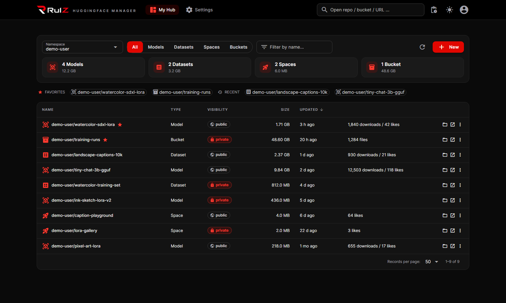

# RulZ Huggingface Manager

A friendly local web app for managing your Hugging Face **models, datasets, spaces and storage buckets**,
built with [NiceGUI](https://nicegui.io) and the official `huggingface_hub` library.

Moving, renaming, uploading and downloading files is much quicker than on the website or with the CLI:
select files in a table, click a button, done.

Part of the [RulZ AI Tools Suite](https://github.com/speedyrulz/RulZ-AI-Tools-Suite): the easiest way to install
it is the suite's launcher. Guide: [the wiki](https://github.com/speedyrulz/RulZ-AI-Tools-Suite/wiki/HF-Manager).



## Quick start

### With the RulZ AI Tools Suite launcher

Open *RulZ Huggingface Manager* in the launcher and click **Install**. It installs Python if needed, makes a
Python environment in the app folder (`.venv`) and installs the app's two packages. Then **Launch**: a console
window opens and the app opens in your browser. Closing the console stops it.

### Windows

Double-click **`start-windows.bat`**.

The first run creates a virtual environment (`.venv`) and installs the dependencies. After that the app opens
in your browser at <http://localhost:8765>. You need Python 3.10 or newer
(<https://www.python.org/downloads/>, tick "Add python.exe to PATH" during install).

### WSL / Ubuntu

```bash
cd "/mnt/c/path/to/RulZ-Huggingface-Manager"   # wherever the folder is
./start-linux.sh
```

The first run creates `.venv-linux` (kept separate from the Windows `.venv`, so the same folder works from
both Windows and WSL). Under WSL the app opens your **Windows** browser automatically.

If Ubuntu says the `venv` module is missing:

```bash
sudo apt update && sudo apt install -y python3 python3-venv
```

### Options

```text
--port 8765       use another port (also configurable in Settings)
--host 0.0.0.0    listen on the network (not recommended: anyone who can reach it can use your token)
--no-browser      don't open a browser window
```

Example: `start-windows.bat --port 9000` or `./start-linux.sh --no-browser`.

Starting the app a second time just opens the already-running instance.

## First steps

1. Create a token at <https://huggingface.co/settings/tokens>. Pick **Write** access (or a fine-grained token
   with write permission on your repos), otherwise you can only browse and download.
2. In the app, open **Settings**, paste the token and click **Save & test**.
   If you already ran `hf auth login`, the app uses that login automatically (or click **Import from "hf auth login" / HF_TOKEN** to save it).
   Note: recent `hf` versions log in through the browser with a *temporary* OAuth token that expires after a
   few weeks; Settings shows the expiry date. For a setup that keeps working, save a regular access token.
3. Pick a **download folder** (default: `Downloads/HuggingFace`; under WSL this is your Windows Downloads folder).

The token is stored only on your computer:

| Platform | Settings file |
| --- | --- |
| Windows | `%APPDATA%\RulZ-HF-Manager\settings.json` |
| WSL / Linux | `~/.config/rulz-hf-manager/settings.json` (permissions `600`) |

Windows and WSL keep separate settings, so add the token once in each.

## Features

**My Hub (dashboard)**
- Every model, dataset, space and bucket in your account or organizations in one sortable, filterable table,
  with size, visibility and last update. Type any other username to browse their public repos.
- Storage totals per type.
- Create repos/buckets, rename or transfer them to an org, make them public/private, duplicate, delete
  (delete asks you to type the name).
- Favorites and recently opened repos for one-click access.
- The search box at the top opens anything: `user/name`, a huggingface.co link, or an `hf://` path.

**File browser (repos and buckets)**
- Folder navigation with breadcrumbs, multi-select, filter, sizes, LFS/Xet badges.
- **Upload** files and whole folders straight from disk (best for big model files), or drag & drop in the browser.
  Files that would be overwritten are flagged before you confirm.
- **Download** a selection (or everything in the current folder) to your download folder, keeping the folder
  structure; or straight through the browser (several files are zipped).
- **Rename** (type `sub/new-name` to move at the same time), **Move** and **Copy** with a destination-folder picker.
  Folders are handled recursively.
  - In repos, all changes go into **one commit**. You can set the commit message or open a **pull request** instead.
  - In buckets, moves and copies run **server-side** (nothing is downloaded or re-uploaded).
- **Copy to...** another repo or bucket (server-side whenever the Hub supports it).
- **Delete** files and folders (one commit in repos).
- **Preview and edit** text files (README, JSON, YAML, Python...) with syntax highlighting, and preview images.
  Saving creates a commit (or PR).
- **New folder**: create (nested) folders, then upload into them.
- Repos: switch **branches**, create branches, see the **commit history**.
- Buckets: **Sync** a local folder up to the bucket, or a bucket folder down to your computer, rsync-style:
  preview exactly what will be uploaded/downloaded/deleted, then run it.
- Repos: **Push a whole folder** in one commit, optionally mirroring (deleting remote files that are gone locally).
- Copy the `hf://` path of any folder for use with the `hf` CLI or Python.

**vast.ai: send models straight to your instance**
- Attach a vast.ai instance: the **vast.ai** page lists your instances (with the API key the `vastai` CLI already
  saved, or one you paste) and connects over ssh with one click. Without an API key, paste the ssh command from the
  instance's *Connect* button instead; any Linux machine you reach with ssh works the same way.
- Pick what to send from anywhere: tick repos on **My Hub** (yours, an organization's, or any user's), tick files
  and folders in any repo's file browser and press **To vast.ai**, paste huggingface.co links (repo, folder or single
  file), or search the Hub on the vast.ai page. Collect several into the **transfer list** and send them together.
- Choose where they go on the instance: type a path, browse the instance's folders, or click a suggestion (the
  instance's ComfyUI model folders, RulZ Trainer's models folder, `/workspace`, your recent destinations). Choose how:
  keep the repo's folders, files only (for ComfyUI's `loras`, `checkpoints`...), a folder named after the repo, or
  the Hugging Face cache (`HF_HOME`) for `from_pretrained()`. Optional filters (`*.safetensors`, skip `*.bin`...).
  The dialog shows the total size against the free space there.
- The **instance downloads the files itself**, straight from Hugging Face at datacenter speed: nothing passes through
  your computer. The transfer runs in the background on the instance and keeps going if you close the app or lose
  your connection. Progress shows in the Activity panel and under *Transfers on the instance*, with Cancel and
  Retry; sending again skips files that are already there with the same size.
- Your Hugging Face token goes to the instance over ssh for private and gated repos, inside the transfer process's
  environment only (never on a command line or on the instance's disk). The first transfer installs
  `huggingface_hub` into `~/.rulz-hf` on the instance (about 30 MB); the instance's own Python environments are not
  touched.

**Activity panel**: uploads, downloads and moves run in the background with progress; the panel lists every
job with its result, errors in plain language, and an **Open folder** button for downloads.

**Dark or light**: the RulZ look, black and red (the default) or white and red. The first start asks which one you
want; switch any time with the sun / moon button at the top right or under Settings ▸ Appearance & behaviour.

## Notes

- The app listens on `127.0.0.1` only by default, so only your own computer can reach it.
- Files you pick with "from this computer" are read directly from disk, so multi-GB uploads don't pass through
  the browser. Under WSL, Windows drives are under `/mnt/c`, `/mnt/d`...; you can also paste a Windows path
  like `C:\Users\me\model` and it is converted automatically.
- Downloads into the download folder include a small `.cache/huggingface` folder used by `huggingface_hub` to
  skip unchanged files next time.
- Requires `nicegui>=4.0` and `huggingface_hub>=2.4` (bucket support).
- vast.ai needs an `ssh` program (built into Windows 10/11 and Linux) and your ssh key in your vast.ai account.
  The vast.ai API key and the attached instance are stored in the same settings file as the token. Each instance gets
  its own known-hosts file next to it (`ssh/`), because vast.ai reuses addresses for new rentals.

## Project layout

```text
rulz_hf_manager/
  main.py            command line + server start
  config.py          settings file (token, download folder, preferences)
  hub.py             huggingface_hub wrapper: one file-system interface for repos and buckets
  vast.py            vast.ai: instances, ssh, planning a transfer, following it
  remote_agent.py    the instance's side (standard library only, piped over ssh on every call)
  jobs.py            background jobs with progress
  platform_utils.py  Windows / WSL / Linux helpers
  ui/                NiceGUI pages: dashboard, browser, vast.ai, settings, pickers, dialogs
  ui/theme.py        the RulZ look (colors, dark / light, "Choose your look")
  static/            the RulZ logo (dark and light) and the browser-tab icon
assets/              app icon (.png, .ico) for shortcuts
tests/               pytest tests (no network, token or instance needed)
start-windows.bat    Windows launcher
start-linux.sh       Ubuntu / WSL launcher
```

## License

MIT (see `LICENSE`), except the RulZ name and logo: see `LOGO-NOTICE.md`.
