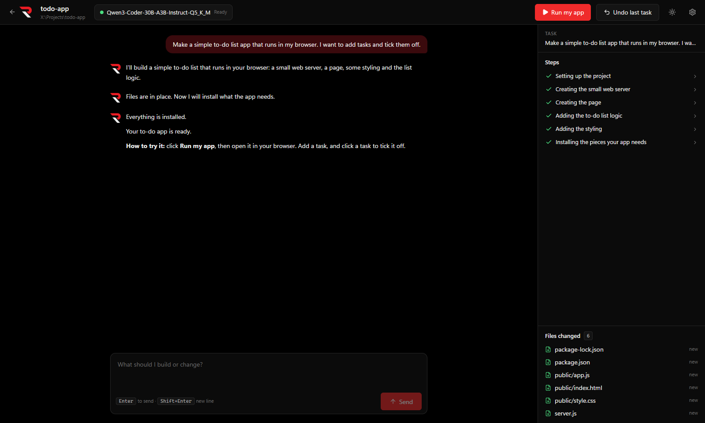
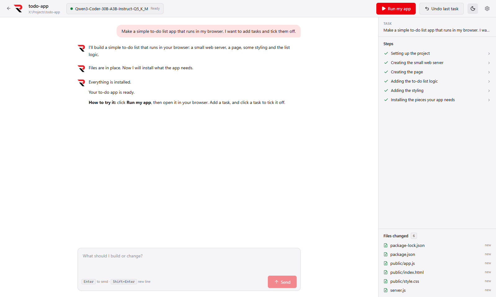
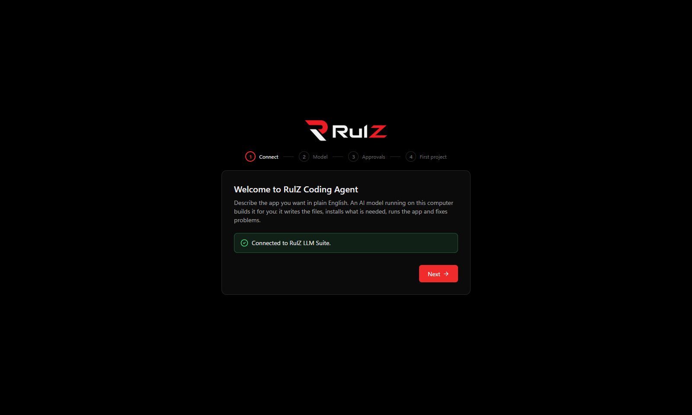
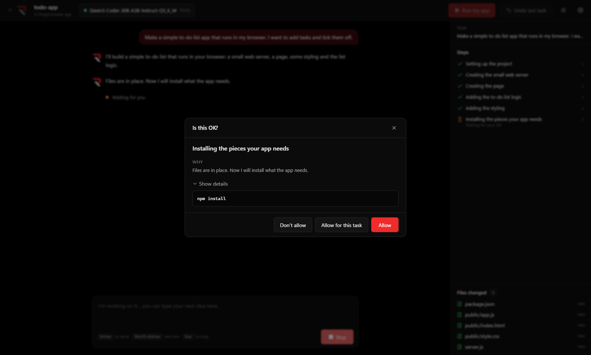
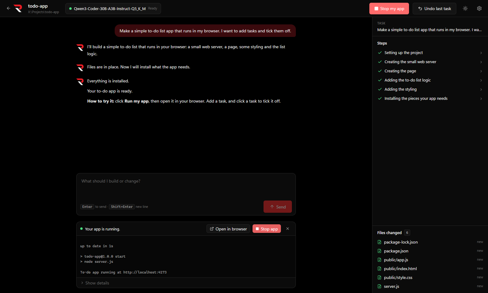
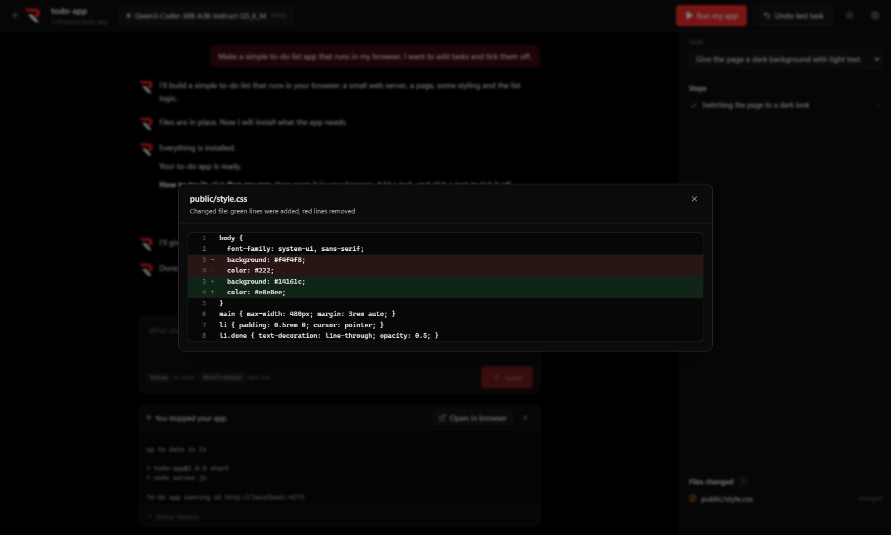

# RulZ Coding Agent

A Windows desktop app that builds software from plain English. Describe an app ("make a video upscaler with a
drag-and-drop window") and a local AI model creates the files, installs what is needed, runs it, reads the errors
and fixes them, asking for your OK before risky steps.

Everything runs on your computer. The model is served by
[RulZ LLM Suite](https://github.com/speedyrulz/rulz-llm-suite); this app is the "hands" that edit files and run
commands. No cloud services and no accounts.

## Screenshots

| Dark | Light |
| --- | --- |
|  |  |

The light look is one click away: use the sun/moon button in the top bar (or **Settings > Look**).









## Getting started

1. In **RulZ LLM Suite**, open the **Developer** page and click **Start server**. If LM Studio is also running it
   uses port 1234, so give RulZ port **1235**. This app finds either.
2. Install and start RulZ Coding Agent (the installer from the
   [Releases](https://github.com/speedyrulz/rulz-coding-agent/releases) page, or `install.bat` then `run.bat`).
3. The first-run wizard finds the server, lets you pick a model (Qwen3-Coder works best), explains approvals and
   creates your first project.
4. Type what you want and press **Enter**.

## What you see

- **Conversation** on the left: what you asked and what the agent says, in plain words. **Stop** (or `Esc`)
  stops it at any moment, even mid-command.
- **Steps** on the right: each thing the agent does ("Installing the pieces your app needs") with a status icon.
  Click a step to see the exact command and its output.
- **Files changed**: every file the task created, changed or deleted. Click one to see what changed.
- **Run my app** starts the project (`npm start` / `npm run dev`, `main.py`, or opens `index.html`), with its output
  in a panel and an **Open in browser** button for web servers. If it can't tell how, it asks the agent and remembers.
  When the app crashes or prints an error, **Fix this** stops it and hands the error to the agent to find and fix.
- **Undo last task** puts the project back exactly as it was before the last task (press again to go further back).
- **History** lists every task in the project, newest first, with when it ran and how many files it changed.
  **Go back to before this** on any task puts the project back to how it was then, undoing that task and every
  later one in a single step (after a confirmation that lists them).

## Approvals

| Level | Asks before |
| --- | --- |
| Careful | every file change and every command |
| **Balanced** (default) | every command and every delete; file edits run freely because Undo covers them |
| Hands-off | deletes and risky commands only |

At every level it always asks before deleting, installing software for the whole computer, using admin rights,
touching anything outside the project folder, changing Windows settings, closing other programs, or sending
anything to the internet (`git push`, publishing). It always refuses, with an explanation, to format disks, delete
outside the project, edit the registry, turn off security software, shut down the PC, or download and run
scripts unchecked. Deleted files go to the Recycle Bin.

## How it works

- **Connection**: tries the saved address, then `127.0.0.1:1234` and `:1235`, and tells RulZ apart from LM Studio
  by the extra fields RulZ adds to `/v1/models` (`path`, `state`, …). A model that isn't loaded is loaded by RulZ on
  the first request ("Loading the model…").
- **Agent loop**: streams `/v1/chat/completions` with tools (`list_files`, `find_files`, `search_text`, `read_file`,
  `write_file`, `edit_file`, `delete_path`, `run_command`, `start_background_command`, `check_background_command`,
  `stop_background_command`, `check_page`, `ask_user`) until the model answers without a tool call.
- **Checking pages**: `check_page` opens a local address (`localhost`) or an HTML file in the project in a hidden,
  sandboxed window with its own throwaway storage. It reports script errors, files that failed to load, and the text,
  buttons and fields the page shows, so the agent sees a broken or empty page that a server log wouldn't reveal.
  Internet addresses are refused, the page can't leave its own server or the project folder, and downloads,
  pop-ups and permission requests (camera, notifications, …) are blocked.
- **Qwen3-Coder fix**: its original chat template prints earlier tool arguments in Python form, which the model
  then copies and llama.cpp can't parse. When `/props` shows that template, earlier arguments are re-sent as JSON
  text (shared with RulZ LLM Suite).
- **Path guard**: file tools only work inside the project folder; `..`, absolute paths elsewhere and links that
  lead out are rejected.
- **Commands** run in `powershell.exe -NoProfile -NonInteractive` in the project folder, with Node.js, npm and
  Python folders added to `PATH`. Output streams live, each command has a time limit (10 minutes by default), and
  Stop kills the whole process tree.
- **Loop guard**: the same call three times in a row, five failures in a row, or the step limit (40 by default)
  pauses the task and asks you whether to keep going, try another way, or stop.
- **Context**: requests stay under ~80% of the model's context. Older tool results are shortened first; if that
  isn't enough, older turns are summarised. The system prompt and the current task are never dropped.
- **Undo**: before each task, the project is committed to a private git repository in the app's data folder
  (never a `.git` inside your project, so your own repositories are untouched; `node_modules`, `dist`, `.venv`
  and files over 50 MB are left out). Without Git for Windows, files are copied aside before the agent changes them.
  Going back from History resets to that task's commit; with copied files, each later task is restored in turn,
  newest first. The agent is told what was undone at the start of its next task.
- **Data**: `%APPDATA%\RulZ Coding Agent` holds settings, recent projects, each project's history and restore points.

## Development

```
npm install
node node_modules/electron/install.js   # first time only: Electron downloads its binary lazily
npm run dev          # run with hot reload
npm test             # unit tests
npm run test:e2e     # builds, then drives the app with Playwright against a mock RulZ server
npm run typecheck
npm run build:win    # installer → dist/RulZ-Coding-Agent-Setup-<version>.exe
```

Real-model check (needs RulZ LLM Suite serving a model; builds a to-do app, adds dark mode, undoes it, and writes
`test-results/real-model.md`; the latest results are in [docs/real-model-check.md](docs/real-model-check.md)):

```
$env:RULZ_REAL = '1'; npx vitest run --config vitest.e2e.config.ts real-model
```

Releases: pushing a tag such as `v0.1.0` builds the installer on GitHub Actions and attaches it to a GitHub Release.

## Later

Not in version 1: several agents at once, cloud models, web browsing, image input, a built-in code editor, git
branches, publishing apps, plug-ins.

## License

MIT, except the RulZ name and logo; see [LOGO-NOTICE.md](LOGO-NOTICE.md).
