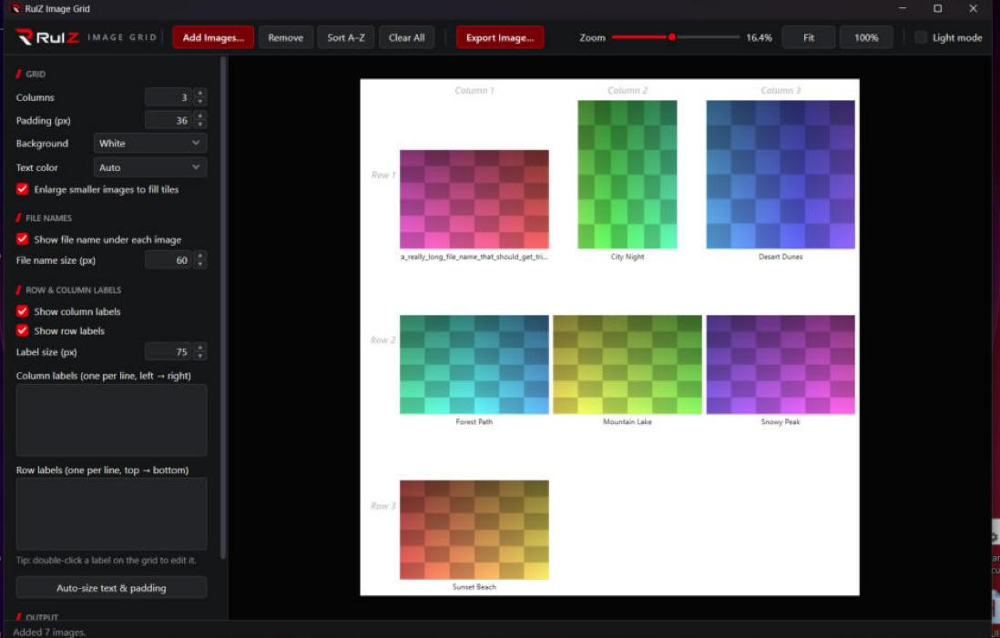

# RulZ Image Grid

A Windows app for arranging images into a labelled grid and exporting it as one image. Part of the RulZ AI Tools family.



## Run

Install it from the RulZ AI Tools Suite launcher, or download `RulZ-Image-Grid-v<version>-win64.zip` from the suite's Releases page, unzip it anywhere and double-click `RulZ Image Grid.exe`. It runs on any Windows 10/11 PC (uses the built-in .NET Framework 4.8). You can also drag images or a folder onto the .exe.

## Features

- **Add images**: click *Add Images…* (Ctrl+O), or drag files/folders onto the window. A folder's images are added in name order (img2 before img10). Dropping onto the grid inserts them at the slot marked in red. Big batches load several images at once, with progress in the status bar.
- **Rearrange**: drag a tile to a new slot. Right-click a tile to remove it or show it in Explorer; Delete removes the selected tile. *Sort A–Z* sorts by file name (img2 comes before img10).
- **Zoom**: Ctrl+mouse wheel, the zoom slider, *Fit* or *100%*. Tiles shown bigger than their small preview load a sharper copy in the background, so 100% shows the real detail.
- **File names**: shown under each image without the extension. Turn them off with *Show file name under each image*.
- **Row/column labels**: type them in the side panel (one per line), or double-click a header on the grid. Each set can be turned off. A set of labels you leave completely empty takes no space in the saved image (one empty label in a set that has others still keeps its space); the faint *Column 1* / *Row 1* placeholders only show in the editor.
- **Layout**: columns, padding, text sizes, background (white/gray/black/transparent), text color, and whether smaller images are enlarged to fill their tile.
- **Dark or light look**: black and red (the default) or white and red, matching the other RulZ apps. You choose on first launch; switch any time with the *Light mode* checkbox at the right end of the toolbar. The choice is saved in `%APPDATA%\RulZ Image Grid\settings.ini`.
- **Export** (Ctrl+E): set a scale from 1–200% of full resolution and see the exact output size in pixels before saving. Save as PNG or JPG (with a quality setting). There's a live preview.

Sizes (padding, text) are in output pixels at 100%, so what you see on screen is a scaled-down version of the export. Each tile is as big as the largest image, so 100% export keeps every image at its original resolution.

## Build

```powershell
.\build.ps1
```

Needs Visual Studio 2022 or Build Tools for Visual Studio (for the Roslyn `csc.exe` compiler). No NuGet packages or .NET SDK needed. The .exe lands in `bin\`. `.\build.ps1 -Test` also builds and runs the tests in `tests\` first (export layout, saving, loading, previews and background threads); the release workflow does this.

## Source

| File | Purpose |
|---|---|
| `src/MainWindow.cs` | Main window, settings panel, drag/drop, editing |
| `src/ExportWindow.cs` | Export dialog: scale, resolution preview, format |
| `src/Models.cs` | Settings, image loading (with EXIF rotation), the shared layout maths |
| `src/Renderer.cs` | Draws the full-resolution output and encodes PNG/JPG |
| `src/Theme.cs` | Dark/light palettes, saved settings, logo loading, dark title bar |
| `src/Theme.xaml` | Control styles (buttons, inputs, sliders, scroll bars, menus) for both looks |
| `src/ChooseLook.cs` | First-run "Choose your look" dialog |
| `src/Ui.cs` | Small UI helpers (number box, input dialog, section headings) |
| `tests/ImageGridTests.cs` | Tests run by `build.ps1 -Test` |

`build.ps1` embeds the logos, icon and `Theme.xaml` in the .exe, so it runs as a single file.

## License

Open source under the [MIT License](LICENSE).

The RulZ name and logo are excluded from the MIT License; all rights reserved. If you fork or redistribute this
project, remove or replace the RulZ branding. See [LOGO-NOTICE.md](LOGO-NOTICE.md).

`assets/logo-source.webp` is the original artwork; `tools/make_logo.py` (needs Pillow) regenerates the transparent wordmarks and the icon from it.
