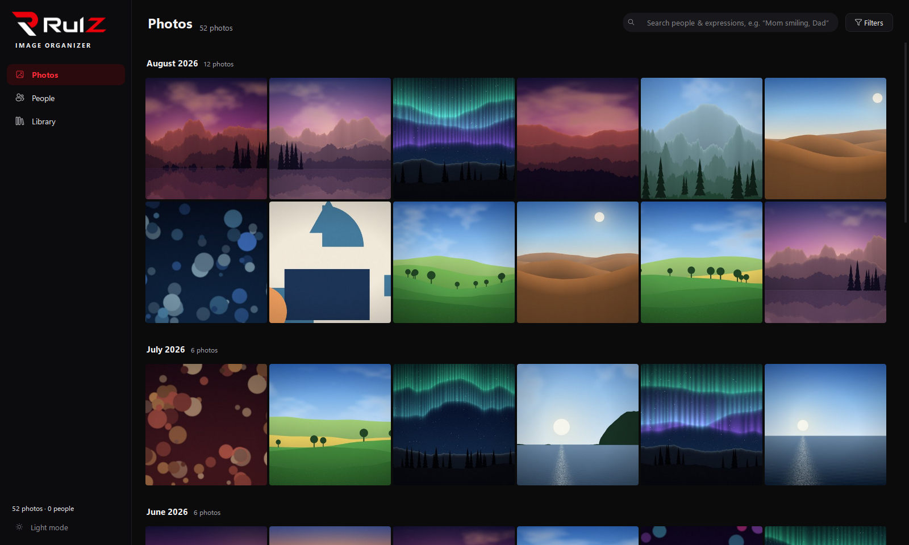
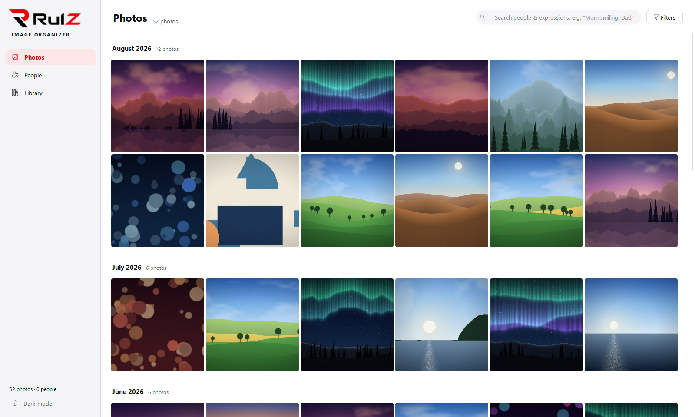
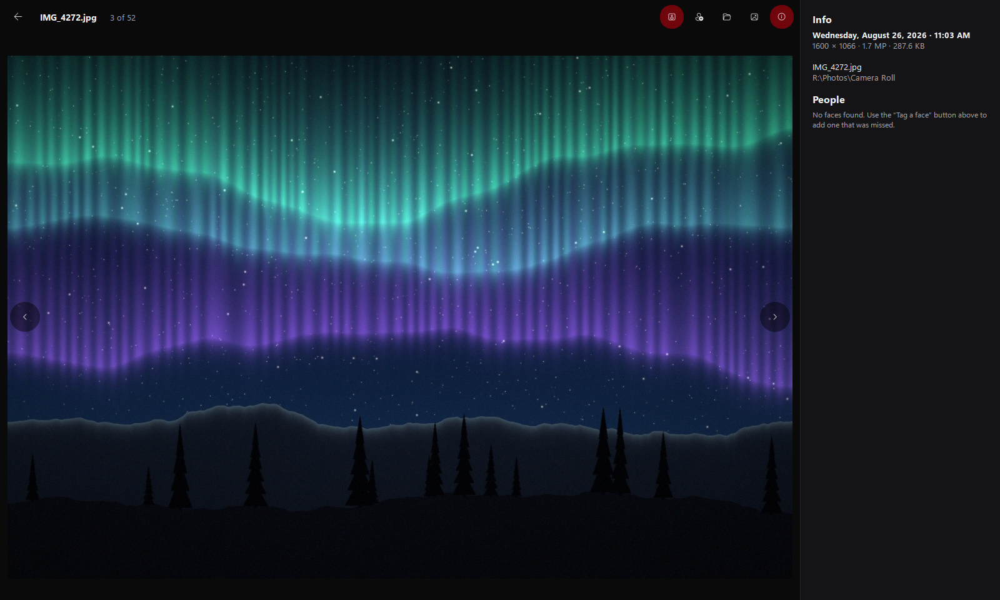
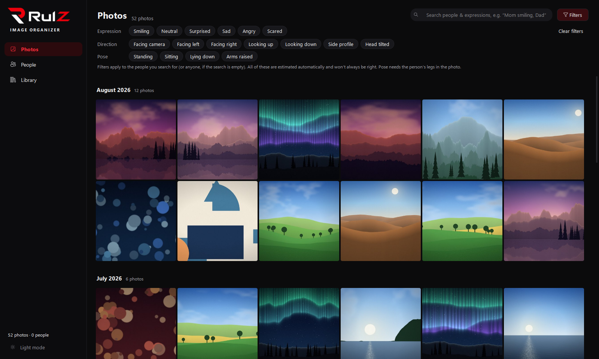
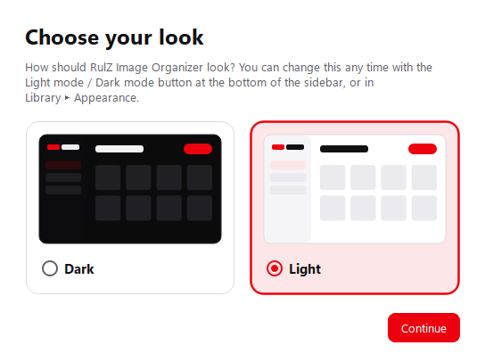

# RulZ Image Organizer

A Windows desktop photo organizer that works like Google Photos' People view: add folders to your
Library, and RulZ finds every photo, detects the faces in them, and groups them by person automatically.
You name people and fix any mistakes; your corrections are always kept.

Everything runs on your PC. No photos or face data ever leave your computer (the optional AI tagging sends
photos only to the AI server you choose, and asks before sending any to another computer).

**[Download](https://github.com/speedyrulz/RulZ-AI-Tools-Suite/releases)** (or install it from the [RulZ AI Tools Suite](https://github.com/speedyrulz/RulZ-AI-Tools-Suite) launcher, under **Photos**) · **[Wiki: guides, FAQ and troubleshooting](https://github.com/speedyrulz/RulZ-AI-Tools-Suite/wiki/Image-Organizer)**

| Dark (default) | Light |
| --- | --- |
|  |  |





<sub>Screenshots show generated demo pictures, not real photos.</sub>

## Features

- **Library**: add any number of folders (subfolders included). Scans run in the background on startup,
  or when you click **Scan now** (F5). New, changed, deleted and *moved/renamed* photos are picked up;
  files moved or renamed within the same library folder keep their face tags (a move to another library
  folder counts as a deletion plus a new photo). A photo whose file date changes but whose picture doesn't
  (a backup or copy tool, a clock change on a memory card) keeps its tags, and a folder that can't be read
  during a scan (access denied, a network drop) keeps its photos until it can be read again.
- **Photos**: a timeline of all photos grouped by month (by EXIF date taken, or the file date if there is
  none). Ctrl + mouse wheel zooms
  the grid. Search by person, facial expression, head direction and body pose. Words in one
  comma-separated group describe one person:

  | Search | Finds |
  | --- | --- |
  | `Mom` | photos of Mom |
  | `Mom, Dad` | photos with both |
  | `smiling` | anyone smiling |
  | `Mom smiling, Dad` | Mom smiling, with Dad somewhere in the photo |
  | `Dad facing left` | Dad's head turned towards the left side of the photo |
  | `looking down`, `side profile`, `head tilted` | anyone posed that way |
  | `Mom sitting`, `standing`, `lying down`, `arms raised` | body pose |

  Expressions: smiling, neutral, surprised, sad, angry, disgusted, scared, smirking (and "not smiling").
  Directions: facing camera, facing left/right, looking up/down, side profile, head tilted.
  Poses: standing, sitting, lying down, arms raised.
  The **Filters** button shows the same options as clickable chips; they apply to the people you searched
  for, or to anyone if the search box is empty. The photo viewer lists each face's expression, direction
  and pose. These are estimated automatically and won't always be right (a smirk may read as a smile, and
  up/down is less reliable than left/right). Standing and sitting are only decided when the person's ankles
  are in the photo, so head-and-shoulders and waist-up shots never get those; lying down and arms raised
  need only the upper body. Only people whose face was found are covered.
- **People**: automatic face groups. Click a group, then its name, to name it. Select several groups (hover → tick the
  circle) and **Merge** them. Naming a group with an existing name offers to merge them. Hide people you
  don't care about. **Ungroup** dissolves a wrong group.
- **Corrections** (on a person's page):
  - **Faces** tab: select faces → **Not {name}**, **Move to…**, **Use as profile photo**, **Not a face**.
  - **Review suggestions** tab: unassigned faces that look like this person → **Yes** / **No**.
- **Photo viewer**: face boxes with names. Click any face to say who it is, confirm it, remove it from a
  person, or mark it "not a face". **Tag a face** (person+ icon) lets you drag a box around a face that
  wasn't detected. ← / → to browse, `F` toggles face boxes, `I` toggles info, Esc closes.
- **Face grouping sensitivity** (Library page): move towards *Stricter* if different people get mixed,
  towards *Looser* if one person is split into many groups, then **Apply and regroup**. Named people and
  manual corrections are never undone.
- **AI tagging and Look for** (optional, off until you set it up): a vision AI model on a server you choose
  (Ollama, LM Studio, llama.cpp, or the server you set up in the Rulz Training Captioner) tags photos in
  detail, and checks photos for anything you type, like `red sweater`. Results are kept, and the search box
  finds them. See [AI tagging and search](#ai-tagging-and-search-optional).
- **Dark or light**: dark is the default. The first launch asks which look you want (*Choose your look*);
  switch any time with the **Light mode / Dark mode** button at the bottom of the sidebar, in
  **Library ▸ Appearance**, or with Ctrl+Shift+L. The change applies immediately and is remembered.

  
- Supports JPG, PNG, WebP, BMP, GIF, TIFF and HEIC/HEIF (iPhone) photos.

### How corrections stick
- Faces you assign by hand are never moved automatically.
- Once you say a face is *not* someone, it will never be auto-assigned to them again, even if you say so
  while a scan is grouping faces.
- Faces from a dissolved group can still join existing people, but won't re-form the same group.
- A face you tag by hand stays, even on a photo the scan hasn't analyzed yet.
- When a photo file changes (an edit, or a rating or tags another program writes into it), it is analyzed
  again and your corrections move over to the same faces found again in the same places. Boxes you drew
  stay unless the picture was rotated, mirrored or cropped.

## AI tagging and search (optional)

A vision AI model can describe your photos in more detail than the face models, and check them for things
you name. It is off until you turn it on in **Library ▸ AI tagging and search**, and RulZ never sends a
photo anywhere while it is off.

**Choosing the server** (Library ▸ AI tagging and search):

| Option | What it uses |
| --- | --- |
| **Off** | Nothing (the default). |
| **My own server** | Any OpenAI-compatible server: Ollama (`http://127.0.0.1:11434/v1`), LM Studio (`http://127.0.0.1:1234/v1`), vLLM or a running llama-server. Type the model name or press **Load models**; it must be a vision model (for Ollama, for example `qwen2.5vl:7b` or `gemma3`, installed with `ollama pull qwen2.5vl:7b`). Several addresses separated by commas share the work. |
| **Training Captioner's server** | For power users who already set up the Rulz Training Captioner: RulZ reads its server settings (`%APPDATA%\RulzCaptioner\settings.json`, or `RULZ_CAPTIONER_DIR`) and never changes them. With an external server (Ollama, LM Studio…) it uses the same address and model. With the Captioner's llama.cpp setup it uses the Captioner's llama-server while that runs, and otherwise starts its own copy on its own ports (from 8190), which closes with RulZ or with **Stop AI server**. Two copies of the model need the VRAM twice. |

**Test connection** sends a small red test picture and checks that the model names its colour, so you know
it can see images. If the server is on another computer, the card says so in red, and RulZ asks before it
sends the first photo to each such server, every time it starts (so an address that changes, in the Training
Captioner too, is asked again).

**Tag photos with AI** (the **AI** button on the Photos page, the selection bar, a photo's right-click menu,
or **Tag with AI** in the viewer): the model lists what it sees in each photo, such as people and their
clothing, objects, places, weather, colours and the kind of picture. The tags show in the viewer's info
panel (click one to search for it), and the search box finds photos by any of their words: `sweater` finds
`red sweater`, and a trailing s doesn't matter (`dogs` finds `dog`).

**Look for something** (same places): type what to look for, for example `red sweater` (several things:
separate them with commas), and pick this photo, the selected photos, the photos shown, or all photos. The
model answers YES or NO for each photo. When you start it from the Photos page the matches show up there as
they are found. Searching for the same text later shows the results straight away.

**What is kept:** tags and YES/NO answers are stored in the library, so nothing is asked twice. Photos that
were already tagged or checked are skipped unless you tick **Tag again** / **Check again**. An edited photo
(a changed file) counts as not tagged or checked yet, a deleted photo takes its results with it, and
**Forget the selected search** (in the Look for dialog) or **Clear AI results…** (Library) remove them.
Answers that can't be read (neither YES nor NO, a hedge like "not sure", or a reply cut off at the token
limit) and failed requests are not kept, so the next run asks again. When everything was checked before,
the dialog's button reads **Show results** and nothing is sent (and no llama-server is started).

If an AI server doesn't accept the connection within 10 seconds (asleep, firewalled, gone), RulZ counts it as
down: with several addresses the others take over its photos, and when none answers the job stops.

**Search** finds AI results with the same box as people and expressions. Someone's full name, and groups
made only of expressions, directions or poses (`smiling`), still mean what they did. Other words are looked
up in the Look for searches and AI tags, as written (`woman in red dress`), before part of a name: `car` finds
the tag "car", not Carl (`carl` still finds Carl). `Mom, red sweater` finds photos with Mom where the AI found
a red sweater. Text in quotes, like `“smiling”`, means only the AI's results for exactly that text; RulZ uses
quotes itself when it shows Look for results or when you click a tag. For a Look for search, a NO answer
beats a tag with the same words. A saved search is used whole even when it contains "and" (`salt and
pepper`). A Look for over all photos or the photos shown fills the search box; one over one photo or a
selection leaves it alone, and **Show results** in the sidebar shows the matches.

**Advanced…** holds the instructions (system prompts) and questions RulZ sends, the token limits, the
temperature, the image size sent (1024 px), requests at a time, the reply timeout, thinking on/off and
the port for RulZ's own llama-server. The page is locked until you tick *I understand*, and saving asks
again, because RulZ reads the replies by their format: tagging must reply with a comma-separated list and
Look for with a reply that starts with YES or NO. `{query}` in the Look for question is replaced by what you
look for. **Restore defaults** puts the built-in prompts back; prompts you never edited follow improvements
in later versions. Results saved before a change stay as they are.

Only one AI job runs at a time; its progress shows in the sidebar with **Stop** (requests already sent
finish first, and everything found so far is kept). It can run while a library scan runs. Model output and
llama-server messages go to `ai.log` in the library data folder.

## Running

**Packaged app:** run `dist\RulZ Image Organizer\RulZ Image Organizer.exe` (the whole folder must stay
together; you can copy it anywhere and pin the .exe to Start/taskbar).

**From source:**

```powershell
python -m venv .venv
.\.venv\Scripts\python.exe -m pip install -r requirements.txt
.\.venv\Scripts\python.exe run.py
```

**Build the .exe:** `powershell -ExecutionPolicy Bypass -File .\build.ps1` (add `-Test` to run the tests
first; GitHub Actions always does).

Library data (database, thumbnails, face crops, AI results) lives in `%LOCALAPPDATA%\RulZ Image Organizer`.
Your preferences (theme, window size) are kept there too, in `settings.ini`, the AI settings in
`ai_settings.json` (a broken file is set aside as `ai_settings.bad-<time>.json`), and AI messages in `ai.log`.
Set `RULZ_DATA_DIR` to use a different location, and `RULZ_THEME=light|dark` to force a theme for that run.

## How it works

| Part | File |
| --- | --- |
| Face detection: OpenCV **YuNet** (`models/face_detection_yunet_2023mar.onnx`) | `rulz/faces.py` |
| Face recognition: OpenCV **SFace** 128-d embeddings (`models/face_recognition_sface_2021dec.onnx`) | `rulz/faces.py` |
| Expressions: **FER+** emotion model (`models/emotion-ferplus-8.onnx`) on the aligned face crop | `rulz/faces.py` |
| Head direction: yaw/pitch/roll from the 5 face landmarks; search vocabulary | `rulz/attributes.py`, `rulz/search.py` |
| Body pose: MediaPipe **BlazePose** person detector + 33 body landmarks, run around each face; joint-angle rules | `rulz/body.py` |
| Grouping: match to existing people (centroid + nearest face), then link remaining faces into new groups | `rulz/clustering.py` |
| Scanning, thumbnails, moved-file detection | `rulz/scanner.py`, `rulz/imaging.py` |
| AI tagging and Look for: settings and prompts, OpenAI-compatible requests, background jobs, llama-server for the Training Captioner's llama.cpp setup | `rulz/ai/` |
| SQLite storage (WAL) | `rulz/db.py` |
| Qt (PySide6) UI | `rulz/ui/` |

The face models come from the [OpenCV Model Zoo](https://github.com/opencv/opencv_zoo) and the expression
model from the [ONNX Model Zoo](https://github.com/onnx/models); see [models/README.md](models/README.md)
for their licenses. Libraries created before
expressions or poses were added are analyzed once in the background on the next scan; people assignments
are kept.

## License

Open source under the [MIT License](LICENSE). The face, expression and pose models in `models/` keep their own licenses; see [models/README.md](models/README.md).

The RulZ name and logo are excluded from the MIT License; all rights reserved. If you fork or redistribute this
project, remove or replace the RulZ branding. See [LOGO-NOTICE.md](LOGO-NOTICE.md).
