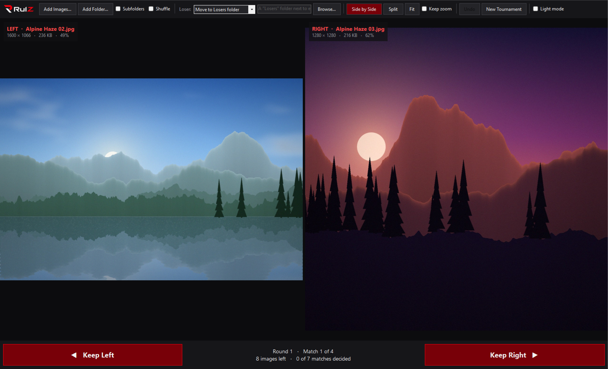
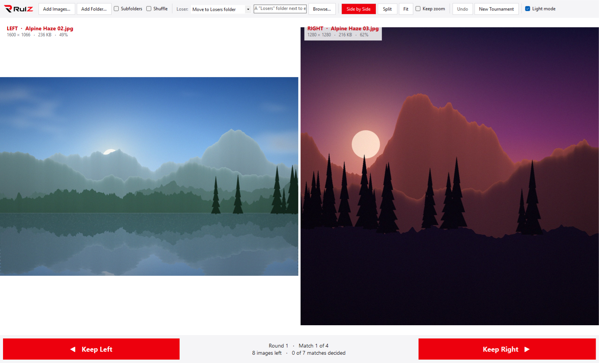
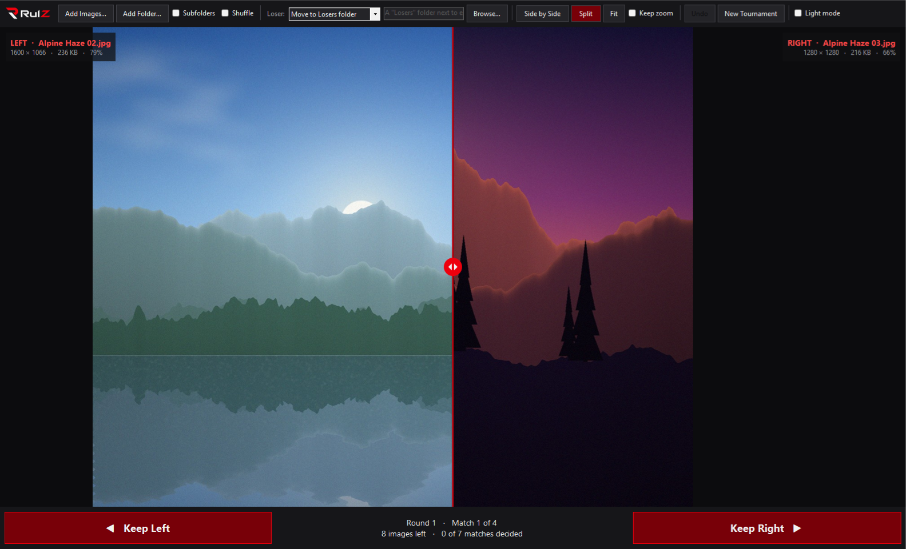
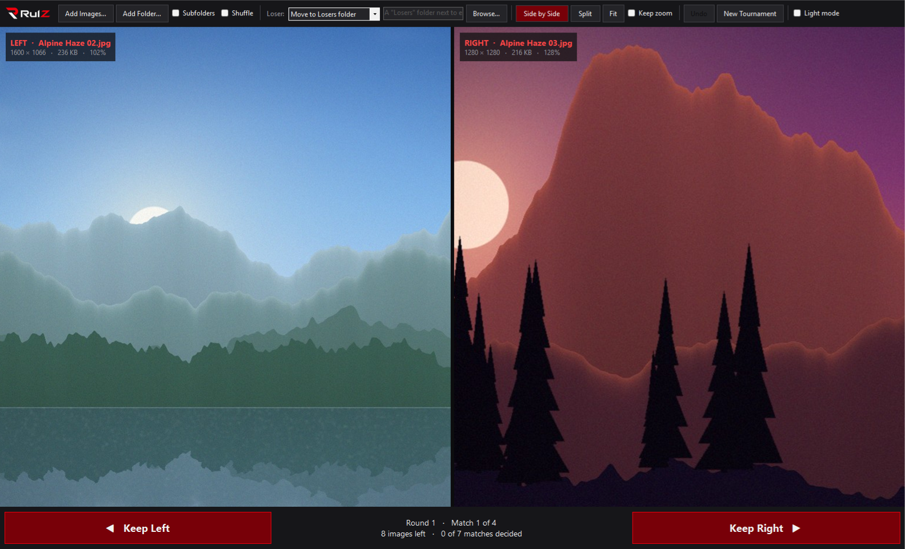
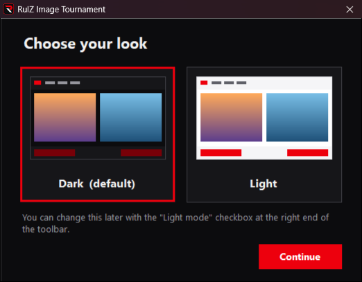

# RulZ Image Tournament

A Windows app that finds your favorite image by single-elimination tournament. It shows two images at a time. You keep one, and the other is moved to a Losers folder (or recycled, deleted, or left alone). This repeats until one champion is left.

<p align="center">
  <picture>
    <source media="(prefers-color-scheme: dark)" srcset="assets/logo.png">
    
  </picture>
</p>

| Dark (default) | Light |
|---|---|
|  |  |

| Split view with a movable divider | Zoom and pan stay in sync |
|---|---|
|  |  |

## Get it

The easiest way is the [RulZ AI Tools Suite](https://github.com/speedyrulz/RulZ-AI-Tools-Suite) launcher: find
RulZ Image Tournament under **Photos** and click **Install**. Without the launcher, download
`RulZ-Image-Tournament-v<version>-win64.zip` from the newest `image-tournament-v…` release on the suite's
[Releases page](https://github.com/speedyrulz/RulZ-AI-Tools-Suite/releases), unzip it anywhere and run
`RulZ Image Tournament.exe`. To run it from this source folder instead, read on.

## Run

Double-click **`launch.bat`**. It builds the app first if needed. You can also drop images or folders onto `launch.bat` to start a tournament with them.

The app needs nothing beyond Windows 10/11 (.NET Framework 4.8 is built into Windows 10 version 1903 and later, and Windows 11). You can also run `bin\RulZ Image Tournament.exe` directly, or pass images and folders to it on the command line.

Only one copy runs at a time. Starting it again while it's open (with **Send to**, a double-click, or files dropped on the `.exe`) brings the open window to the front and adds those images to its tournament.

## Install (optional)

Double-click **`install.bat`** to install the app for your user account. It doesn't need admin rights. It:

- builds the app and copies it to `%LOCALAPPDATA%\Programs\RulZ Image Tournament`
- adds Start Menu and Desktop shortcuts
- adds a **Send to** shortcut, so you can right-click images or a folder and choose *Send to → RulZ Image Tournament*

Run `install.bat` again to update the installed copy after changing the code. `uninstall.bat` removes the app and shortcuts, and asks before deleting your settings. It never touches your images or Losers folders.

## Build

```powershell
.\build.ps1          # builds bin\RulZ Image Tournament.exe
.\build.ps1 -Test    # also runs the bracket logic tests
```

It uses the C# compiler that ships with Windows, so no SDK or Visual Studio is needed. Both logos (white lettering for dark, black for light) are embedded in the `.exe`, so it remains a single file.

`tools\make_logo.py` (needs Pillow) builds the app's artwork from `assets\logo-source.webp`. It makes a transparent wordmark with white lettering for the dark UI (`logo.png`), a light-background version (`logo-light.png`), and the "R" icon (`app.ico`). Rerun it, then `build.ps1`, if the logo changes.

## How the bracket works

Images are paired in order: 1 v 2, 3 v 4, 5 v 6… When every match in a round is done, the winners meet in the same order in the next round.

If a round has an odd number of images, the last one advances automatically (a bye). In the next round, the image that got the bye goes **first**, so it faces the winner of 1 v 2. The image left over at the end of that round gets the next bye, which keeps the same image from getting a free pass every round.

Example with 7 images: round 1 is 1v2, 3v4, 5v6, and 7 gets the bye. Round 2 is 7 v W(1,2) and W(3,4) v W(5,6). Round 3 is the final.

Images you add during a tournament join the end of the current round. Images you add after a champion is decided challenge the champion.

## Controls

| Action | Mouse / button | Keyboard |
|---|---|---|
| Keep left image | **Keep Left** | `←`, `A`, `1` |
| Keep right image | **Keep Right** | `→`, `D`, `2` |
| Undo last pick | **Undo** | `Ctrl+Z`, `Backspace` |
| Zoom (both images) | Mouse wheel (zooms toward the cursor) | `+` / `-` |
| Pan (both images) | Click and drag | |
| Reset zoom | Double-click, **Fit** | `F`, `0`, `Home` |
| Side by side / split | **Side by Side**, **Split** | `V` or `S` toggles |
| Move the split line | Drag the red divider | |
| Add images / folder | **Add Images…**, **Add Folder…**, or drag and drop | `Ctrl+O`, `Ctrl+Shift+O` |

Zoom and pan stay in sync. Both images show the same spot measured as a fraction of each image's size from its center, so images of different resolutions still line up. From 300% zoom up, true pixels are shown without smoothing.

A pick needs a fresh key press or click. Holding a key down doesn't decide one match after another, and a click that comes within a quarter of a second of a new pair appearing (the second half of a double-click) is ignored. The same goes for the buttons on the champion screen.

## Options

- **Loser:** sets what happens to the image you didn't pick:
  - *Move to Losers folder* (default). Leave the folder box empty to use a `Losers` folder next to each image. An absolute path sends every loser to one folder. A relative name, such as `Rejects`, is created next to each image, and `\Rejects` means that folder at the root of each image's own drive. A file with the same name already there is never overwritten: the loser is saved as `name (2).jpg`.
  - *Send to Recycle Bin*. Images that Windows can't recycle (on a network drive or most USB sticks, too big for the Recycle Bin, with a path longer than 260 characters, or on a drive whose Recycle Bin is turned off) are left alone, and the app tells you. Windows would otherwise delete them for good without asking.
  - *Delete permanently*. It asks you to confirm when you choose it, and again at the first pick after the app starts if it is still selected from last time.
  - *Leave in place*, if you only want to find a favorite
- **Undo** works for *Move* and *Leave in place*, and moves the file back. Images you added after the pick stay in the tournament. Undo is disabled after recycling or deleting.
- If the same file meets itself under two names (a mapped drive and its network path, or a hard link), the loser is only taken out of the tournament. The file isn't touched.
- **Subfolders** scans folders recursively. It skips the Losers folder and hidden folders (such as `$RECYCLE.BIN` on a drive's root), and it scans each folder only once even when a link or junction leads back to it.
- **Shuffle** randomizes the order of newly added images.
- **Keep zoom** keeps the zoom and position from one match to the next. This is handy for comparing the same detail across a burst of similar shots.
- **Light mode** (at the right end of the toolbar) switches between the dark look and a light one with a white background. It switches immediately and is remembered.

The first time the app starts, it asks you to choose a look, Dark or Light. Closing that window without choosing keeps Dark. You can change it any time with **Light mode**.



Progress is saved a moment after every pick, and when the app closes. If the app is closed mid-tournament, it offers to resume the next time it starts (answering No there discards the saved tournament). If some of the images can't be found then (for example, a drive isn't connected yet), it says how many and asks before going on without them. If you answer No, the saved tournament is kept until you start a new one (adding images then asks before replacing it), so you can connect the drive and start the app again. Options are saved as soon as you change them (the Losers folder box when you leave it). Settings (including the look) and progress are stored in `%APPDATA%\RulZ Image Tournament`.

To keep them somewhere else, set the `RULZ_TOURNAMENT_DATA` environment variable to a folder before starting the app. It then uses `<that folder>\RulZ Image Tournament` and leaves the normal settings and saved tournament alone. This is handy for testing or a portable copy, for example:

```bat
set RULZ_TOURNAMENT_DATA=D:\Portable\TournamentData
"RulZ Image Tournament.exe"
```

## Supported formats

JPEG, PNG, BMP, GIF (first frame), TIFF, WebP, ICO, and JPEG XR. HEIC/HEIF and AVIF also work when the matching Windows codec extensions are installed. Camera rotation (EXIF orientation) is applied automatically.

Paths longer than 260 characters (deep folders, or images named after a long prompt) work when Windows long paths are turned on. That is the `LongPathsEnabled` setting. It is off by default, but some installers turn it on, such as Python's "Disable path length limit".

## License

Open source under the [MIT License](LICENSE).

The RulZ name and logo are excluded from the MIT License; all rights reserved. If you fork or redistribute this
project, remove or replace the RulZ branding. See [LOGO-NOTICE.md](LOGO-NOTICE.md).
