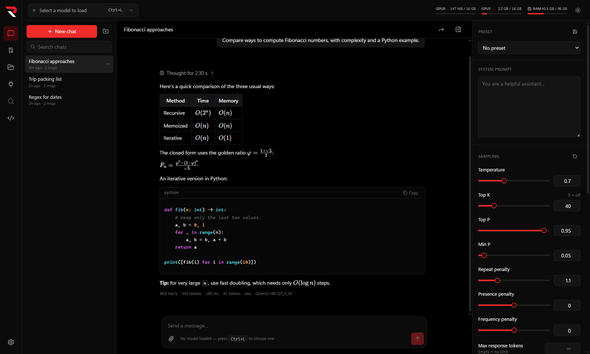
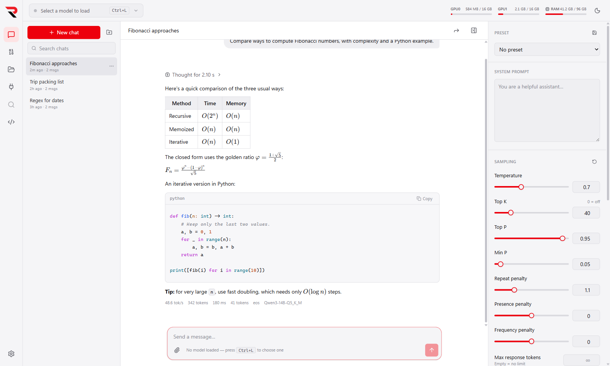
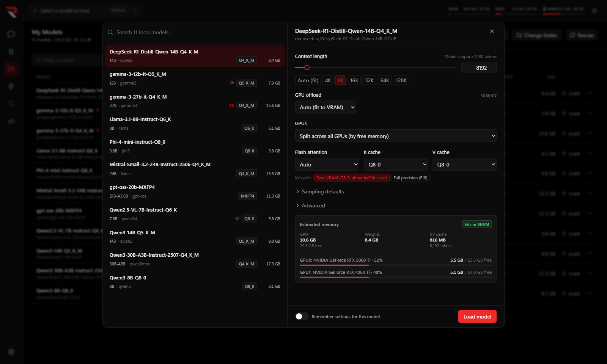
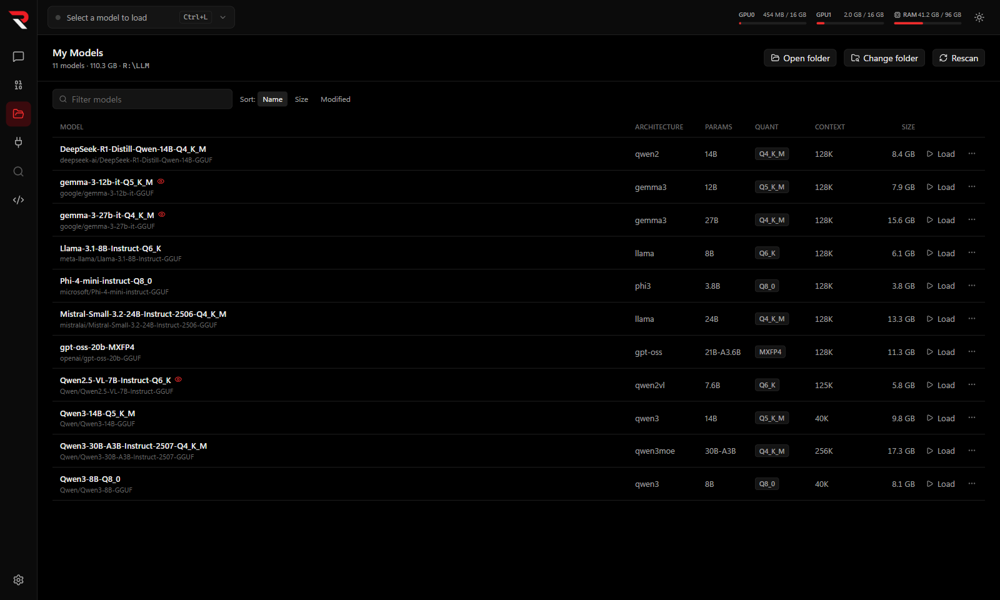
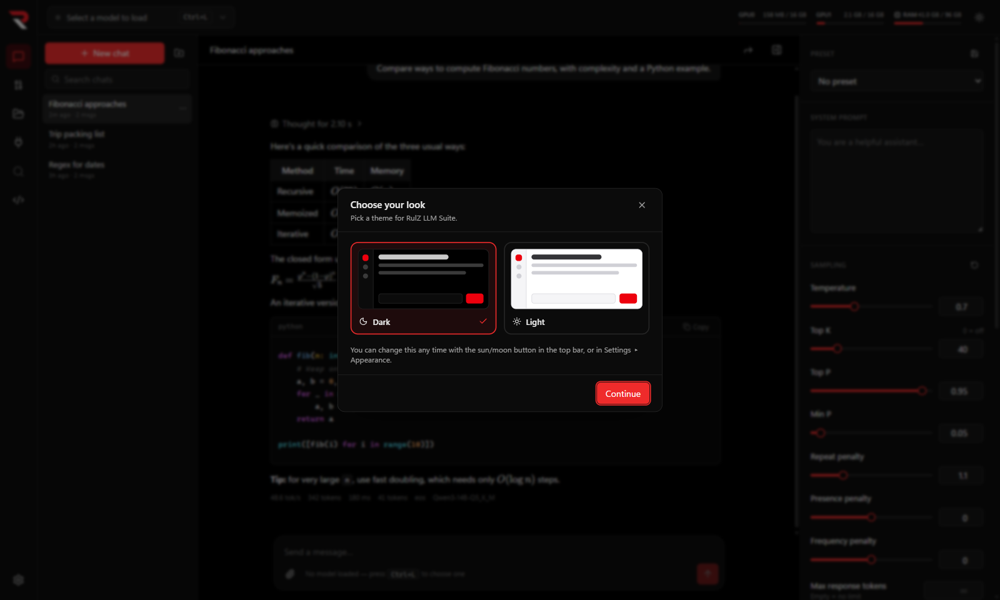

# RulZ LLM Suite

A Windows desktop app for running local LLMs, modelled on LM Studio's feature set. Models run in your own
llama.cpp build (`llama-server.exe`), one process per loaded model, bound to `127.0.0.1`.

**Documentation:** setup, guides and troubleshooting are in the [wiki](https://github.com/speedyrulz/RulZ-AI-Tools-Suite/wiki/LLM-Suite).
Discover/downloads, RAG and a CLI are planned.

| Dark (default) | Light |
| --- | --- |
|  |  |







<sub>Screenshots use demo content: made-up chats and header-only model files.</sub>

## Features

- **My Models** — scans a folder (default `C:\LLM`) for `.gguf` files, reads GGUF metadata (architecture,
  parameters, quantization, trained context, layers), pairs vision projectors (`mmproj`) and MTP draft files with
  their model, joins split shards, and watches the folder for changes.
- **Model loading** (`Ctrl+L`) — context length, GPU offload (auto-fit / all / N layers), MoE expert offload
  (`--cpu-moe` / `--n-cpu-moe`: keep all experts, or those of the first N layers, in system RAM while attention stays
  on the GPU) and custom tensor overrides (`--override-tensor`), single-GPU or split across GPUs, flash attention, KV cache quantization, threads, batch sizes, mmap/mlock, chat template override and
  extra arguments; per-model saved defaults; memory estimate with a fits/partial/likely-OOM verdict; load progress;
  live server log; several models loaded at once.
  - **Inkling 2 Mini (loop model) GPU split** (0.39.0): llama.cpp divides this model's cache slots, not its weights, over the GPUs, so a plain `--tensor-split 55,45` puts every layer on the first GPU. LLM Suite converts your split (or, with two or more GPUs and an automatic split, the free memory of each GPU) so the weights land as the percentages say, and shows the value it passes under **GPUs**. Inkling models also need a large prompt scratch buffer that grows with context length and micro-batch size; the memory estimate counts it and, when it does not fit, says which micro-batch (512 down to 32) would. Your settings are never changed for you.
  - **Settings per mode** (0.33.0): each model can have its own load settings, sampling and system prompt for Chat,
    Coding (0.35.0, used by RulZ Coding Agent), Reverse engineering, Adventure and Writing (**My Models**, pick a model, **Settings for**). Anything a mode leaves
    out stays as it is without it. The load dialog has **Load for** and, for a mode, its **Own sampling** (0.34.1).
    **API server sampling** is only for other programs and is set for all modes. When a model is loaded with other settings than the
    mode wants, a bar offers to reload it; it never reloads by itself. Existing chats, sessions and Writing projects keep
    their settings.
  - **Speculative decoding**: a draft-head sidecar next to the model (`mtp-*.gguf`, or eagle3/dflash/dspark) is
    detected and used automatically (`--spec-type draft-<kind>`), with a per-model switch and draft length.
    MTP layers built into the model file (Qwen3.5+ "MTP" GGUFs) are detected too and preferred. A **Draft model**
    picker can choose built-in layers or any draft file in the models folder instead.
  - **LoRA adapters**: adapter GGUFs anywhere in the models folder are offered for every model with the same
    architecture, with a warning when an adapter names a different base model. Tick one or more in the load form, each
    with a default strength (`--lora`; the strengths are set right after loading). Their size counts toward the memory
    estimate. A path containing a comma can't be passed to llama.cpp; rename it.
- **My Models ▸ Adapters** — lists the adapter files with architecture, size, LoRA alpha and base model, and which
  models they go with. **Convert PEFT adapter** turns a Hugging Face PEFT folder (`adapter_config.json` +
  `adapter_model.safetensors`) into a GGUF in the models folder with llama.cpp's `convert_lora_to_gguf.py`, found next to
  the llama.cpp build the app uses. Python with `torch`, `safetensors` and `transformers` is needed. Give a base model
  folder (only its `config.json` is read) or a Hugging Face model id; with neither, the converter reads the base named in
  `adapter_config.json` from the Hub.
- **Load-settings benchmark** — **Benchmark** on My Models runs one fixed prompt over every combination of the settings
  you pick (GPU layers, MoE offload, KV cache type, draft tokens, context length, batch and micro-batch sizes; at most
  48 combinations), starting from the model's saved settings. For each it loads the model, sends an untimed warm-up and
  then a few timed requests (prompt of 512, 2048 or 8192 tokens cut with the model's own tokenizer, end-of-text
  ignored), and tables load time, time to first token, prompt and generation tok/s, draft acceptance and peak VRAM
  (nvidia-smi sampled every ~0.5 s, minus what was in use before the load) next to the memory estimate. Combinations the
  estimate calls likely out of memory can be skipped. The fastest row is marked, and **Save as defaults** stores a
  row's settings as the model's defaults. A run unloads every loaded model first and leaves nothing loaded; runs are
  kept in `%APPDATA%\RulZ LLM Suite\benchmarks.json` (newest 100).
- **Chat** — streaming replies, collapsible reasoning ("thinking") blocks, Markdown with tables, LaTeX and
  highlighted code, image, PDF and text-file attachments (drag-drop / paste), copy, edit, regenerate, continue, branch,
  delete (with undo); per-chat adapter strengths (on/off and 0–2 in the side panel, applied per request without
  reloading; a change makes the model process the chat again from the start); a note typed while the model replies is sent now (stopping the reply, keeping its thinking) or
  after it; tok/s, time-to-first-token and token stats; context usage meter with "truncate middle" or "stop" overflow
  policy; folders, pinning, search; per-chat system prompt, sampling and thinking settings (on/off, reasoning effort,
  thinking budget); presets; JSON-schema structured output. A message sent while its model is still loading waits for
  that load. Samplers for fiction: DRY (stops the model repeating earlier passages, with sequence breakers such as
  character names), XTC (now and then skips the likeliest tokens for fresher wording) and an avoid-words list (sent as
  logit bias, so use distinctive words); DRY and XTC can also be set as a model's API defaults.
- **Chat handoff** — at 85% context (or any time via the header button) the model writes a handoff summary and
  a new chat with the same settings continues from it.
- **MCP tools** — configure servers in `mcp.json` (same format as LM Studio / Cursor; stdio `command` or remote
  `url`) on the MCP Tools page. Enabled tools are offered to the model; each call asks for approval unless the
  tool is marked "always allow", and calls and results show inline in the chat.
  - **On-demand tool loading** for large servers (e.g. REA's 207 tools): the model gets a name catalog plus
    `rulz_search_tools` / `rulz_load_tools` / `rulz_unload_tools`, and only loaded tools' full descriptions are
    sent, within a token budget (least recently used are unloaded first). "Auto" switches to this once the
    enabled tools exceed the budget.
  - **Built-in file tools**: read-only `list_directory` and `find_files`, so the model can find exact paths (such as a
    program's `.exe`) before handing them to other tools, and `read_pdf`, which reads or searches the text of a PDF
    (no OCR) in a separate thread.
  - **Tool-result compaction**: once you send a new message, tool results from earlier turns are sent to the
    model as their beginning and end only (the chat still shows them in full); the latest results of the turn in
    progress stay complete.
- **Developer tab: local API server** — OpenAI-compatible (`/v1/models`, `/v1/chat/completions`, `/v1/completions`,
  `/v1/embeddings`, `/v1/responses`) and Anthropic-compatible (`/v1/messages`) endpoints in front of your models.
  A request for a model that isn't loaded loads it with its saved settings; models the server loaded are unloaded
  after an idle timeout. Optional API key, CORS, localhost-only or LAN, and a live request log with token counts.
  `GET /v1/models/{id}/load-config` returns a model's saved load settings, and `POST` with
  `{ "config": { … }, "reload": true }` changes them (other apps, like RulZ Coding Agent, use this). `POST` accepts only
  context length, GPU layers, MoE expert offload (`cpuMoe`: `"off"`, `"all"` or a layer count), flash attention,
  KV cache types, parallel slots, the GPU split (mode, main GPU,
  per-GPU proportions), whether the vision projector runs on the CPU (`mmprojOnCpu`), the model's sampling
  defaults (`sampling`: any subset, merged value by value; `null` clears one), LoRA adapters (`adapters`: a list of
  `{ "id", "scale" }` with ids from `adapter_choices`; `[]` removes them) and the draft (MTP) settings, including which draft (`draftFile`: `null` for automatic,
  `"builtin"`, or the id of one of `draft_choices`). File paths and extra arguments stay app-only. A loaded model
  restarts with the new settings unless `"reload": false`; `"dry_run": true` only returns the memory estimate for the
  changed settings. Replies include the GPUs, `moe_layers` (layers with experts; `null` for dense models), whether the model has a draft head, what automatic uses
  (`default_draft`), the drafts that can be picked (`draft_choices`, by path relative to the models folder), the
  adapters that can be picked (`adapter_choices`: id, name, size, base model, alpha and whether the base matches), and
  the memory estimate. A chat-completions request may also carry llama.cpp's own `lora` field (`[{ "id", "scale" }]`,
  ids in load order) to set adapter strengths for that request. `POST /v1/models/{id}/unload` unloads every running instance of a model (replying with how many it
  `unloaded`), so a client can free the memory when it is done with a model.
  Settings per mode for other apps (0.35.0, Coding and Reverse engineering only): `GET /v1/models/{id}/modes` returns
  each mode's sampling, system prompt and whether the loaded model matches its load settings;
  `GET` / `POST /v1/models/{id}/modes/{coding|re}/load-config` reads and changes a mode's load settings (a reload only
  with `"reload": true`); `POST /v1/models/{id}/reload` with `{ "mode": "coding" }` loads the model again with them. A
  reload is refused while anything uses the model and for a model on a rental, and web pages can't use these routes. A
  request with `X-RulZ-Mode: coding` (or `re`) loads a model that isn't loaded with that mode's settings, and one with
  `X-RulZ-Rental: deny` is refused instead of being answered on a rented computer. Replies name the model that answered
  (`X-RulZ-Model`) and say when it ran on a rental (`X-RulZ-Rental: 1`).
  OpenRouter models ticked **Allow other apps** are listed as `openrouter/…` with `cloud: {provider, free}` (0.36.0); only
  chat completions, token counting and `/props` work with them, and their answers carry `x-rulz-cloud: 1`. Naming one that
  is not ticked answers 403 with code `cloud_not_allowed`; a used-up limit answers 402 with `cloud_limit`.
  Default port 1234 (pick another if LM Studio is running).
- **Writing mode** (`Ctrl+7`) — write a novel with a local model. A project is a plain folder of Markdown files
  (default `Documents\RulZ Novels`, set in **Settings → Writing**), so Obsidian, VS Code or a sync client can open it
  too.
  - **Outline**: chapters and scenes, each scene with beats, POV, characters present, a target word count, a status
    and a summary. **Plan chapters** and **Plan scenes** ask the model for a plan; **Summarize** writes a scene or
    chapter summary. Every proposal is a card you accept, edit or reject.
  - **Story bible**: characters, places and other entries as Markdown files with front matter (aliases, keyword
    triggers, priority, always-include). An entry goes into a request when its name, an alias or a trigger appears in
    the beats or the text near the cursor, when it is the scene's POV or present, or when it was used earlier in the
    scene. The **Context** tab shows each part's tokens against its cap, every included entry and why, and what was
    cut to fit.
  - **Editor**: CodeMirror with Markdown, search and soft wrap. **Continue**, **Draft scene**, **Rewrite** (tighter,
    more vivid, another tone, show don't tell, or your own note), **Expand**, **Condense** and **Dialogue**, with up to
    four alternatives. AI text is a pending change with **Accept** / **Reject** per change; nothing is written until
    you accept it.
  - **Requests** are assembled to fit the model's context: system and style, fixed bible entries, the story so far
    (summaries), the scene, triggered entries, then the latest prose in steps, so llama-server can reuse its prompt
    cache between requests. Each project has its own model, sampling (including DRY, XTC and avoid words) and adapters.
  - **Your text is kept safe**: atomic saves; an unsaved-text journal every few hundred milliseconds that is offered
    back after a crash; a conflict banner when another program changed the file; snapshots in **History**; deleted
    scenes, chapters and entries in **Trash**; a project whose `project.json` or `outline.json` can't be read is
    opened read-only instead of being reset. Closing the window first saves or journals open text.
  - **Check** (scene toolbar) and **Check chapter** (chapter menu) ask the model to read a scene against the bible,
    the story so far and the tracked state, and list problems: continuity, character, timeline, POV, tense. Each
    problem quotes the scene and is marked in the margin; **Jump**, **Fix** (a Rewrite you accept or reject) or
    **Dismiss** (remembered per scene in `.rulz\checks.json`) in the **Checks** tab.
  - **Tracked state** (`state.json`): facts per character or thing (location, what they know or carry, condition,
    relationships), each true from one scene until another in reading order. **Update state** asks the model what
    changed in a scene; you accept or reject each change before anything is written. The **State** tab shows the state
    before or after the current scene and lets you add, edit, end or remove facts; facts whose scene or entry was
    deleted, or that end before they start after a scene move, are listed for repair. The state before the scene goes
    into every request.
  - **Interview** tab: chat with a character, in their voice, who knows only what they know by the current scene
    (their entry, their state and summaries of the scenes they were in). **Add to voice notes** appends an answer to a
    `## Voice` section in the character's entry. For **Dialogue**, or a selection that names a character, that
    character's voice notes come first in the request.
  - **Recording** (Project panel, on by default): every AI action is recorded with what you did with it (accepted,
    mixed, rejected, edited) and, once you stop editing, the final text, in `.rulz\records\<day>.jsonl`. Nothing about
    your writing waits for it. **Export training data…** writes `train.jsonl` (SFT), `pairs.jsonl` (DPO: the
    alternative you accepted over the ones you looked at, and optionally your edits over the model's text) and a
    manifest into a new folder outside the project. Cut-off, rejected and abandoned outputs are left out.
    **Delete records…** moves them to the Recycle Bin.
  - **Adapters**: the Project panel shows which base model an adapter was trained on and warns on a mismatch; the
    PEFT converter says where to use a converted adapter.
  - **Writing benchmark** (Benchmark on the Writing start page): 2 to 6 candidates (model, adapters, sampling) write
    the same prompts with the same seeds; you vote blind on pairs (A / B / Tie / Skip, keys 1/2/3/S) and an Elo
    scoreboard ranks them. **Adjust settings** on a candidate changes its sampling and its load settings (context,
    GPU layers, KV cache…) for that run only; presets and the model's saved settings are not touched. **Settings for
    all candidates** sets the same values for every candidate; a setting a candidate changed itself wins for that
    candidate. Every output's generation and prompt speed is saved, and the scoreboard shows each candidate's average
    tokens/s (weighted by tokens). Bundled prompts or your own; each run is one file you can resume. While a benchmark runs,
    chat, batch runs, the hardware benchmark and model loading wait for it.
  - **Phone access** (0.26.0): write from an Android phone with
    [RulZ Writer for Android](../rulz-writer-android). Turn on **Settings → Phone access → Let my phone connect** and
    scan the QR code with the phone. It needs [Tailscale](https://tailscale.com) on the computer and the phone (same
    account): the app listens only on the computer's Tailscale address (port 7421 by default) and every phone must
    show the pairing code; **New pairing code** signs out all paired phones. The phone opens projects from the
    Writing folder, edits scenes and the story bible with the same save rules (a changed file is a conflict, never
    overwritten), and runs the AI actions, summaries, outline proposals, checks, Update state and interviews; they
    run here on the computer as jobs, so a result is kept while the phone sleeps. The phone can't start a job
    while the computer is generating, and phone jobs are not recorded as training data. LLM Suite has to be running (the tray is enough).
  - Not yet tried with a real model.
- **Adventure mode** (`Ctrl+8`, 0.28.0) — choose-your-own-adventure stories played with the loaded model.
  - **New adventure**: your own idea (title, genre, premise, your character, tone, passage length, 2 to 4 choices,
    model, temperature; eight starter ideas fill the form) or **From a Writing project**, which copies the project's
    characters, places and chapter summaries into the adventure as its world.
  - **Playing**: the model writes a passage in the second person and offers choices; pick one (keys 1 to 4) or type
    what you do. Every step is kept as a tree: **Go back here** on any passage, take another path, and switch between
    paths with **Other paths** or the **Map**. A choice you already took shows as visited and goes to that path;
    Shift+click writes it again. **Try again** writes the latest passage again as another path, **New choices**
    replaces its choices, **Edit** changes the text, choices or state by hand, **Delete branch** removes a passage
    and everything after it.
  - **Tracked state**: inventory, stats and facts that the model updates after each passage and must stay
    consistent with. Each passage keeps its own state, so going back also goes back to what you carried then.
  - **Export** saves the path you are on as one Markdown story. Adventures are saved in the app's data folder
    (`adventures\`); **Delete** sends one to the Recycle Bin.
  - Only one model job runs at a time on the computer: an adventure turn, a phone Writing run or a desktop chat
    waits for the other to finish. Also playable from [RulZ Writer for Android](../rulz-writer-android) (no deletes
    on the phone). Design: [docs/adventure-mode-design.md](docs/adventure-mode-design.md).
  - Not yet tried with a real model.
- **vast.ai** (`Ctrl+9`, 0.29.0) — run a model on a rented GPU and control everything from here. Only the model server
  (`llama-server`) runs on the rental; chats, REA, the targets, recordings, grading and the scoreboard stay on this PC.
  - **Rent, start, stop, destroy** from the app: search on-demand offers (GPU memory, price, reliability, download
    speed), sort them by price, DLPerf/$/hr and more (0.30.0; the last used settings are kept), see the price, disk and traffic costs and your balance, and confirm. Nothing is rented or started without
    that click; loading a model, a batch run, an API request or a phone never does it. A rent request whose answer is
    lost is never repeated: the app looks for the instance by its label first. **Attach** uses an instance rented
    elsewhere; the app never destroys it and leaves it alone while something else uses its GPU.
  - **Auto-stop**: an app rental stops after 30 idle minutes and at the latest after 12 hours (both can be changed, and
    **Extend cap** adds hours), after a 60-second countdown with **Keep running**. A small watchdog on the instance
    enforces the same limits when the app or the PC is off. Stopping keeps the disk, which is still billed. The top bar
    shows what the rentals cost; quitting asks what to do with running ones.
  - **Models**: pick a model from this PC (its files are uploaded, with resume and checksums) or from Hugging Face
    (downloaded on the instance over 16 connections, with the speed shown, 0.31.0; gated repositories need a token).
    **Set up** installs the llama.cpp Linux CUDA build
    with the same build number as this PC's, checked against GitHub's checksums, and the model's files.
  - A loaded remote model works everywhere a local one does: chat, Reverse Engineering, Writing, Adventure and the API
    server. The API server and the phone only use one that is already loaded. The connection is an ssh tunnel that
    reconnects by itself; the server is reachable from this PC only.
  - Needs a vast.ai API key (typed in the app and kept encrypted, or taken from `VAST_API_KEY` or the `vastai` CLI) and
    an ssh key in `~/.ssh` that is on the vast.ai account (the app can add it).
  - Design: [docs/vast-design.md](docs/vast-design.md). Not yet tried on a real rental.
- **OpenRouter** (`Ctrl+0`, 0.36.0) — use models that run at [OpenRouter](https://openrouter.ai) in Chat, MCP tools,
  Writing, Adventure, Reverse Engineering and batch practice. Their text goes to OpenRouter and to the provider that
  answers; models on this PC and on rentals never send anything there.
  - **Your key** is typed on the page, checked with OpenRouter and kept encrypted. No environment variable or other file
    is read. **Privacy**: requests only go to providers that do not keep or train on prompts, unless you allow it.
  - **Spending**: a daily limit ($1.00 to start with; change it or switch it off). Before each request the app books the
    most it could cost and refuses the request if that would pass the limit; it is settled with what OpenRouter charged.
    Cost per reply, per model and per day are shown. The estimate is rough, so one request can end slightly above it. Set
    a credit limit on the key at OpenRouter as well.
  - **Models**: pick them from OpenRouter's list (search, free, images, tools, prices per million tokens). Each has a
    context limit (32,768 tokens at first, because Chat and Writing fill what they are given) and a reply limit. Router,
    batch and image-output models are left out. Settings a model does not take are greyed out; load settings, adapters and
    benchmarks do not apply.
  - **Allow other apps** (off at first, per model) lets the API server, RulZ Coding Agent and the phone apps use a model.
    It is only used when a request names it exactly (`openrouter/…`); no fallback or default ever picks one. Web pages
    cannot use them, and on a network address the API key must be set.
  - Practice runs take 1 to 4 tasks at once, with the same tool limits as rentals. A run stops when the limit, the key or
    the credits refuse a request, and the tasks not done can be resumed.
  - Design: [docs/cloud-design.md](docs/cloud-design.md). Tried with a stand-in for OpenRouter, not yet with a real key.
- **Reverse Engineering mode** (`Ctrl+6`) — runs a local model as a reverse engineer with the REA MCP tools, and
  collects fine-tuning data while it works. Tuned first for Ornith 1.5 35B-A3B (Heretic MTP APEX I-Mini).
  - **Sessions**: pick a program, library, package or folder and a goal (overview, license check, network, config,
    crypto, hidden strings, or your own). The chat gets an RE system prompt, thinking sampling for Qwen3.5-family models
    (temperature 0.6, top-k 20, no repeat penalty), REA's core tools preloaded, up to 80 tool rounds per reply, and the
    model's thinking sent back within a tool loop (interleaved thinking, as the template expects). Tools are on even if
    chats have them off. Static-analysis tools (decompile, search, list, annotate) run without asking; tools that run the
    target, attach debuggers or reach devices still ask.
  - **calc**: the RE training kit's sandboxed calculator runs as a built-in MCP server (`calc__calc`) when Python 3 is
    on PATH, so the model computes hash rounds and XOR decoding instead of doing 32-bit math in its head.
  - **Recording**: every finished round is saved as llama-server received it (system prompt with the tool catalog,
    tool definitions, every turn) in `%APPDATA%\RulZ LLM Suite\re-data\<chat id>\`. A chat's data goes to the Recycle
    Bin with the chat.
  - **Grading**: Solved / Partial / Failed in the chat's RE strip or on the Reverse Engineering page.
  - **Practice tasks**: reads `build/tasks.jsonl` from the RE training kit (`C:\coding\Trainers\re-training-kit`),
    copies a task's binary to a fresh work folder, and checks the final `ANSWER:` line automatically (a port of the
    kit's `verify.py`). The check types are `run`, `config`, `exact`, `keyword`, `env` (the answer is `NAME=value`; the
    program runs with a minimal environment plus that variable) and `file` (the answer is hex bytes, written to a file
    the program is run on).
  - **Task sets**: a set is a folder of generated tasks with a label. The kit's `build/` folder is the set
    `original`; every finished folder under `<kit>/sets/<id>/` (one with `set.json` and `tasks.jsonl`) is another.
    The **Set** dropdown on the practice card picks the set that the family tiles, the task list, **Start next task**
    and batch runs use; the choice is remembered. If two sets hold the same task id the first set's copy is used and
    the card shows a warning. The API (`/v1/re/overview`, `/v1/re/practice/{id}/prepare|grade`) finds a task in any
    set; the overview adds `sets` and a `set` on each task.
  - **Generate a new set**: **New set...** asks for a label, tasks per family (1 to 50), the families to include
    (read from `python -m kit.generate --list-families`) and a seed, then runs the kit's generator
    (`python -m kit.generate --out <kit>/sets/<id> ...`) with progress and a Cancel button. The id is the label's slug
    plus four random characters. It needs Python 3 and Visual Studio Build Tools (the C compiler); a failed or
    cancelled run removes its partial folder. **Remove set** moves a generated set to the Recycle Bin (never the
    original); results recorded for its tasks stay.
  - **Results per model** (0.34.0): the practice tiles show what the model chosen under New session has solved and
    failed; click a family to see each task. **Start next task** and a batch run's **Only unsolved** go by that model
    too, so a new model gets every task. A model on this PC and its copy on a rental count as one (same name), and
    batch results count even when their chats were deleted.
  - **Batch runs**: **Start batch run** under the practice tasks runs them without you and keeps a
    score, so two models (or one model before and after fine-tuning) can be compared on the same tasks. Options: at
    most N tasks (taken family by family in turn, so a short run still covers every family), tries per task, a time
    limit per task (counted from the task's first reply, so loading the model is not counted), only tasks this model has
    not solved, and a label. A run records the adapters the model had loaded and their strengths, shown next to
    the model name, so a base model and its fine-tune can be told apart. Each task is a normal recorded practice session in its own chat. A tool call that
    would ask for approval is refused instead of waiting (the model is told why and carries on); the form warns when a
    tool every session starts with, such as `rea__open_binary`, still asks, with an **Always allow** button. A task
    still calling tools at the round limit or the time limit is graded as failed. **Stop after this task** and
    **Stop now** end a run; the play button on its row runs the tasks not run yet. **Batch runs** lists every run:
    solved tries out of the tries that ran to an end (errors and tasks you stopped are not counted), median tool rounds
    and time of the solved ones, a score per task family, and each task's result, rounds, time and largest prompt, with
    a button to open its chat. Runs are kept in `%APPDATA%\RulZ LLM Suite\re-batches.json`; removing a run keeps its
    chats. A chat that belongs to a run can be watched but
    not changed while its task runs; other chats can be used meanwhile.
    **Several tasks at once** (0.29.0): choose how many run side by side on each host and which hosts (this PC, or one
    or more vast.ai rentals with the model set up). Each task has its own REA process on this PC (about 1.3 GB of RAM
    each) and stays on one model server. Rows show the hosts and, for rentals, the cost and the cost per solved task.
    **Context per session** starts from the context saved in the model's Reverse engineering load settings, shared out over
    the tasks at once (0.34.1). **Stop the rentals when the run ends** is an option. A task cut off by a lost connection goes back to the queue
    instead of counting as failed.
  - **Export**: writes `train.jsonl` in the kit's format (OpenAI / Hugging Face chat: `messages`, `tools`, `meta`;
    thinking in `reasoning_content`) plus `manifest.json`, from solved sessions by default, at most N per practice task
    (fewest tool rounds first), leaving out sessions whose context was trimmed. Email addresses are replaced. When
    several models practised, **Models** picks whose sessions go in (0.34.0).
  - **Clone**: the New session card switches between **Analyse** and **Clone**. A clone session rebuilds either
    **specific pieces** of the target (presets for a file format, network protocol, algorithm, license logic, config and
    command line, or one function, or your own description) or **the whole program**, as new readable source code in
    the language you pick (or the original's). It writes only into the **output folder** you choose, with two built-in
    tools that exist only in clone sessions: `write_file` (inside the output folder, never over the target) and
    `read_file` (the output folder and the target's folder). The model keeps `NOTES.md` (so it can pick up after the
    context is trimmed) and a `README.md` saying how to build it and what is and isn't reproduced. Clone sessions may
    run up to **400** tool rounds (an option), are recorded and graded like other sessions, and exported samples carry
    `meta.kind` (`clone-pieces` or `clone-full`).
  - **Sessions from other apps**: a `/v1/chat/completions` request with an `x-rulz-re-session: <id>` header (letters,
    digits, `_` and `-`, up to 56) is recorded as part of that RE session, with its reply. `POST /v1/re/sessions/{id}`
    with `client`, `title`, `target`, `goal` describes the session, and with `outcome` (`unrated`, `solved`, `partial`,
    `failed`) grades it; `GET` reads it back, and the reply's `recording` says whether recording is on. Such sessions are
    listed, graded, deleted and exported on the Reverse Engineering page like chats, labelled with the app's name.
    RulZ Coding Agent 0.16.0 sends these when its **Record tasks for reverse-engineering training** setting is on. Since
    the other app fits its own context, a request with fewer messages than the one before marks the session as
    trimmed. Turn it off with **Record sessions from other apps** in the page's options.
    `GET /v1/re/overview` lists every RE session (chats here and other apps' sessions, newest first, with kind, grade
    and tool rounds), the practice tasks with how often each was tried and solved (never their answers), and the
    question, clone-piece and language templates. `POST /v1/re/practice/{task}/prepare` copies a task's program into a
    fresh work folder and returns its path and prompt; `POST /v1/re/practice/{task}/grade` with `target` and `text`
    checks the reply's `ANSWER:` line and returns `answer`, `passed` and `expected`. Session descriptions also take
    `kind` and `practice`. RulZ Coding Agent 0.18.0 and its phone app use these to show and start RE tasks.
- **Dark and light themes** — dark is the default; the first launch asks which look you want ("Choose your look").
  Switch any time with the sun/moon button in the top bar or in Settings ▸ Appearance (Dark, Light or System).
- **System tray** — optional minimize-to-tray and close-to-tray (Settings ▸ Appearance), so loaded models and the API
  server keep running with the window hidden.
- GPU/RAM meters (nvidia-smi), keyboard shortcuts (see Settings).

## Engine

Build `llama-server` with CUDA in a separate folder (sm_89 = RTX 40xx, sm_120 = RTX 50xx):

```
cmake -S C:\coding\llama.cpp -B C:\coding\llama.cpp\build-cuda -G "Visual Studio 17 2022" -DGGML_CUDA=ON -DCMAKE_CUDA_ARCHITECTURES="89;120" -DLLAMA_BUILD_SERVER=ON -DLLAMA_CURL=OFF
cmake --build C:\coding\llama.cpp\build-cuda --config Release --target llama-server -j
```

The app auto-detects `llama-server.exe` in `C:\coding\llama.cpp\build-cuda\bin\Release`, `build-cuda\bin`,
`build\bin\Release` or `build\bin`; any other folder containing `llama-server.exe` can be set in Settings. Child processes get `CUDA_DEVICE_ORDER=PCI_BUS_ID`, so GPU numbers match nvidia-smi.

## Development

The source lives in `apps/rulz-llm-suite` of the [RulZ AI Tools Suite](https://github.com/speedyrulz/RulZ-AI-Tools-Suite)
repository:

```
git clone https://github.com/speedyrulz/RulZ-AI-Tools-Suite.git
cd RulZ-AI-Tools-Suite\apps\rulz-llm-suite
npm install
node node_modules/electron/install.js   # first time only: Electron downloads its binary lazily
npm run dev          # run with hot reload
npm test             # unit tests (GGUF reader, model grouping, args, estimates, SSE, context fitting, batch runs)
npm run typecheck
npm run build:win    # installer → dist/RulZ-LLM-Suite-Setup-<version>.exe
```

App data (settings, chats, presets, metadata cache) lives in `%APPDATA%\RulZ LLM Suite`.

## License

Open source under the [MIT License](LICENSE).

The RulZ name and logo are excluded from the MIT License; all rights reserved. If you fork or redistribute this
project, remove or replace the RulZ branding. See [LOGO-NOTICE.md](LOGO-NOTICE.md).
