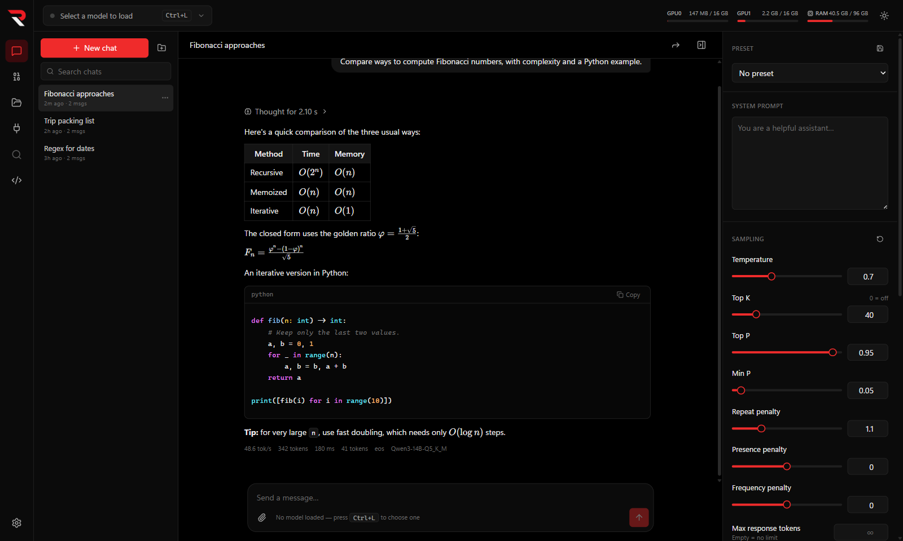
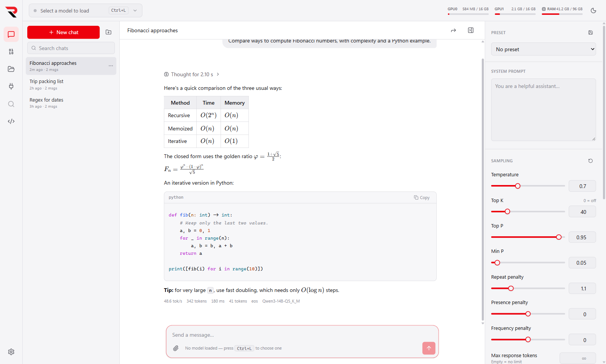
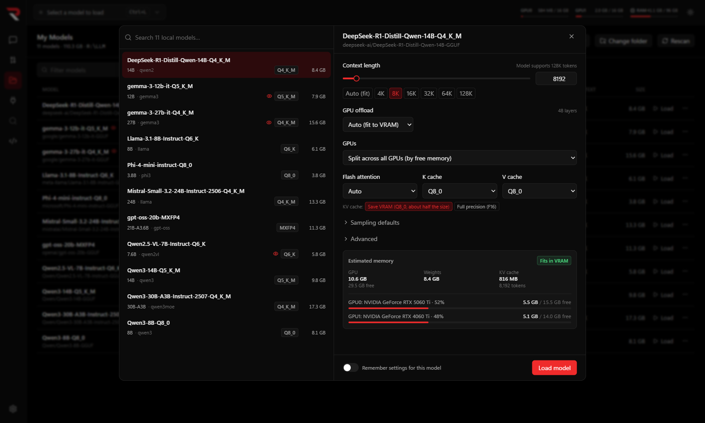
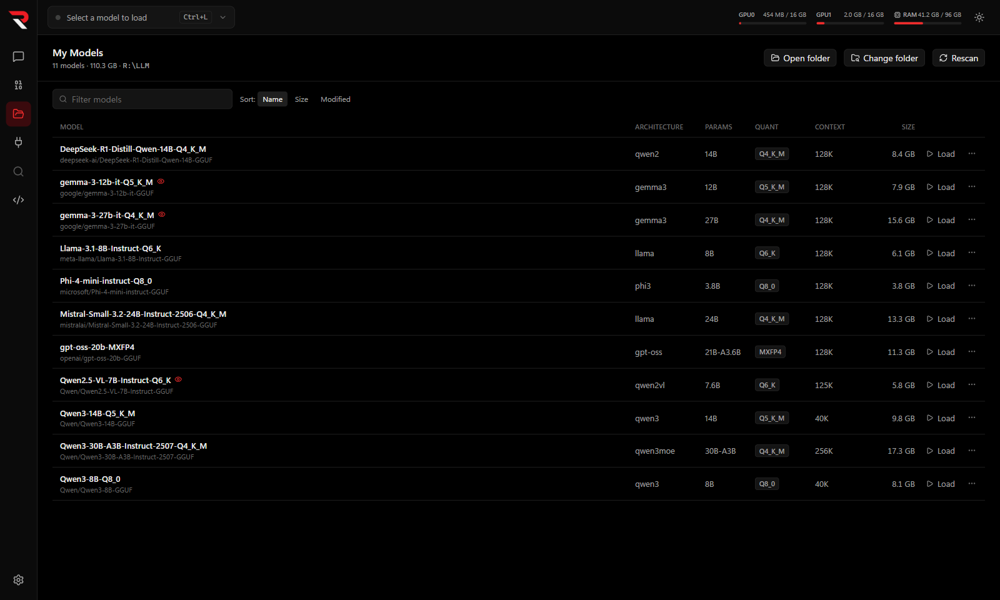
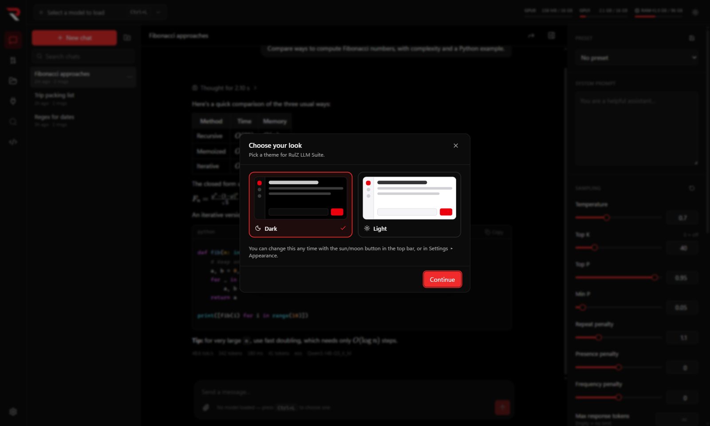

# RulZ LLM Suite

A Windows desktop app for running local LLMs, modelled on LM Studio's feature set. Models run in your own
llama.cpp build (`llama-server.exe`), one process per loaded model, bound to `127.0.0.1`.

**Documentation:** setup, guides and troubleshooting are in the [wiki](https://github.com/speedyrulz/RulZ-AI-Tools-Suite/wiki/LLM-Suite).
Discover/downloads, RAG and a CLI are planned.

| Dark (default) | Light |
| --- | --- |
|  |  |







<sub>Screenshots use demo content: made-up chats and header-only model files.</sub>

## Features

- **My Models** — scans a folder (default `C:\LLM`) for `.gguf` files, reads GGUF metadata (architecture,
  parameters, quantization, trained context, layers), pairs vision projectors (`mmproj`) and MTP draft files with
  their model, joins split shards, and watches the folder for changes.
- **Model loading** (`Ctrl+L`) — context length, GPU offload (auto-fit / all / N layers), MoE expert offload
  (`--cpu-moe` / `--n-cpu-moe`: keep all experts, or those of the first N layers, in system RAM while attention stays
  on the GPU) and custom tensor overrides (`--override-tensor`), single-GPU or split across GPUs, flash attention, KV cache quantization, threads, batch sizes, mmap/mlock, chat template override and
  extra arguments; per-model saved defaults; memory estimate with a fits/partial/likely-OOM verdict; load progress;
  live server log; several models loaded at once.
  - **Speculative decoding**: a draft-head sidecar next to the model (`mtp-*.gguf`, or eagle3/dflash/dspark) is
    detected and used automatically (`--spec-type draft-<kind>`), with a per-model switch and draft length.
    MTP layers built into the model file (Qwen3.5+ "MTP" GGUFs) are detected too and preferred. A **Draft model**
    picker can choose built-in layers or any draft file in the models folder instead.
- **Chat** — streaming replies, collapsible reasoning ("thinking") blocks, Markdown with tables, LaTeX and
  highlighted code, image and text-file attachments (drag-drop / paste), edit, regenerate, continue, branch,
  delete; tok/s, time-to-first-token and token stats; context usage meter with "truncate middle" or "stop" overflow
  policy; folders, pinning, search; per-chat system prompt and sampling settings; presets; JSON-schema structured output.
- **Chat handoff** — at 85% context (or any time via the header button) the model writes a handoff summary and
  a new chat with the same settings continues from it.
- **MCP tools** — configure servers in `mcp.json` (same format as LM Studio / Cursor; stdio `command` or remote
  `url`) on the MCP Tools page. Enabled tools are offered to the model; each call asks for approval unless the
  tool is marked "always allow", and calls and results show inline in the chat.
  - **On-demand tool loading** for large servers (e.g. REA's 207 tools): the model gets a name catalog plus
    `rulz_search_tools` / `rulz_load_tools` / `rulz_unload_tools`, and only loaded tools' full descriptions are
    sent, within a token budget (least recently used are unloaded first). "Auto" switches to this once the
    enabled tools exceed the budget.
  - **Built-in file tools**: read-only `list_directory` and `find_files`, so the model can find exact paths (such as a
    program's `.exe`) before handing them to other tools.
  - **Tool-result compaction**: once you send a new message, tool results from earlier turns are sent to the
    model as their beginning and end only (the chat still shows them in full); the latest results of the turn in
    progress stay complete.
- **Developer tab: local API server** — OpenAI-compatible (`/v1/models`, `/v1/chat/completions`, `/v1/completions`,
  `/v1/embeddings`, `/v1/responses`) and Anthropic-compatible (`/v1/messages`) endpoints in front of your models.
  A request for a model that isn't loaded loads it with its saved settings; models the server loaded are unloaded
  after an idle timeout. Optional API key, CORS, localhost-only or LAN, and a live request log with token counts.
  `GET /v1/models/{id}/load-config` returns a model's saved load settings, and `POST` with
  `{ "config": { … }, "reload": true }` changes them (other apps, like RulZ Coding Agent, use this). `POST` accepts only
  context length, GPU layers, MoE expert offload (`cpuMoe`: `"off"`, `"all"` or a layer count), flash attention,
  KV cache types, parallel slots, the GPU split (mode, main GPU,
  per-GPU proportions), whether the vision projector runs on the CPU (`mmprojOnCpu`), the model's sampling
  defaults (`sampling`: any subset, merged value by value; `null` clears one) and the draft (MTP) settings, including which draft (`draftFile`: `null` for automatic,
  `"builtin"`, or the id of one of `draft_choices`). File paths and extra arguments stay app-only. A loaded model
  restarts with the new settings unless `"reload": false`; `"dry_run": true` only returns the memory estimate for the
  changed settings. Replies include the GPUs, `moe_layers` (layers with experts; `null` for dense models), whether the model has a draft head, what automatic uses
  (`default_draft`), the drafts that can be picked (`draft_choices`, by path relative to the models folder), and the
  memory estimate. `POST /v1/models/{id}/unload` unloads every running instance of a model (replying with how many it
  `unloaded`), so a client can free the memory when it is done with a model.
  Default port 1234 (pick another if LM Studio is running).
- **Reverse Engineering mode** (`Ctrl+6`) — runs a local model as a reverse engineer with the REA MCP tools, and
  collects fine-tuning data while it works. Tuned first for Ornith 1.5 35B-A3B (Heretic MTP APEX I-Mini).
  - **Sessions**: pick a program, library, package or folder and a goal (overview, license check, network, config,
    crypto, hidden strings, or your own). The chat gets an RE system prompt, thinking sampling for Qwen3.5-family models
    (temperature 0.6, top-k 20, no repeat penalty), REA's core tools preloaded, up to 80 tool rounds per reply, and the
    model's thinking sent back within a tool loop (interleaved thinking, as the template expects). Tools are on even if
    chats have them off. Static-analysis tools (decompile, search, list, annotate) run without asking; tools that run the
    target, attach debuggers or reach devices still ask.
  - **calc**: the RE training kit's sandboxed calculator runs as a built-in MCP server (`calc__calc`) when Python 3 is
    on PATH, so the model computes hash rounds and XOR decoding instead of doing 32-bit math in its head.
  - **Recording**: every finished round is saved as llama-server received it (system prompt with the tool catalog,
    tool definitions, every turn) in `%APPDATA%\RulZ LLM Suite\re-data\<chat id>\`. A chat's data goes to the Recycle
    Bin with the chat.
  - **Grading**: Solved / Partial / Failed in the chat's RE strip or on the Reverse Engineering page.
  - **Practice tasks**: reads `build/tasks.jsonl` from the RE training kit (`C:\coding\Trainers\re-training-kit`),
    copies a task's binary to a fresh work folder, and checks the final `ANSWER:` line automatically (a port of the
    kit's `verify.py`).
  - **Export**: writes `train.jsonl` in the kit's format (OpenAI / Hugging Face chat: `messages`, `tools`, `meta`;
    thinking in `reasoning_content`) plus `manifest.json`, from solved sessions by default, at most N per practice task
    (fewest tool rounds first), leaving out sessions whose context was trimmed. Email addresses are replaced.
  - **Clone**: the New session card switches between **Analyse** and **Clone**. A clone session rebuilds either
    **specific pieces** of the target (presets for a file format, network protocol, algorithm, license logic, config and
    command line, or one function, or your own description) or **the whole program**, as new readable source code in
    the language you pick (or the original's). It writes only into the **output folder** you choose, with two built-in
    tools that exist only in clone sessions: `write_file` (inside the output folder, never over the target) and
    `read_file` (the output folder and the target's folder). The model keeps `NOTES.md` (so it can pick up after the
    context is trimmed) and a `README.md` saying how to build it and what is and isn't reproduced. Clone sessions may
    run up to **400** tool rounds (an option), are recorded and graded like other sessions, and exported samples carry
    `meta.kind` (`clone-pieces` or `clone-full`).
  - **Sessions from other apps**: a `/v1/chat/completions` request with an `x-rulz-re-session: <id>` header (letters,
    digits, `_` and `-`, up to 56) is recorded as part of that RE session, with its reply. `POST /v1/re/sessions/{id}`
    with `client`, `title`, `target`, `goal` describes the session, and with `outcome` (`unrated`, `solved`, `partial`,
    `failed`) grades it; `GET` reads it back, and the reply's `recording` says whether recording is on. Such sessions are
    listed, graded, deleted and exported on the Reverse Engineering page like chats, labelled with the app's name.
    RulZ Coding Agent 0.16.0 sends these when its **Record tasks for reverse-engineering training** setting is on. Since
    the other app fits its own context, a request with fewer messages than the one before marks the session as
    trimmed. Turn it off with **Record sessions from other apps** in the page's options.
    `GET /v1/re/overview` lists every RE session (chats here and other apps' sessions, newest first, with kind, grade
    and tool rounds), the practice tasks with how often each was tried and solved (never their answers), and the
    question, clone-piece and language templates. `POST /v1/re/practice/{task}/prepare` copies a task's program into a
    fresh work folder and returns its path and prompt; `POST /v1/re/practice/{task}/grade` with `target` and `text`
    checks the reply's `ANSWER:` line and returns `answer`, `passed` and `expected`. Session descriptions also take
    `kind` and `practice`. RulZ Coding Agent 0.18.0 and its phone app use these to show and start RE tasks.
- **Dark and light themes** — dark is the default; the first launch asks which look you want ("Choose your look").
  Switch any time with the sun/moon button in the top bar or in Settings ▸ Appearance (Dark, Light or System).
- GPU/RAM meters (nvidia-smi), keyboard shortcuts (see Settings).

## Engine

Build `llama-server` with CUDA in a separate folder (sm_89 = RTX 40xx, sm_120 = RTX 50xx):

```
cmake -S C:\coding\llama.cpp -B C:\coding\llama.cpp\build-cuda -G "Visual Studio 17 2022" -DGGML_CUDA=ON -DCMAKE_CUDA_ARCHITECTURES="89;120" -DLLAMA_BUILD_SERVER=ON -DLLAMA_CURL=OFF
cmake --build C:\coding\llama.cpp\build-cuda --config Release --target llama-server -j
```

The app auto-detects `llama-server.exe` in `C:\coding\llama.cpp\build-cuda\bin\Release`, `build-cuda\bin`,
`build\bin\Release` or `build\bin`; any other folder containing `llama-server.exe` can be set in Settings. Child processes get `CUDA_DEVICE_ORDER=PCI_BUS_ID`, so GPU numbers match nvidia-smi.

## Development

The source lives in `apps/rulz-llm-suite` of the [RulZ AI Tools Suite](https://github.com/speedyrulz/RulZ-AI-Tools-Suite)
repository:

```
git clone https://github.com/speedyrulz/RulZ-AI-Tools-Suite.git
cd RulZ-AI-Tools-Suite\apps\rulz-llm-suite
npm install
node node_modules/electron/install.js   # first time only: Electron downloads its binary lazily
npm run dev          # run with hot reload
npm test             # unit tests (GGUF reader, model grouping, args, estimates, SSE, context fitting)
npm run typecheck
npm run build:win    # installer → dist/RulZ-LLM-Suite-Setup-<version>.exe
```

App data (settings, chats, presets, metadata cache) lives in `%APPDATA%\RulZ LLM Suite`.

## License

Open source under the [MIT License](LICENSE).

The RulZ name and logo are excluded from the MIT License; all rights reserved. If you fork or redistribute this
project, remove or replace the RulZ branding. See [LOGO-NOTICE.md](LOGO-NOTICE.md).
