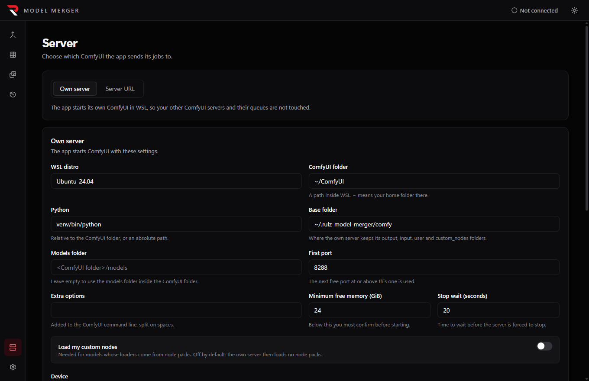
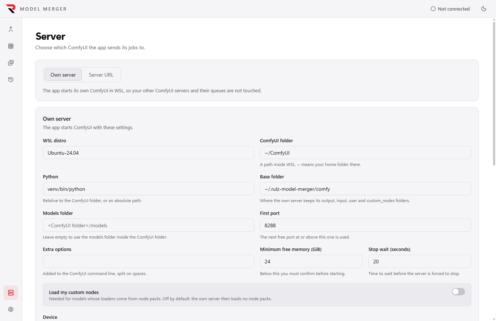

# RulZ Model Merger

A Windows app for merging image models with ComfyUI: checkpoint with checkpoint, LoRA with LoRA, and LoRA into a
checkpoint, with sample grids at different mixes so you can compare the results before you save one. Part of the
RulZ AI Tools family.

**Version 0.1 sets up the ComfyUI connection.** Merging and sample grids come in the next versions.

**[Download](https://github.com/speedyrulz/RulZ-AI-Tools-Suite/releases)** (or install it from the [RulZ AI Tools Suite](https://github.com/speedyrulz/RulZ-AI-Tools-Suite) launcher, under **ComfyUI**) · **[Wiki](https://github.com/speedyrulz/RulZ-AI-Tools-Suite/wiki/Model-Merger)**

| Dark (default) | Light |
| --- | --- |
|  |  |


## What it does

- **Its own ComfyUI.** By default the app starts its own ComfyUI inside WSL, on a GPU you pick or on the CPU. It
  uses your ComfyUI install and its models, but keeps its own output, input and user folders, so your other ComfyUI
  servers and their queues are not touched. Closing the app stops this server.
- **Or a server you already run.** Enter its address instead. Before the first job the app asks once whether it may
  put jobs into that server's queue. It never clears that queue, cancels other jobs or unloads its models.
- **Checks before starting:** free memory in WSL, a free port (from 8288 up), which GPUs your other ComfyUI servers
  use, and whether the ComfyUI folder and its Python exist. Anything that needs your OK (for example a GPU another
  server already uses) has to be ticked before **Start server** works.
- **GPU picker** with each card's name, memory and load, refreshed every few seconds.
- **Live log** of the own server, shown the way a terminal shows it.
- **What the server can do:** how many checkpoints, diffusion models, LoRAs, text encoders and VAEs it sees, and
  which merge and save nodes it has, including the per-model block merge nodes.
- **Dark and light theme.** Black and red by default. Switch with the button at the top right or Ctrl+Shift+L.

## Requirements

- Windows 10 or 11 with WSL 2 and a distro that has ComfyUI installed. The defaults are `Ubuntu-24.04` and
  `~/ComfyUI` with its Python in `venv/bin/python`; change them on the Server page.
- An NVIDIA driver on Windows (for `nvidia-smi`) if you want to run the server on a GPU.

## Settings of the own server

| Field | Meaning |
| --- | --- |
| WSL distro | The distro ComfyUI lives in. |
| ComfyUI folder | Linux path of the folder that holds `main.py`. `~` is your home folder in WSL. |
| Python | The interpreter that runs `main.py`: relative to the ComfyUI folder, or a full path. |
| Base folder | Where the own server keeps its `output`, `input`, `user` and `custom_nodes` folders (`--base-directory`). Default `~/.rulz-model-merger/comfy`. |
| Models folder | The models the server reads (`--models-directory`). Empty means the `models` folder of your ComfyUI. |
| First port | The server uses the first free port at or above it. It listens on `127.0.0.1` only. |
| Load my custom nodes | Also loads the node packs of your ComfyUI folder. Off by default, because `--base-directory` moves the `custom_nodes` folder: without it the own server loads no node packs, so models whose loaders come from a node pack do not load. |
| Extra options | Added to the ComfyUI command line, split on spaces. |
| Minimum free memory | Below this much free WSL memory you have to confirm before starting. A second ComfyUI that loads large models can use up WSL's memory, which stops the whole WSL machine. |
| Stop wait | Seconds between Ctrl+C and forcing the server to stop. |

## How GPU numbers work

GPUs are numbered the way `nvidia-smi` numbers them (PCI bus order). The app starts its server with
`CUDA_DEVICE_ORDER=PCI_BUS_ID` and `--cuda-device <number>`, so the number means the same card. CUDA's own default
order ("fastest first") can differ, so a number you type by hand elsewhere can mean another card.

## How the own server is run and stopped

- It runs `main.py` of your ComfyUI with `--base-directory`, `--models-directory`, `--port`, `--listen 127.0.0.1`
  and `--cuda-device` or `--cpu`. The app writes its process number to `server.pid` in the base folder.
- **Stop** sends Ctrl+C (SIGINT), then forces it (SIGKILL) after the stop wait.
- A stop signal is only ever sent to a `main.py` whose command line contains the app's base folder, so ComfyUI
  servers you started yourself are never stopped.
- If the app was closed without stopping its server (a crash, for example), the next start finds the old server by
  its `server.pid` and stops it first.

## Running from source

```powershell
.\install.bat
.\run.bat
```

`run.bat dev` starts it with hot reload. Tests and checks:

```powershell
npm run typecheck
npm test
```

`npm run build:win` builds the installer into `dist\`.

## Code layout

| Path | Role |
| --- | --- |
| `src/main/index.ts` | Window, IPC handlers, connection status. |
| `src/main/settings.ts` | Settings file with defaults and checks. |
| `src/main/comfy/` | ComfyUI client: HTTP, websocket events, parsing of `/system_stats` and `/object_info`. |
| `src/main/server/` | The own server: WSL scripts, start and stop, checks before starting, GPUs, ports. |
| `src/shared/` | Types and IPC channels shared by both sides. |
| `src/renderer/` | The window (React and Tailwind). |
| `tests/` | Unit tests (`npm test`). |

## Limits of this version

- No merging or sample grids yet.
- **Load my custom nodes** has not been tried with a real set of node packs yet.
- The own server runs bash without a login shell, so variables set in `~/.bashrc` (for example CUDA paths) are not
  read. ComfyUI on the CPU and on a GPU with the venv's own CUDA libraries does not need them.
