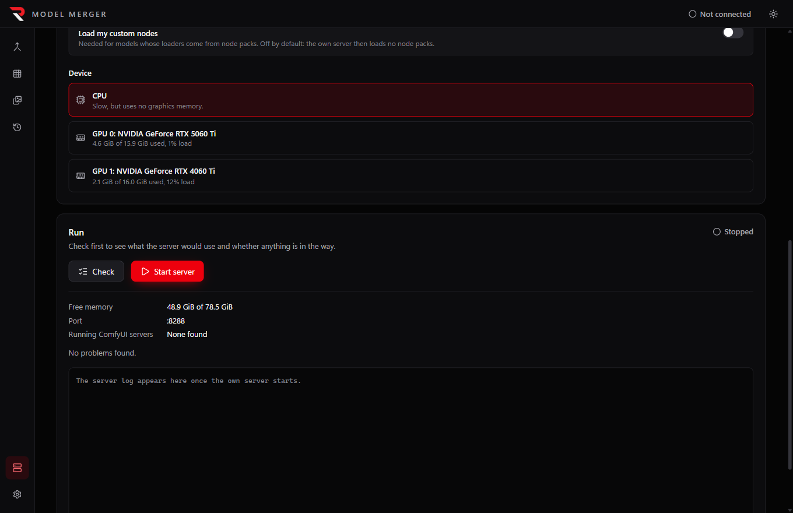
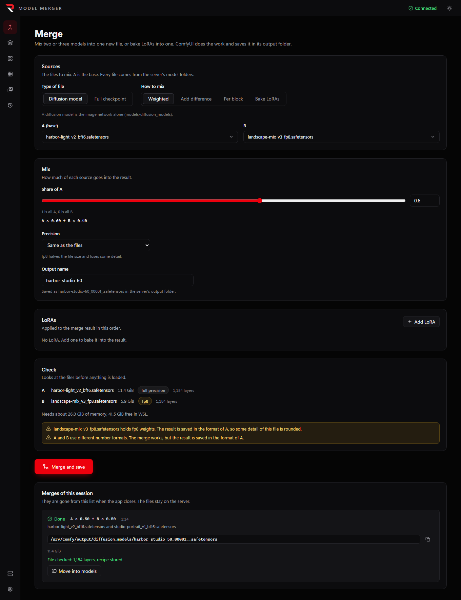
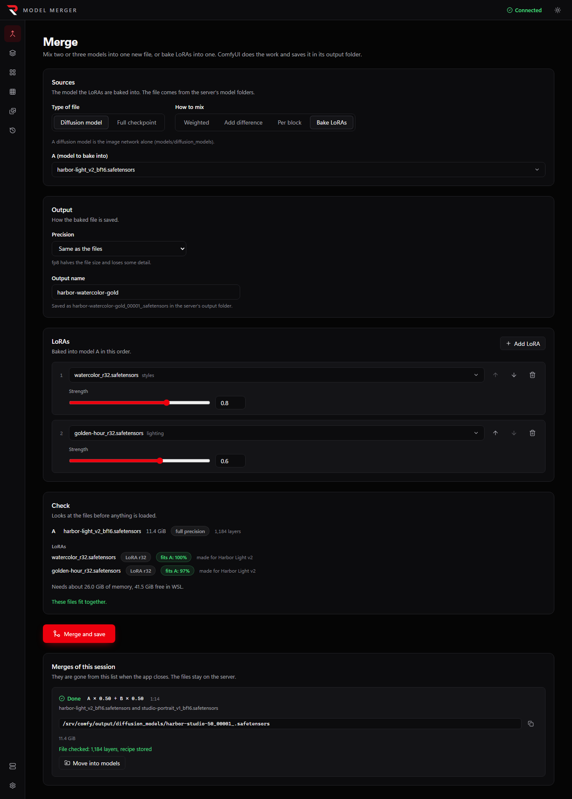
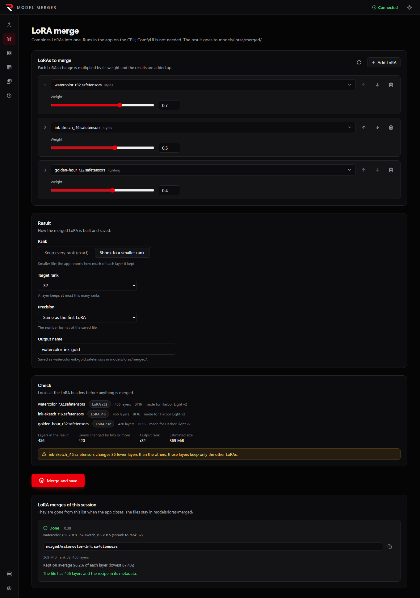
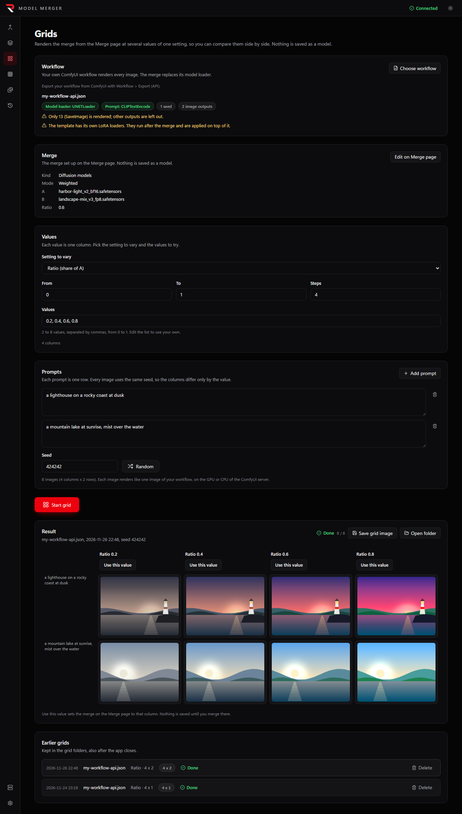
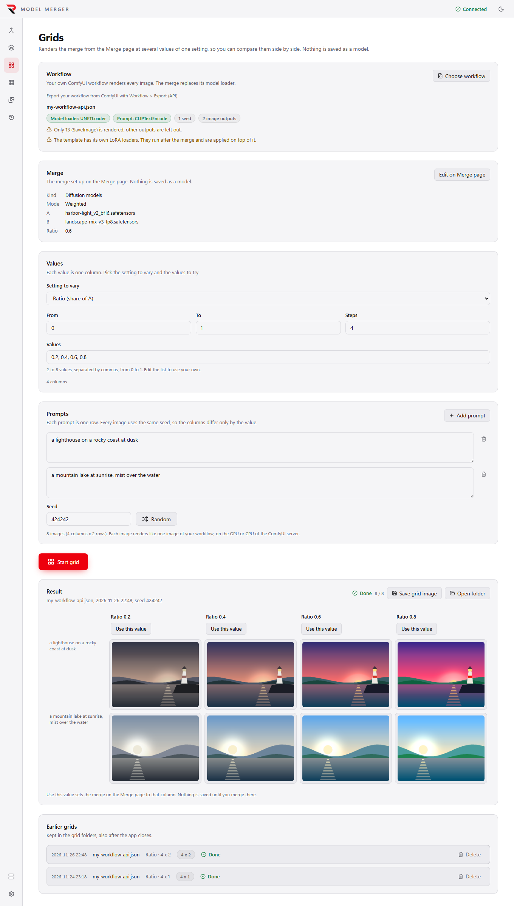

# RulZ Model Merger

A Windows app for merging image models with ComfyUI: checkpoint with checkpoint, LoRA with LoRA, and LoRA into a
checkpoint, with sample grids at different mixes so you can compare the results before you save one. Part of the
RulZ AI Tools family.

**Version 0.5 merges checkpoints and diffusion models, bakes LoRAs into them, merges LoRAs with LoRAs, and renders
sample grids of a merge at several values with your own ComfyUI workflow.**

**[Download](https://github.com/speedyrulz/RulZ-AI-Tools-Suite/releases)** (or install it from the [RulZ AI Tools Suite](https://github.com/speedyrulz/RulZ-AI-Tools-Suite) launcher, under **ComfyUI**) · **[Wiki](https://github.com/speedyrulz/RulZ-AI-Tools-Suite/wiki/Model-Merger)**

| Dark (default) | Light |
| --- | --- |
|  |  |



## What it does

- **Its own ComfyUI.** By default the app starts its own ComfyUI inside WSL, on a GPU you pick or on the CPU. It
  uses your ComfyUI install and its models, but keeps its own output, input and user folders, so your other ComfyUI
  servers and their queues are not touched. Closing the app stops this server.
- **Or a server you already run.** Enter its address instead. Before the first job the app asks once whether it may
  put jobs into that server's queue. It never clears that queue, cancels other jobs or unloads its models.
- **Checks before starting:** free memory in WSL, a free port (from 8288 up), which GPUs your other ComfyUI servers
  use, and whether the ComfyUI folder and its Python exist. Anything that needs your OK (for example a GPU another
  server already uses) has to be ticked before **Start server** works.
- **GPU picker** with each card's name, memory and load, refreshed every few seconds.
- **Live log** of the own server, shown the way a terminal shows it.
- **What the server can do:** how many checkpoints, diffusion models, LoRAs, text encoders and VAEs it sees, and
  which merge and save nodes it has, including the per-model block merge nodes.
- **Dark and light theme.** Black and red by default. Switch with the button at the top right or Ctrl+Shift+L.

## Merging

The **Merge** page merges two models through the connected ComfyUI and saves the result. It works with diffusion-model
files (the `diffusion_models` folder, loaded with ComfyUI's UNETLoader) and full checkpoints (the `checkpoints`
folder, with text encoder and VAE).

| Mode | What it computes |
| --- | --- |
| Weighted | `A × r + B × (1 − r)`. The slider is the share of A. |
| Add difference | `A + (B − C) × m`: adds what C changed to make B (for example a fine-tune) onto A. |
| Per block | A different share of A per block, through ComfyUI's block merge node for that model type (for example `ModelMergeFlux1`). The app picks the node that fits model A and shows only the blocks the model has. |

- **Checks before merging.** On the own server the app reads the headers of the files (a few milliseconds, the weights
  are not loaded) and blocks the merge when A and B are different model types or have layers of different shapes. It
  also says when the files are quantized and how much memory the merge needs against what is free in WSL.
- **Quantized files** (int8, fp8, nvfp4) can be merged: ComfyUI unpacks the weights, merges them and saves the result
  in A's format again. That adds a little loss; merging the bf16 originals is best when you have them.
- **Full checkpoints:** the text encoder can be merged with the same share or taken from A or B. The VAE is taken
  from A or B, never merged.
- **Saving.** The result goes to the server's output folder as `<name>_00001_.safetensors` (`diffusion_models/` or
  `checkpoints/`). The recipe (sources, mode, numbers, app version) is stored in the file's header, and on the own
  server also in a `.recipe.json` file next to it. The app then checks the saved file: that it is this merge's file
  and has the same layers as A.
- **Move into models** (own server) moves the file and its recipe into `models/diffusion_models/merged/` or
  `models/checkpoints/merged/`, so ComfyUI lists it. An existing file is never overwritten; the new one gets `-2`,
  `-3`... instead.
- **Cancel** removes only this merge from the queue or stops it while it runs, also on a server you share.


- One merge runs at a time. On the CPU a merge of two 5 GB models takes about three minutes.

## Baking LoRAs

**Bake LoRAs** applies one or more LoRAs to model A and saves the result as a new model. LoRAs can also be added in the
other modes; they are then applied to the merge result. Up to 10 LoRAs, applied in the order of the list, each with its
own strength (the slider covers −2 to 2, the number box takes −10 to 10). For a full checkpoint each LoRA also has a
text-encoder strength.

- **Fit check before baking.** The app reads each LoRA's header: its format (LoRA, LoKr, LoHa, DoRA), rank, and how many
  of its layers are in model A, also when A stores q, k and v as one fused layer. A LoRA none of whose layers are in A
  (made for another model type) blocks the bake; one that fits only partly gives a warning. LoRAs with diffusers layer
  names (`transformer.…`) are mapped by ComfyUI itself, so the app cannot check them beforehand and says so.
- **Check after baking** (own server). ComfyUI logs every LoRA weight it could not place (`lora key not loaded`). The
  app counts these lines for the job and marks the result as failed if any were skipped, with a few of the key names.
  Text-encoder weights in a diffusion-model bake are counted apart, because a diffusion-model file has no text encoder.
  On a server reached by URL this check is not possible, and the app says so.
- The LoRA files and their header hashes are stored in the recipe with the saved file.



## Merging LoRAs

The **LoRA merge** page combines two to ten LoRAs into one new LoRA. The app computes it itself, on the CPU in a
background thread; ComfyUI does not need to run. It reads the LoRAs from the own server's models folder
(`models/loras`) and saves the result to `models/loras/merged/`, where ComfyUI lists it.

Each LoRA gets a weight (the slider covers −2 to 2, the number box takes −10 to 10; negative weights subtract a LoRA).

| Result | What it computes |
| --- | --- |
| Keep every rank (exact) | Stacks the LoRAs along the rank. The result equals the weighted sum of their changes exactly (up to the saved precision); its rank is the sum of the inputs' ranks, so the file is as large as the inputs together. |
| Shrink to a smaller rank | Reduces each layer of that exact result to the chosen rank (8 to 512) with an SVD of the small factors, never the full weight matrix. The app reports how much of each layer it kept (mean and lowest). |

- **Check before merging.** The app reads each LoRA's header and blocks the merge when a file cannot be merged (LoKr,
  LoHa, DoRA, LoCon mid weights, full diffs), when the LoRAs use different layer names (different trainers or model
  types), when they share no layer, or when a shared layer has different shapes. It warns when they share less than
  half their layers, name different base models, or add up to more than 8 GiB (the app holds them in memory).
- **Check after saving.** The app reads the saved file back and compares 16 of its layers with the weighted sum of the
  inputs. For an exact merge they must agree within the rounding of the saved precision.
- **Saving.** The result and its `.recipe.json` (inputs, weights, mode, rank, app version, the inputs' header hashes)
  are written in a staging folder under the own server's base folder, then moved into `models/loras/merged/`. An
  existing file is never overwritten; the new one gets `-2`, `-3`... instead. **Cancel** stops the merge and removes
  only its own partial file.
- **Speed** (CPU, two MOSS LoRAs of rank 32 with 252 layers): exact merge 11 s, shrink to rank 32 about 25 s.
- LoRA files reached through a symbolic link with an absolute target cannot be read from Windows over
  `\\wsl.localhost\`; use a hard link or a copy in the models folder.



## Sample grids

The **Grids** page renders the merge set up on the Merge page at 2 to 8 values of one setting (the columns) for 1 to 4
prompts (the rows), with the same seed in every image, so you can compare the values side by side. No model file is
saved: each image builds the merge inside its own ComfyUI job.

| Setting to vary | Mode on the Merge page |
| --- | --- |
| Ratio (share of A) | Weighted, or Per block for the blocks that have no value of their own |
| Multiplier | Add difference |
| Strength of one LoRA | Any mode with LoRAs, including Bake LoRAs |

- **Your own workflow renders the images.** Pick a ComfyUI workflow saved in API format (in ComfyUI: Workflow >
  Export (API)). The app replaces its model loader with the merge, writes your prompt into its positive prompt node
  and your seed into its seed inputs, and keeps the rest: sampler, steps, size, text encoder, VAE, model patches. A
  diffusion-model merge needs a workflow with a UNETLoader, a checkpoint merge one with a CheckpointLoaderSimple.
- **Only what the image needs runs.** The app picks one image output (a SaveImage first) and leaves out every node that
  output does not need: other outputs and previews, comparers, a second pass that only feeds a preview, and prompt
  generators such as LLM or vision-API nodes, because the grid's prompt replaces their text. A model loader on a side
  branch (for example a SAM 3 mask loader) stays as it is.
- **Warnings** say what the app found and changed: where the prompt came from, LoRA loaders of the workflow that are
  applied on top of the merge, a negative prompt that uses the same text field as the positive one, and the outputs
  left out.
- The images run one at a time, column by column, so the models of one column are loaded once. **Cancel** removes only
  this grid's job from the queue or stops it while it runs (on a server you share, a job that is already running
  finishes and its image is dropped).
- **Results.** Each grid is kept in the app's data folder with its images, the workflow it used and a `grid.json` with
  the recipe and values. **Save grid image** saves one PNG with the labels; **Use this value** sets the Merge page to
  that column's value, keeping your output name. **Earlier grids** lists the saved ones; deleting one moves its folder
  to the Recycle Bin.
- **Speed** (RTX 4060 Ti, Krea 2 int8 at 1 megapixel and 8 steps, three LoRA strengths): 60 s for the first image
  with model loading, about 40 s for each of the others.

| Dark | Light |
| --- | --- |
|  |  |

## Requirements

- Windows 10 or 11 with WSL 2 and a distro that has ComfyUI installed. The defaults are `Ubuntu-24.04` and
  `~/ComfyUI` with its Python in `venv/bin/python`; change them on the Server page.
- An NVIDIA driver on Windows (for `nvidia-smi`) if you want to run the server on a GPU.

## Settings of the own server

| Field | Meaning |
| --- | --- |
| WSL distro | The distro ComfyUI lives in. |
| ComfyUI folder | Linux path of the folder that holds `main.py`. `~` is your home folder in WSL. |
| Python | The interpreter that runs `main.py`: relative to the ComfyUI folder, or a full path. |
| Base folder | Where the own server keeps its `output`, `input`, `user` and `custom_nodes` folders (`--base-directory`). Default `~/.rulz-model-merger/comfy`. |
| Models folder | The models the server reads (`--models-directory`). Empty means the `models` folder of your ComfyUI. |
| First port | The server uses the first free port at or above it. It listens on `127.0.0.1` only. |
| Load my custom nodes | Also loads the node packs of your ComfyUI folder. Off by default, because `--base-directory` moves the `custom_nodes` folder: without it the own server loads no node packs, so models whose loaders come from a node pack do not load. |
| Extra options | Added to the ComfyUI command line, split on spaces. |
| Minimum free memory | Below this much free WSL memory you have to confirm before starting. A second ComfyUI that loads large models can use up WSL's memory, which stops the whole WSL machine. |
| Stop wait | Seconds between Ctrl+C and forcing the server to stop. |

## How GPU numbers work

GPUs are numbered the way `nvidia-smi` numbers them (PCI bus order). The app starts its server with
`CUDA_DEVICE_ORDER=PCI_BUS_ID` and `--cuda-device <number>`, so the number means the same card. CUDA's own default
order ("fastest first") can differ, so a number you type by hand elsewhere can mean another card.

## How the own server is run and stopped

- It runs `main.py` of your ComfyUI with `--base-directory`, `--models-directory`, `--port`, `--listen 127.0.0.1`
  and `--cuda-device` or `--cpu`. The app writes its process number to `server.pid` in the base folder.
- **Stop** sends Ctrl+C (SIGINT), then forces it (SIGKILL) after the stop wait.
- A stop signal is only ever sent to a `main.py` whose command line contains the app's base folder, so ComfyUI
  servers you started yourself are never stopped.
- If the app was closed without stopping its server (a crash, for example), the next start finds the old server by
  its `server.pid` and stops it first.

## Running from source

```powershell
.\install.bat
.\run.bat
```

`run.bat dev` starts it with hot reload. Tests and checks:

```powershell
npm run typecheck
npm test
```

`npm run build:win` builds the installer into `dist\`.

## Code layout

| Path | Role |
| --- | --- |
| `src/main/index.ts` | Window, IPC handlers, connection status. |
| `src/main/settings.ts` | Settings file with defaults and checks. |
| `src/main/comfy/` | ComfyUI client: HTTP, websocket events, parsing of `/system_stats` and `/object_info`. |
| `src/main/merge/` | Merges: file checks, ComfyUI graphs, the job runner, moving files in WSL. |
| `src/main/grid/` | Sample grids: reading and rewriting the workflow template, running the grid, its folder. |
| `src/main/models/` | Reads the header of a `.safetensors` file. |
| `src/main/server/` | The own server: WSL scripts, start and stop, checks before starting, GPUs, ports. |
| `src/shared/` | Types and IPC channels shared by both sides. |
| `src/renderer/` | The window (React and Tailwind). |
| `tests/` | Unit tests (`npm test`). |

## Limits of this version

- Merging and baking have been run on the CPU only. A sample grid with a baked LoRA has run on a GPU (RTX 4060 Ti);
  grids of ratio and multiplier sweeps have not been tried on a GPU yet.
- The Grids page has been tested with 12 real workflows (Krea 2, Qwen-Image 2.1, FLUX.2 Klein); other workflow shapes
  may not be read correctly, and the app then says what it could not find.
- The own server runs bash without a login shell, so variables set in `~/.bashrc` (for example CUDA paths) are not
  read. ComfyUI on the CPU and on a GPU with the venv's own CUDA libraries does not need them.
